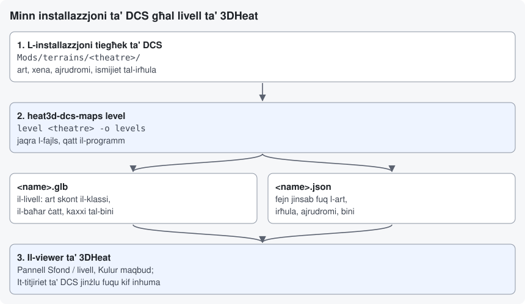

# 3DHeat DCS {#dheat-dcs}

**X'inhi?** Teatru huwa l-kelma ta' DCS World għal mappa: reġjun tad-dinja li
ttir fuqu. Din l-għodda tibdel l-art ta' teatru wieħed, moqrija mill-
**installazzjoni tiegħek stess**, f'livell 3D - mudell li tista' ttir fuqu - għall-viewer ta'
[3DHeat](https://github.com/Holdi601/3DHeat)
([dokumentazzjoni](https://holdi601.github.io/3DHeat/)).

**Għaliex nużaha?** Biex tara t-titjiriet tiegħek ta' DCS fuq il-mappa proprja tal-logħba: l-
għoljiet, il-kosta, l-ajrudromi, it-toroq, il-linji tal-ferrovija, l-irħula u l-bini tagħha.

**Eżempju:** `heat3d-dcs-maps level <theatre> -o levels` ->
`levels/<theatre>.glb` (il-livell) + `levels/<theatre>.json` (fejn jinsab fuq
l-art, l-irħula u l-ajrudromi tiegħu).

Għal xiex hija utli:

- **Titjiriet fuq il-mappa proprja tal-logħba.** L-isfond tad-dinja ta' 3DHeat jiżżejjen
  bl-art ta' llum minn dejta miftuħa; din tpinġi t-teatru kif ipinġih DCS.
- **Ebda pass ta' tqegħid.** Il-livell huwa fil-metri proprji tad-dinja ta' DCS, għalhekk it-telemetrija
  f'metri ta' DCS (il-hook ta' DCS tal-Watcher ta' 3DHeat jikteb eżatt dan) tinżel
  fuqu bid-defaults tal-viewer.
- **Latitudni u lonġitudni.** Kull livell iġorr il-projezzjoni tiegħu, il-kantunieri tiegħu
  u l-irħula tiegħu fiż-żewġ oqfsa.



## Tluq malajr {#quick-start}

Ġdid mal-linja tal-kmandi? Aqra [Qabel ma tibda](before-you-start.md) l-ewwel.
Ħaddem dawn fil-folder li kklonjajt jew ħlist miż-zip:

```bash
python -m pip install -e .                         # installs the heat3d-dcs-maps command
heat3d-dcs-maps list                               # the theatres installed, and whether each can be read
heat3d-dcs-maps level <theatre> -o levels          # a whole (small) theatre
heat3d-dcs-maps level <theatre> --around <lat> <lon> 12 -o levels --name <name>   # 12 km either side of a point
```

Għandek tara linja waħda għal kull teatru minn `list`, li tispiċċa b'`readable`.
Imbagħad tgħabbi `levels/<name>.glb` fil-pannell Sfond / livell tal-viewer
([Livelli](https://holdi601.github.io/3DHeat/levels.html)).

Il-livelli li tikteb huma mibnija mid-dejta tal-logħba: jibqgħu **fuq il-magna tiegħek**,
biex tarahom, mhux biex taqsamhom jew tippubblikahom ([Termini](terms.md)).

## Paġni {#pages}

| Paġna | X'tkopri |
|---|---|
| [Qabel ma tibda](before-you-start.md) | Python, terminal, ewwel użu |
| [Insibu t-teatri: list](list.md) | fejn tinstab l-installazzjoni, x'jistampa `list` |
| [Nibnu livell: level](level.md) | kull għażla, reġjuni, daqs, pass b'pass |
| [Il-fajls tal-livell](output.md) | il-partijiet tal-`.glb`, il-klassijiet tal-art u l-kuluri tagħhom, il-`.json`, il-koordinati |
| [Ismijiet tal-postijiet: towns](towns.md) | l-irħula ta' teatru b'koordinati ta' DCS |
| [Projezzjonijiet: fit](fit.md) | insibu l-projezzjoni ta' teatru minn reġistrazzjoni |
| [Kif jinqraw il-fajls](reading.md) | il-formati, x'ġie vverifikat, x'ma jinqarax |
| [Termini u liċenzja](terms.md) | il-liċenzja ta' Eagle Dynamics, u għaliex dan huwa pakkett separat |
| [Referenza tal-kmandi](../cli-reference.md) | kull għażla, iġġenerata mill-kodiċi |
| [Iżżomm dawn id-dokumenti](maintaining.md) | il-lista ta' kontroll tar-rilaxx |

## Relatat {#related}

- Il-viewer ta' 3DHeat: [github.com/Holdi601/3DHeat](https://github.com/Holdi601/3DHeat),
  dokumentazzjoni fuq [holdi601.github.io/3DHeat](https://holdi601.github.io/3DHeat/).
- Telemetrija għal dawn il-livelli: il-[Watcher ta' 3DHeat](https://holdi601.github.io/3DHeat-Watcher/)
  jirrekordja titjiriet ta' DCS; il-formati tal-fajls tal-viewer, inkluż il-container
  ta' fajl wieħed għal kull partita, huma deskritti f'
  [Fajl wieħed għal kull partita (.3dheat)](https://holdi601.github.io/3DHeat/container.html).

## L-għodod ta' 3DHeat {#the-3dheat-tools}

| Għodda | X'tagħmel | Kodiċi | Dokumenti |
|---|---|---|---|
| 3DHeat viewer | juri d-dejta: heatmaps, analiżi tat-tlielaq, reviżjoni tal-partiti | [3DHeat](https://github.com/Holdi601/3DHeat) | [docs](https://holdi601.github.io/3DHeat/) |
| GameFiles | livelli u korsijiet mill-fajls proprji tal-logħba | [3DHeat-GameFiles](https://github.com/Holdi601/3DHeat-GameFiles) | [docs](https://holdi601.github.io/3DHeat-GameFiles/) |
| GameCapture | telemetrija tal-lapes, u livelli mibnija mill-ġdid minn vidjow tal-logħba | [3DHeat-GameCapture](https://github.com/Holdi601/3DHeat-GameCapture) | [docs](https://holdi601.github.io/3DHeat-GameCapture/) |
| Unreal Exporter | plugin ta' Unreal Editor: livell bħala `.glb` wieħed | [3DHeat-UnrealExporter](https://github.com/Holdi601/3DHeat-UnrealExporter) | [docs](https://holdi601.github.io/3DHeat-UnrealExporter/) |
| CS2 | demos u mapep ta' Counter-Strike 2 | [3DHeat-CS2](https://github.com/Holdi601/3DHeat-CS2) | [docs](https://holdi601.github.io/3DHeat-CS2/) |
| Watcher | jirrekordja dak li l-logħob jippubblika waqt li tilgħab | [3DHeat-Watcher](https://github.com/Holdi601/3DHeat-Watcher) | [docs](https://holdi601.github.io/3DHeat-Watcher/) |
| Ext-WarThunder | replays ta' War Thunder | [3DHeat-Ext-WarThunder](https://github.com/Holdi601/3DHeat-Ext-WarThunder) | [docs](https://holdi601.github.io/3DHeat-Ext-WarThunder/) |
| Ext-WoT | replays ta' World of Tanks | [3DHeat-Ext-WoT](https://github.com/Holdi601/3DHeat-Ext-WoT) | [docs](https://holdi601.github.io/3DHeat-Ext-WoT/) |
| Ext-WoWs | replays ta' World of Warships | [3DHeat-Ext-WoWs](https://github.com/Holdi601/3DHeat-Ext-WoWs) | [docs](https://holdi601.github.io/3DHeat-Ext-WoWs/) |
| Ext-Squad | demos tas-server ta' Squad | [3DHeat-Ext-Squad](https://github.com/Holdi601/3DHeat-Ext-Squad) | [docs](https://holdi601.github.io/3DHeat-Ext-Squad/) |
| Ext-DCS | mapep ta' DCS World bħala livelli 3D | [3DHeat-Ext-DCS](https://github.com/Holdi601/3DHeat-Ext-DCS) | [docs](https://holdi601.github.io/3DHeat-Ext-DCS/) |
| Ext-IL2 | mapep ta' IL-2 Sturmovik bħala livelli 3D | [3DHeat-Ext-IL2](https://github.com/Holdi601/3DHeat-Ext-IL2) | [docs](https://holdi601.github.io/3DHeat-Ext-IL2/) |
