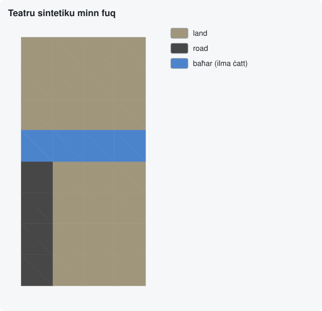
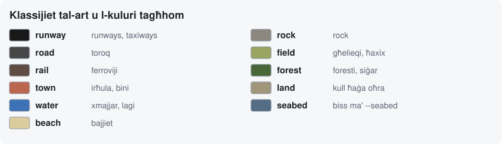

# Il-fajls tal-livell {#the-level-files}

Livell huwa mudell 3D tal-art; teatru huwa l-kelma ta' DCS World għal mappa.

`<out>/<name>.glb` u `<name>.json` ħdejh.

| Parti | X'inhi |
|---|---|
| `ground:<Level>` | it-trijangoli proprji tat-terren, ikkuluriti skont dak li l-logħba tpinġi fuq kull wieħed |
| `water:<Level>` | kull trijangolu li l-logħba timmarka bħala taħt il-baħar, mqiegħed ċatt fil-livell tal-baħar |
| `structure:<Level>` | il-bini tat-teatru bħala kaxxi, fejn il-logħba tqiegħdu (hawn taħt) |

Il-kuluri huma l-klassijiet hawn taħt:

Il-kuluri jidhru b'**Kulur maqbud** fil-pannell tal-livell tal-viewer. Kull
trijangolu tal-art jieħu l-klassi tal-overlay li biha l-logħba tpinġih:

| Klassi | Kulur | Mill-overlay tal-logħba |
|---|---|---|
| runway | iswed kważi | `Runway` - runways, taxiways u aprons |
| road | griż skur | `Road` |
| rail | kannella | `Rail` |
| town | aħmar tal-briks | `Town`, `Building` |
| water | blu | `River`, `Lake` (ilma interni, miġbud bħala art) |
| beach | ramel | `Beach` |
| rock | griż | `Rock` |
| field | aħdar ċar | `Field`, `Grass` |
| forest | aħdar skur | `Forest`, `Trees` |
| land | kaki | ebda waħda minn dawn |
| seabed | blu-griż | biss ma' `--seabed` |

Fejn bosta overlays jpinġu l-istess trijangolu, l-ordni tat-tabella tiddeċiedi
(triq minn ġo foresta hija triq). Kull trijangolu ta' overlay huwa wieħed mill-
art proprja - ikkontrollat fuq kull klassi tat-teatri ttestjati, kull wieħed qabbel - għalhekk
il-klassijiet huma eżatti, mhux maħsuba minn punti fil-qrib.

Il-**Koordinati** huma l-metri proprji tad-dinja ta' DCS: x tramuntana, y 'il fuq, z lvant, u
l-assi ta' glTF huma l-istess (X = x, Y = y, Z = z). It-telemetrija f'metri ta' DCS - il-
hook ta' DCS tal-Watcher ta' 3DHeat jikteb eżatt dan - tinżel fuq il-livell bid-defaults
tal-viewer (Y 'il fuq, skala 1) u mingħajr pass ta' tqegħid.

**Latitudni u lonġitudni:** kull teatru huwa projezzjoni Transverse Mercator
bil-kostanti tagħha; `<name>.json` iġorruhom, il-kantunieri tal-livell f'latitudni u
lonġitudni, u kull raħal kemm bil-latitudni/lonġitudni tiegħu kif ukoll bl-x/z ta' DCS tiegħu.
Fejn il-kostanti ta' teatru mhumiex ippubblikati, jitqiegħdu fuq
il-beacons li l-`beacons.lua` tiegħu jagħti fiż-żewġ oqfsa (ftit ċm root mean
square; l-istess fit jagħti lura l-kostanti ppubblikati ta' teatri oħra sal-
millimetru).
Għal teatru mingħajr kostanti, [`fit`](fit.md) isibhom minn kull
reġistrazzjoni li fiha t-tnejn, bħal sessjoni tal-Watcher ta' titjira waħda.

**Il-qiegħ tal-baħar** jitħalla barra (heatmap ta' flight-sim m'għandhiex bżonn il-qiegħ tal-baħar);
`--seabed` iżommu bħala art. `--no-water` iħalli barra l-baħar
ċatt.

**Daqs.** Ara [Nibnu livell: Daqs](level.md#size).

**Ajrudromi.** Kull `AirfieldsTaxiways/<name>.rn4` iżomm in-netwerk tat-taxi ta' ajrudrom wieħed,
imsemmi għalih; il-punti tiegħu huma doubles (x, y, z) f'metri ta' DCS. Il-`.json` tal-
livell jelenka kull ajrudrom ġol-reġjun bl-isem tiegħu (tal-fajl), nofs il-kaxxa tal-
punti tiegħu, il-kaxxa, u l-art hemm. Fuq it-teatru ttestjat, kull fajl ta' ajrudrom inqara, kull wieħed imqiegħed fuq l-għalqa tiegħu
(ftit mijiet ta' metri mill-punt ta' referenza tal-ajruport imkejjel: nofs it-taxiways, mhux tar-runway).

**Bini.** `Scenes/<theatre>.scn5` iqiegħed kull oġġett tat-teatru
(miljuni minnhom - siġar, lampi, xbieki, wajers, djar). Dawk
li huma bini skont l-isem u d-daqs (djar, flats, tined, hangars,
fabbriki, torrijiet, terminals: frazzjoni tal-mudelli, mijiet
ta' eluf ta' tqegħid) jitpinġu bħala kaxxi: il-kaxxa tal-limiti proprja ta' kull mudell mill-
fajl, mdawra għad-direzzjoni tagħha u wieqfa fejn il-logħba tqiegħedha, minn sa
3 m taħt l-oriġini tagħha (is-sies tagħha fuq għolja) sa ras tagħha. Siġar, arbuxelli,
dwal, pali, wajers, xbieki, ħitan, sinjali, vetturi, vagons, dgħajjes, krejnijiet,
arbli, pylons u pontijiet jitħallew barra. Ebda forma jew texture ta' mudell
tal-logħba mhi kkupjata: kaxxa għal kull bini, ikkulurita skont it-tip (dar, blokk,
industrijali, ajrudrom, torri, ieħor). `<name>.json` jelenkahom ukoll
(`buildings.rows`: x, z, base, height, half lengths, heading, kind) għall-
isfond ibridu tal-viewer, li jpinġihom fl-irħula tal-logħba minflok
il-bini mmappjat. `--no-buildings` iħallihom barra.

`<name>.json` jirrekordja wkoll il-fajl tas-sors, id-daqs u d-data tiegħu, it-tiles
moqrija, l-għadd tat-trijangoli għal kull klassi, u kemm mill-irħula tat-teatru jaqgħu
fuq l-art - kontroll tal-projezzjoni li għandu jaqra "N of N".

Il-livell huwa glTF binarju b'partijiet bl-isem, kif inhu kull livell ta' 3DHeat; il-paġna
[Livelli](https://holdi601.github.io/3DHeat/levels.html) tal-viewer tgħid kif jgħabbihom.
