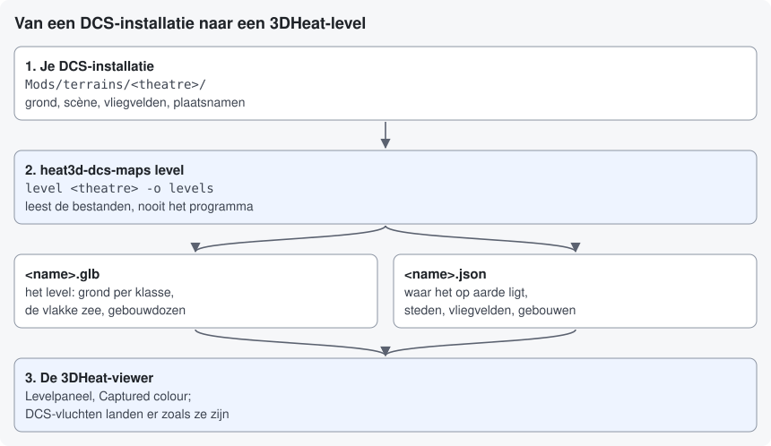

# 3DHeat DCS {#dheat-dcs}

**Wat is het?** Een thema (theatre) is het woord van DCS World voor een kaart: een gebied van de
wereld waarboven je vliegt. Deze tool zet de grond van één thema, gelezen uit **je eigen
installatie**, om in een 3D-level - een model waarboven je kunt vliegen - voor de
[3DHeat](https://github.com/Holdi601/3DHeat)-viewer
([documentatie](https://holdi601.github.io/3DHeat/)).

**Waarom zou ik het gebruiken?** Om je DCS-vluchten te zien op de eigen kaart van het spel: de
heuvels, de kust, vliegvelden, wegen, spoorwegen, steden en gebouwen.

**Voorbeeld:** `heat3d-dcs-maps level <theatre> -o levels` ->
`levels/<theatre>.glb` (het level) + `levels/<theatre>.json` (waar het op aarde ligt, de steden en vliegvelden).

Waarvoor het nuttig is:

- **Vluchten op de eigen kaart van het spel.** De wereldachtergrond van 3DHeat tekent de aarde van vandaag
  uit open gegevens; dit tekent het thema zoals DCS het tekent.
- **Geen plaatsingsstap.** Het level staat in DCS' eigen wereldmeters, dus telemetrie in
  DCS-meters (de DCS-hook van de 3DHeat Watcher schrijft precies dat) komt er met de standaardinstellingen van de viewer op uit.
- **Breedte- en lengtegraad.** Elk level draagt zijn projectie, zijn hoeken en zijn steden in beide stelsels.



## Snelstart {#quick-start}

Nog nooit met de opdrachtregel gewerkt? Lees eerst [Voordat je begint](before-you-start.md).
Voer deze opdrachten uit in de map waarin je hebt gekloond of uitgepakt:

```bash
python -m pip install -e .                         # installeert het commando heat3d-dcs-maps
heat3d-dcs-maps list                               # de geïnstalleerde thema's, en of elk gelezen kan worden
heat3d-dcs-maps level <theatre> -o levels          # een heel (klein) thema
heat3d-dcs-maps level <theatre> --around <lat> <lon> 12 -o levels --name <name>   # 12 km aan elke kant van een punt
```

Je ziet per thema één regel van `list`, die eindigt met `readable`.
Laad daarna `levels/<name>.glb` in het paneel Achtergrond / level van de viewer
([Levels](https://holdi601.github.io/3DHeat/levels.html)).

De levels die het schrijft, zijn gemaakt uit de gegevens van het spel: ze blijven **op jouw computer**,
om te bekijken, niet om te delen of te publiceren ([Voorwaarden](terms.md)).

Elke spellezer is een eigen klein project met een eigen licentiebestand, eigen releases en een eigen issuetracker, zodat hij los kan worden geïnstalleerd, bijgewerkt, onderhouden - of op verzoek van een rechthebbende teruggetrokken - zonder dat de viewer of de andere tools daar last van hebben.

## Pagina's {#pages}

| Pagina | Wat die behandelt |
|---|---|
| [Voordat je begint](before-you-start.md) | Python, een terminal, een eerste keer draaien |
| [Thema's zoeken: list](list.md) | waar de installatie wordt gevonden, wat `list` afdrukt |
| [Een level bouwen: level](level.md) | elke optie, gebieden, grootte, stap voor stap |
| [De levelbestanden](output.md) | de `.glb`-onderdelen, de grondklassen en hun kleuren, de `.json`, de coördinaten |
| [Plaatsnamen: towns](towns.md) | de steden van een thema met DCS-coördinaten |
| [Projecties: fit](fit.md) | de projectie van een thema vinden uit een opname |
| [Hoe de bestanden worden gelezen](reading.md) | de formaten, wat is gecontroleerd, wat niet wordt gelezen |
| [Voorwaarden en licentie](terms.md) | wat er gelezen wordt, wat er niet meegeleverd wordt, de licentie |
| [Commandoreferentie](../cli-reference.md) | elke optie, gegenereerd uit de code |
| [Deze documentatie onderhouden](maintaining.md) | de checklist per release |

## Verwant {#related}

- De 3DHeat-viewer: [github.com/Holdi601/3DHeat](https://github.com/Holdi601/3DHeat),
  documentatie op [holdi601.github.io/3DHeat](https://holdi601.github.io/3DHeat/).
- Telemetrie voor deze levels: de [3DHeat Watcher](https://holdi601.github.io/3DHeat-Watcher/)
  legt DCS-vluchten vast; de bestandsformaten van de viewer, waaronder de container met
  één bestand per wedstrijd, staan beschreven in
  [Eén bestand per wedstrijd (.3dheat)](https://holdi601.github.io/3DHeat/container.html).

## De 3DHeat-tools {#the-3dheat-tools}

| Tool | Wat die doet | Code | Documentatie |
|---|---|---|---|
| 3DHeat-viewer | toont de gegevens: heatmaps, Race-analyse, wedstrijdanalyse | [3DHeat](https://github.com/Holdi601/3DHeat) | [documentatie](https://holdi601.github.io/3DHeat/) |
| GameFiles | levels en banen uit de eigen bestanden van een spel | [3DHeat-GameFiles](https://github.com/Holdi601/3DHeat-GameFiles) | [documentatie](https://holdi601.github.io/3DHeat-GameFiles/) |
| GameCapture | telemetrie van rondes, en levels opnieuw opgebouwd uit gameplayvideo | [3DHeat-GameCapture](https://github.com/Holdi601/3DHeat-GameCapture) | [documentatie](https://holdi601.github.io/3DHeat-GameCapture/) |
| Unreal Exporter | een plug-in voor de Unreal Editor: een level als één `.glb` | [3DHeat-UnrealExporter](https://github.com/Holdi601/3DHeat-UnrealExporter) | [documentatie](https://holdi601.github.io/3DHeat-UnrealExporter/) |
| CS2 | Counter-Strike 2-demo's en -kaarten | [3DHeat-CS2](https://github.com/Holdi601/3DHeat-CS2) | [documentatie](https://holdi601.github.io/3DHeat-CS2/) |
| Watcher | legt vast wat games publiceren terwijl je speelt | [3DHeat-Watcher](https://github.com/Holdi601/3DHeat-Watcher) | [documentatie](https://holdi601.github.io/3DHeat-Watcher/) |
| Ext-WarThunder | War Thunder-replays | [3DHeat-Ext-WarThunder](https://github.com/Holdi601/3DHeat-Ext-WarThunder) | [documentatie](https://holdi601.github.io/3DHeat-Ext-WarThunder/) |
| Ext-WoT | World of Tanks-replays | [3DHeat-Ext-WoT](https://github.com/Holdi601/3DHeat-Ext-WoT) | [documentatie](https://holdi601.github.io/3DHeat-Ext-WoT/) |
| Ext-WoWs | World of Warships-replays | [3DHeat-Ext-WoWs](https://github.com/Holdi601/3DHeat-Ext-WoWs) | [documentatie](https://holdi601.github.io/3DHeat-Ext-WoWs/) |
| Ext-Squad | Squad-serverdemo's | [3DHeat-Ext-Squad](https://github.com/Holdi601/3DHeat-Ext-Squad) | [documentatie](https://holdi601.github.io/3DHeat-Ext-Squad/) |
| Ext-DCS | DCS World-kaarten als 3D-levels | [3DHeat-Ext-DCS](https://github.com/Holdi601/3DHeat-Ext-DCS) | [documentatie](https://holdi601.github.io/3DHeat-Ext-DCS/) |
| Ext-IL2 | IL-2 Sturmovik-kaarten als 3D-levels | [3DHeat-Ext-IL2](https://github.com/Holdi601/3DHeat-Ext-IL2) | [documentatie](https://holdi601.github.io/3DHeat-Ext-IL2/) |
