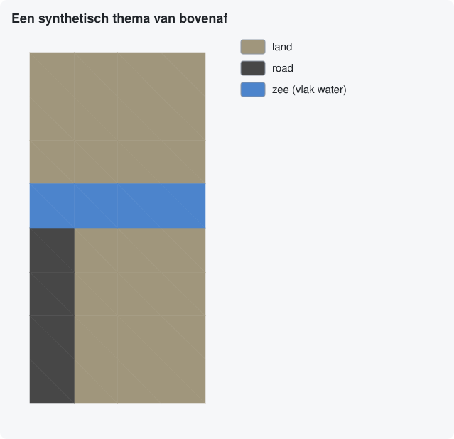
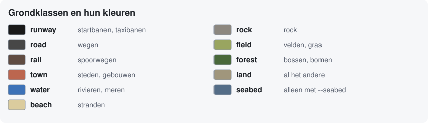

# De levelbestanden {#the-level-files}

Een level is een 3D-model van de grond; een thema is het woord van DCS World voor een kaart.

`<out>/<name>.glb` en `<name>.json` ernaast.

| Onderdeel | Wat het is |
|---|---|
| `ground:<Level>` | de eigen driehoeken van het terrein, gekleurd naar wat het spel erover tekent |
| `water:<Level>` | elke driehoek die het spel als onder zee aanmerkt, plat gelegd op zeeniveau |
| `structure:<Level>` | de gebouwen van het thema als dozen, waar het spel ze plaatst (hieronder) |

De kleuren zijn de klassen hieronder:

De kleuren zijn zichtbaar met **Vastgelegde kleur** in het paneel Achtergrond / level van de viewer. Elke gronddriehoek
krijgt de klasse van de overlay die het spel erover tekent:

| Klasse | Kleur | Uit de overlay van het spel |
|---|---|---|
| runway | bijna zwart | `Runway` - startbanen, taxibanen en platforms |
| road | donkergrijs | `Road` |
| rail | bruin | `Rail` |
| town | baksteenrood | `Town`, `Building` |
| water | blauw | `River`, `Lake` (binnenwater, als grond getekend) |
| beach | zand | `Beach` |
| rock | grijs | `Rock` |
| field | lichtgroen | `Field`, `Grass` |
| forest | donkergroen | `Forest`, `Trees` |
| land | kaki | geen van deze |
| seabed | leiblauw | alleen met `--seabed` |

Waar meerdere overlays dezelfde driehoek tekenen, bepaalt de volgorde van de tabel
(een weg door een bos is weg). Elke overlaydriehoek is een van de eigen driehoeken van de grond -
gecontroleerd op elke klasse van de geprobeerde thema's, elke een match - dus de klassen zijn exact,
niet op het oog geschat uit nabije punten.

**Coördinaten** zijn de eigen wereldmeters van DCS: x noord, y omhoog, z oost, en de
glTF-assen zijn dezelfde (X = x, Y = y, Z = z). Telemetrie in DCS-meters - de DCS-hook van de
3DHeat Watcher schrijft precies dat - komt met de standaardinstellingen van de viewer (Y omhoog, schaal 1)
op het level terecht, zonder plaatsingsstap.

**Breedte- en lengtegraad:** elk thema is een Transverse Mercator-projectie met zijn eigen
constanten; `<name>.json` bevat ze, de hoeken van het level in breedte- en lengtegraad, en
elke stad met zowel haar breedte-/lengtegraad als haar DCS-x/z. Waar de constanten van een thema
niet gepubliceerd zijn, worden ze gefit op de bakens die zijn eigen `beacons.lua` in beide stelsels geeft
(een paar cm wortel uit de gemiddelde kwadratische fout; dezelfde fit geeft de gepubliceerde
constanten van andere thema's terug tot op de millimeter).
Voor een thema zonder constanten vindt [`fit`](fit.md) ze uit elke opname die beide bevat,
zoals een Watcher-sessie van één vlucht.

**De zeebodem** wordt weggelaten (een heatmap van een vluchtsimulator heeft de zeebodem niet nodig);
`--seabed` houdt hem als grond. `--no-water` laat de vlakke zee weg.

**Grootte.** Zie [Een level bouwen: Grootte](level.md#size).

**Vliegvelden.** Elk `AirfieldsTaxiways/<name>.rn4` bevat het taxinetwerk van één vliegveld, genoemd naar het
vliegveld; zijn punten zijn (x, y, z) doubles in DCS-meters. De `.json` van het level somt elk vliegveld
binnen het gebied op met zijn naam (die van het bestand), het midden van het vak van zijn punten, het vak, en de
grond daar. Op het geprobeerde thema is elk vliegveldbestand gelezen en op zijn veld terechtgekomen
(binnen enkele honderden meters van het gemeten referentiepunt van de luchthaven: het midden van de
taxibanen, niet van de startbaan).

**Gebouwen.** `Scenes/<theatre>.scn5` plaatst elk object van het thema
(miljoenen - bomen, lantaarns, hekken, draden, huizen). De objecten die naam en grootte
als gebouw hebben (huizen, flats, schuren, hangars, fabrieken, torens, terminals: een deel van de modellen,
honderdduizenden plaatsingen) worden als dozen getekend: de eigen begrenzingsdoos van elk model uit
het bestand, gedraaid naar zijn richting en neergezet waar het spel het plaatst, van
maximaal 3 m onder zijn oorsprong (zijn voet op een helling) tot zijn top. Bomen, struiken,
lampen, palen, draden, hekken, muren, borden, voertuigen, wagons, boten, kranen,
masten, pylonen en bruggen worden weggelaten. Geen modelvorm of textuur van het
spel wordt gekopieerd: een doos per gebouw, gekleurd naar soort (huis, blok, industrieel, luchthaven, toren, overig).
`<name>.json` somt ze ook op (`buildings.rows`: x, z, basis, hoogte, halve lengtes, richting, soort)
voor de hybride achtergrond van de viewer, die ze in de steden van het spel tekent in plaats van
de in kaart gebrachte gebouwen. `--no-buildings` laat ze weg.

`<name>.json` legt ook het bronbestand vast, zijn grootte en datum, de gelezen tegels, het aantal driehoeken
per klasse, en hoeveel steden van het thema op de grond terechtkomen - een controle van de
projectie die "N van N" moet aangeven.

Het level is een glTF-binair bestand met benoemde onderdelen, zoals elk 3DHeat-level; de pagina
[Levels](https://holdi601.github.io/3DHeat/levels.html) van de viewer zegt hoe het ze laadt.
