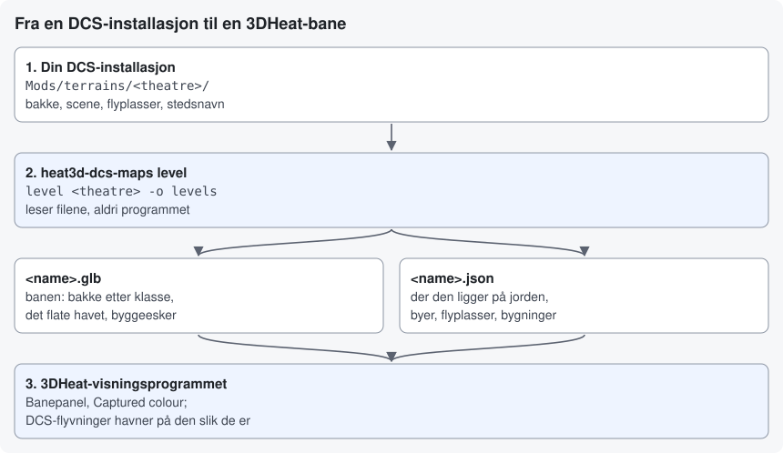

# 3DHeat DCS {#dheat-dcs}

**Hva er det?** Et teater er DCS World sitt ord for et kart: en region av
verden du flyr over. Dette verktøyet gjør bakken i ett teater, lest fra **din egen
installasjon**, om til en 3D-bane - en modell du kan fly over - for
[3DHeat](https://github.com/Holdi601/3DHeat)-visningsprogrammet
([dokumentasjon](https://holdi601.github.io/3DHeat/)).

**Hvorfor skulle jeg bruke det?** For å se dine DCS-flyvninger over spillets eget kart: dets
åser, kyst, flyplasser, veier, jernbaner, byer og bygninger.

**Eksempel:** `heat3d-dcs-maps level <theatre> -o levels` ->
`levels/<theatre>.glb` (banen) + `levels/<theatre>.json` (hvor den ligger på
jorden, dens byer og flyplasser).

Til hva det er nyttig:

- **Flyvninger over spillets eget kart.** 3DHeat sin verdensbakgrunn tegner dagens jord
  fra åpne data; dette tegner teateret slik DCS tegner det.
- **Ingen plasseringssteg.** Banen er i DCS sine egne verdensmeter, så telemetri
  i DCS-meter (3DHeat Watchers DCS-hook skriver nettopp det) havner på
  den med visningsprogrammets standarder.
- **Breddegrad og lengdegrad.** Hver bane har sin projeksjon, sine hjørner
  og sine byer i begge koordinatsystemene.



## Hurtigstart {#quick-start}

Ny til kommandolinjen? Les [Før du begynner](before-you-start.md) først.
Kjør disse i mappen du klonet eller pakket ut:

```bash
python -m pip install -e .                         # installs the heat3d-dcs-maps command
heat3d-dcs-maps list                               # the theatres installed, and whether each can be read
heat3d-dcs-maps level <theatre> -o levels          # a whole (small) theatre
heat3d-dcs-maps level <theatre> --around <lat> <lon> 12 -o levels --name <name>   # 12 km either side of a point
```

Du bør se én linje per teater fra `list`, som slutter med `readable`.
Last deretter inn `levels/<name>.glb` i visningsprogrammets Bane-panel
([Baner](https://holdi601.github.io/3DHeat/levels.html)).

Banene den skriver er laget av spillets data: de blir **på din egen
maskin**, for å se på, ikke for å dele eller publisere ([Vilkår](terms.md)).

## Sider {#pages}

| Side | Hva den dekker |
|---|---|
| [Før du begynner](before-you-start.md) | Python, en terminal, en første kjøring |
| [Finne teatre: list](list.md) | hvor installasjonen finnes, hva `list` skriver ut |
| [Bygge en bane: level](level.md) | hvert alternativ, regioner, størrelse, steg for steg |
| [Banefilene](output.md) | `.glb`-delene, bakkeklassene og deres farger, `.json`, koordinatene |
| [Stedsnavn: towns](towns.md) | et teaters byer med DCS-koordinater |
| [Projeksjoner: fit](fit.md) | å finne et teaters projeksjon fra et opptak |
| [Slik leses filene](reading.md) | formatene, hva som ble kontrollert, hva som ikke leses |
| [Vilkår og lisens](terms.md) | Eagle Dynamics sin lisens, og hvorfor dette er en egen pakke |
| [Kommandoreferanse](../cli-reference.md) | hvert alternativ, generert fra koden |
| [Vedlikehold av disse dokumentene](maintaining.md) | sjekklisten for utgivelse |

## Relatert {#related}

- 3DHeat-visningsprogrammet: [github.com/Holdi601/3DHeat](https://github.com/Holdi601/3DHeat),
  dokumentasjon på [holdi601.github.io/3DHeat](https://holdi601.github.io/3DHeat/).
- Telemetri for disse banene: [3DHeat Watcher](https://holdi601.github.io/3DHeat-Watcher/)
  tar opp DCS-flyvninger; visningsprogrammets filformater, inkludert beholderen med én fil per
  kamp, er beskrevet i [Én fil per kamp (.3dheat)](https://holdi601.github.io/3DHeat/container.html).

## 3DHeat-verktøyene {#the-3dheat-tools}

| Verktøy | Hva det gjør | Kode | Dokumentasjon |
|---|---|---|---|
| 3DHeat-visningsprogram | viser dataene: varmekart, løpsanalyse, kampgjennomgang | [3DHeat](https://github.com/Holdi601/3DHeat) | [dokumentasjon](https://holdi601.github.io/3DHeat/) |
| GameFiles | baner og løyper fra et spills egne filer | [3DHeat-GameFiles](https://github.com/Holdi601/3DHeat-GameFiles) | [dokumentasjon](https://holdi601.github.io/3DHeat-GameFiles/) |
| GameCapture | telemetri fra runder, og baner bygget opp fra spillopptak | [3DHeat-GameCapture](https://github.com/Holdi601/3DHeat-GameCapture) | [dokumentasjon](https://holdi601.github.io/3DHeat-GameCapture/) |
| Unreal Exporter | en Unreal Editor-plugin: en bane som én `.glb` | [3DHeat-UnrealExporter](https://github.com/Holdi601/3DHeat-UnrealExporter) | [dokumentasjon](https://holdi601.github.io/3DHeat-UnrealExporter/) |
| CS2 | Counter-Strike 2-demoer og kart | [3DHeat-CS2](https://github.com/Holdi601/3DHeat-CS2) | [dokumentasjon](https://holdi601.github.io/3DHeat-CS2/) |
| Watcher | tar opp det spill publiserer mens du spiller | [3DHeat-Watcher](https://github.com/Holdi601/3DHeat-Watcher) | [dokumentasjon](https://holdi601.github.io/3DHeat-Watcher/) |
| Ext-WarThunder | War Thunder-replayer | [3DHeat-Ext-WarThunder](https://github.com/Holdi601/3DHeat-Ext-WarThunder) | [dokumentasjon](https://holdi601.github.io/3DHeat-Ext-WarThunder/) |
| Ext-WoT | World of Tanks-replayer | [3DHeat-Ext-WoT](https://github.com/Holdi601/3DHeat-Ext-WoT) | [dokumentasjon](https://holdi601.github.io/3DHeat-Ext-WoT/) |
| Ext-WoWs | World of Warships-replayer | [3DHeat-Ext-WoWs](https://github.com/Holdi601/3DHeat-Ext-WoWs) | [dokumentasjon](https://holdi601.github.io/3DHeat-Ext-WoWs/) |
| Ext-Squad | Squad-serverdemoer | [3DHeat-Ext-Squad](https://github.com/Holdi601/3DHeat-Ext-Squad) | [dokumentasjon](https://holdi601.github.io/3DHeat-Ext-Squad/) |
| Ext-DCS | DCS World-kart som 3D-baner | [3DHeat-Ext-DCS](https://github.com/Holdi601/3DHeat-Ext-DCS) | [dokumentasjon](https://holdi601.github.io/3DHeat-Ext-DCS/) |
| Ext-IL2 | IL-2 Sturmovik-kart som 3D-baner | [3DHeat-Ext-IL2](https://github.com/Holdi601/3DHeat-Ext-IL2) | [dokumentasjon](https://holdi601.github.io/3DHeat-Ext-IL2/) |
