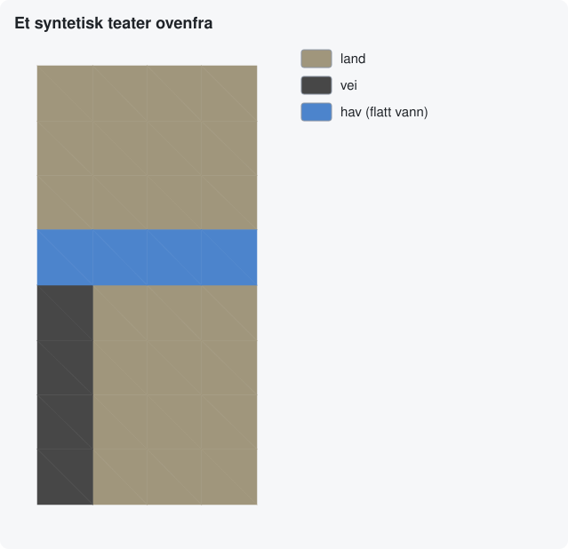
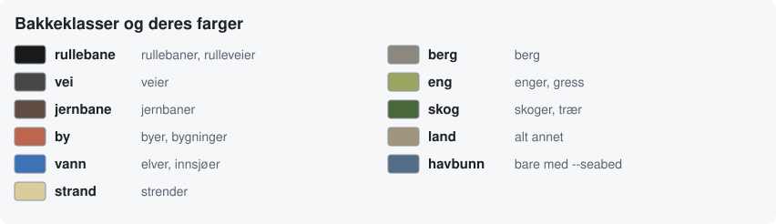

# Banefilene {#the-level-files}

En bane er en 3D-modell av bakken; et teater er DCS World sitt ord for et kart.

`<out>/<name>.glb` og `<name>.json` ved siden av den.

| Del | Hva den er |
|---|---|
| `ground:<Level>` | terrengets egne trekanter, farget etter det spillet tegner over hver |
| `water:<Level>` | hver trekant spillet markerer som under havet, lagt flatt på havnivå |
| `structure:<Level>` | teaterets bygninger som bokser, der spillet plasserer dem (under) |

Fargene er klassene under:

Fargene vises med **Captured colour** i visningsprogrammets banepanel. Hver bakketrekant
får klassen til overlegget spillet tegner den med:

| Klasse | Farge | Fra spillets overlegg |
|---|---|---|
| runway | nesten svart | `Runway` - rullebaner, rullebaner på bakken og plattformer |
| road | mørk grå | `Road` |
| rail | brun | `Rail` |
| town | murstein rød | `Town`, `Building` |
| water | blå | `River`, `Lake` (innlandsvann, tegnet som bakke) |
| beach | sand | `Beach` |
| rock | grå | `Rock` |
| field | lys grønn | `Field`, `Grass` |
| forest | mørk grønn | `Forest`, `Trees` |
| land | kaki | ingen av disse |
| seabed | skiferblå | bare med `--seabed` |

Der flere overlegg tegner samme trekant, avgjør rekkefølgen i tabellen
(en vei gjennom en skog er vei). Hver overleggstrekant er en av bakkens egne -
kontrollert for hver klasse i teatrene som ble prøvd, og alle traff - så
klassene er nøyaktige, ikke gjettet ut fra nærliggende punkter.

**Koordinater** er DCS sine egne verdensmeter: x nord, y opp, z øst, og glTF-aksene
er de samme (X = x, Y = y, Z = z). Telemetri i DCS-meter - 3DHeat Watchers DCS-hook
skriver nettopp det - havner på banen med visningsprogrammets standarder (Y opp, skala 1)
og uten plasseringssteg.

**Breddegrad og lengdegrad:** hvert teater er en Transverse Mercator-projeksjon med
sine egne konstanter; `<name>.json` bærer dem, banens hjørner i
breddegrad og lengdegrad, og hver by med både sin breddegrad/lengdegrad og
sin DCS x/z. Der et teaters konstanter ikke er publisert, tilpasses de
til fyrtårnene som dets egen `beacons.lua` gir i begge koordinatsystemene (noen cm i
rotmiddelkvadrat; den samme tilpasningen gir de publiserte konstantene til andre teatre
tilbake til millimeteren).
For et teater uten konstanter finner [`fit`](fit.md) dem fra et hvilket som helst
opptak som har begge, som en Watcher-økt med én flyvning.

**Havbunnen** utelates (et flysimulator-varmekart trenger ikke havbunnen); `--seabed`
beholder den som bakke. `--no-water` utelater det flate havet.

**Størrelse.** Se [Bygge en bane: Størrelse](level.md#size).

**Flyplasser.** Hver `AirfieldsTaxiways/<name>.rn4` holder en flyplass sitt rulleveisnett, oppkalt
etter den; dets punkter er (x, y, z) som doble tall i DCS-meter. Banens `.json` lister hver
flyplass innenfor regionen med sitt navn (filens), midtpunktet av punktenes
boks, boksen, og bakken der. På teatret som ble prøvd, ble hver flyplassfil lest, hver plassert på sitt
område (innen noen hundre meter fra flyplassens oppmålte referansepunkt: midten av
rulleveiene, ikke rullebanen).

**Bygninger.** `Scenes/<theatre>.scn5` plasserer hvert objekt i teateret
(millioner av dem - trær, lamper, gjerder, ledninger, hus). De som er
bygninger etter navn og størrelse (hus, leiligheter, skur, hangarer,
fabrikker, tårn, terminaler: en brøkdel av modellene, hundretusener av plasseringer) tegnes som bokser: hver modells egen
omgivende boks fra filen, vridd til sin retning og stående der spillet plasserer den, fra opptil
3 m under sitt utgangspunkt (fundamentet i en skråning) til toppen. Trær, busker,
lys, stolper, ledninger, gjerder, murer, skilt, kjøretøy, vogner, båter, kraner,
master, master og broer utelates. Ingen modellform eller tekstur fra
spillet kopieres: en boks per bygning, farget etter type (hus, blokk,
industri, flyplass, tårn, annet). `<name>.json` lister dem også
(`buildings.rows`: x, z, base, height, halve lengder, retning, type) for
visningsprogrammets hybride bakgrunn, som tegner dem i spillets byer i stedet for
de kartlagte bygningene. `--no-buildings` utelater dem.

`<name>.json` registrerer også kildefilen, dens størrelse og dato, flisene som ble lest,
antall trekanter per klasse, og hvor mange av teaterets byer som havner
på bakken - en kontroll av projeksjonen som bør si «N av N».

Banen er en glTF-binærfil med navngitte deler, slik alle 3DHeat-baner er; visningsprogrammets
[Baner](https://holdi601.github.io/3DHeat/levels.html)-side sier hvordan de lastes inn.
