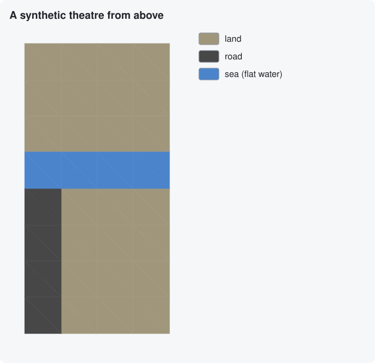
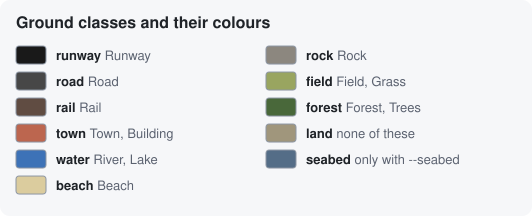

# The level files

`<out>/<name>.glb` and `<name>.json` beside it.

| Part | What it is |
|---|---|
| `ground:<Level>` | the terrain's own triangles, coloured by what the game draws over each |
| `water:<Level>` | every triangle the game marks as under the sea, laid flat at sea level |
| `structure:<Level>` | the theatre's buildings as boxes, where the game places them (below) |

The colours show with **Captured colour** in the viewer's level panel. Each
ground triangle takes the class of the overlay the game draws it with:

| Class | Colour | From the game's overlay |
|---|---|---|
| runway | near black | `Runway` - runways, taxiways and aprons |
| road | dark grey | `Road` |
| rail | brown | `Rail` |
| town | brick red | `Town`, `Building` |
| water | blue | `River`, `Lake` (inland water, drawn as ground) |
| beach | sand | `Beach` |
| rock | grey | `Rock` |
| field | light green | `Field`, `Grass` |
| forest | dark green | `Forest`, `Trees` |
| land | khaki | none of these |

Where several overlays draw the same triangle, the order of the table decides
(a road through a forest is road). Every overlay triangle is one of the
ground's own - checked on all classes of two theatres, every one matched - so
the classes are exact, not guessed from nearby points.

**Coordinates** are DCS's own world metres: x north, y up, z east, and the
glTF axes are the same (X = x, Y = y, Z = z). Telemetry in DCS metres - the
3DHeat Watcher's DCS hook writes exactly that - lands on the level with the
viewer's defaults (Y up, scale 1) and no placement step.

**Latitude and longitude:** every theatre is a Transverse Mercator projection
with its own constants; `<name>.json` carries them, the level's corners in
latitude and longitude, and every town with both its latitude/longitude and
its DCS x/z. Iraq's constants are not published; the ones used are fitted to
the 43 beacons the theatre's own `beacons.lua` gives both ways (4 cm root mean
square; the same fit gives Caucasus, Syria and Sinai back to the millimetre).
For a theatre without constants, [`fit`](fit.md) finds them from any
recording that holds both, such as a Watcher session of one flight.

**The sea floor** is left out (a flight-sim heatmap does not need the bottom
of the Pacific); `--seabed` keeps it as ground. `--no-water` leaves out the
flat sea.

**Size.** The game's mesh is adaptive - open sea in triangles kilometres
across, coasts and roads in a few metres - and the whole of a small theatre
is a few million triangles (Marianas WWII: 5.7 million vertices). The big ones
are 35 to 90 million vertices; for those, `level` asks for a region
(`--around LAT LON KM`, or `--bounds X0 Z0 X1 Z1` in DCS metres) or a thinner
mesh (`--cell 50`: every vertex within 50 m becomes one), or `--force`.

**Airfields.** Each `AirfieldsTaxiways/<name>.rn4` holds one airfield's taxi
network, named after it; its points are (x, y, z) doubles in DCS metres. The
level's `.json` lists every airfield inside the region with its name (the
file's), the middle of its points' box, the box, and the ground there. On
Caucasus all 21 files read, each placed on its field (Beslan 89 m, Kutaisi
191 m from the surveyed airport reference point: the middle of the taxiways,
not the runway's).

**Buildings.** `Scenes/<theatre>.scn5` places every object of the theatre
(Caucasus: 15.6 million - trees, lamps, fences, wires, houses). The ones
that are buildings by name and size (houses, flats, sheds, hangars,
factories, towers, terminals: 171 of Caucasus' 615 models, 568,000
placements) are drawn as boxes: each model's own bounding box from the
file, turned to its heading and standing where the game puts it, from up to
3 m below its origin (its footing on a slope) to its top. Trees, shrubs,
lights, poles, wires, fences, walls, signs, vehicles, wagons, boats, cranes,
masts, pylons and bridges are left out. No model shape or texture of the
game is copied: a box per building, coloured by kind (house, block,
industrial, airfield, tower, other). `<name>.json` lists them too
(`buildings.rows`: x, z, base, height, half lengths, heading, kind) for the
viewer's hybrid backdrop, which draws them in the game's towns instead of
the mapped buildings. `--no-buildings` leaves them out.

`<name>.json` also records the source file, its size and date, the tiles
read, the triangle count per class, and how many of the theatre's towns land
on the ground - a check of the projection that should read "N of N".

The level is a glTF binary with named parts, as every 3DHeat level is; the viewer's
[Levels](https://holdi601.github.io/3DHeat/levels.html) page says how it loads them.
