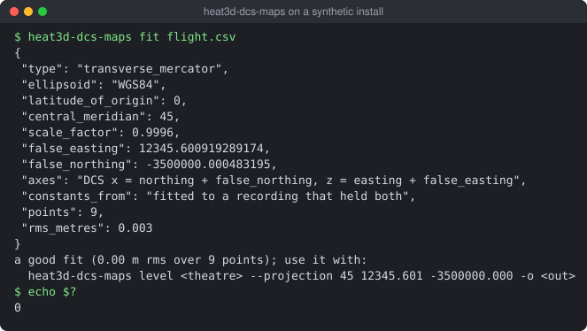

# Projekcje: `fit` {#projections-fit}

```text
heat3d-dcs-maps fit <recording>
```

Każdy teatr to projekcja Transverse Mercator z własnymi stałymi. Narzędzie zna je dla teatrów,
na których je sprawdzono; dla teatru, którego nie zna, `fit` wyznacza je z dowolnego nagrania,
które ma zarówno szerokość/długość geograficzną, jak i metry DCS, na przykład sesji 3DHeat Watcher
z jednego lotu.

1. Nagraj lot nad teatrem programem 3DHeat Watcher (albo zrób dowolne nagranie
   z kolumnami `lat`, `lon`, `x`, `z` w metrach DCS: x to metry na północ, z metry na wschód,
   jak wszędzie w DCS).
2. Uruchom `heat3d-dcs-maps fit "<session>/heat.parquet"` (albo plik `.jsonl` lub `.csv`).
3. Wypisuje wyznaczoną projekcję jako JSON, pierwiastek błędu średniokwadratowego po punktach
   oraz argumenty `--projection`, których należy użyć.
4. Zbuduj poziom z nimi:
   `heat3d-dcs-maps level <theatre> --projection <LON0> <FE> <FN> -o levels`.



Nagranie na obrazku to dziewięć punktów zrobionych z - znanej - projekcji, którą `fit`
odtwarza co do milimetra.

| Argument | Co robi |
|---|---|
| `recording` | `.parquet`, `.jsonl` lub `.csv` z kolumnami `lat`, `lon`, `x`, `z` (metry DCS); wiersze, których nie da się odczytać, są pomijane |

Projekcja to szereg Krügera w ujęciu C. F. F. Karneya („Transverse Mercator with an accuracy of a few nanometers”, Journal of Geodesy 85, 2011).

Kod wyjścia: 0 dobre dopasowanie (poniżej 5 m pierwiastka błędu średniokwadratowego); 1 słabe dopasowanie
albo mniej niż trzy użyteczne wiersze; 2 nie znaleziono pliku.
