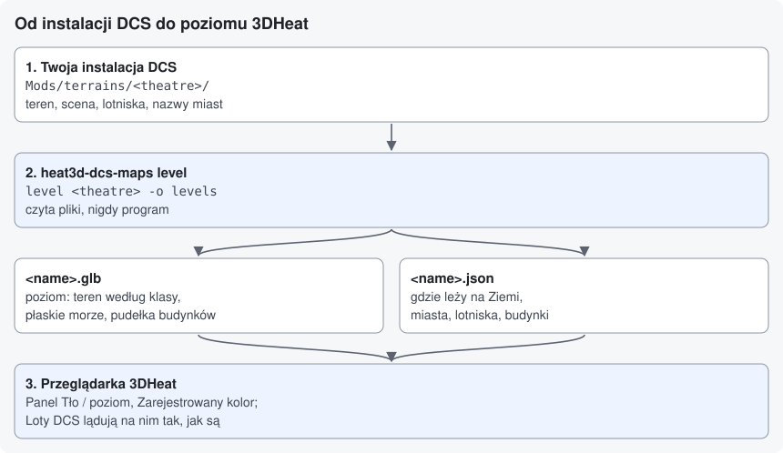

# 3DHeat DCS {#dheat-dcs}

**Czym jest?** Teatr to w DCS World nazwa mapy: regionu świata, nad którym latasz.
To narzędzie zamienia teren jednego teatru, odczytany z **twojej własnej instalacji**,
w poziom 3D - model, nad którym można latać - dla przeglądarki [3DHeat](https://github.com/Holdi601/3DHeat)
([dokumentacja](https://holdi601.github.io/3DHeat/)).

**Po co go używać?** Żeby zobaczyć swoje loty DCS na samej mapie gry: jej wzgórza, wybrzeże, lotniska,
drogi, linie kolejowe, miasta i budynki.

**Przykład:** `heat3d-dcs-maps level <theatre> -o levels` ->
`levels/<theatre>.glb` (poziom) + `levels/<theatre>.json` (gdzie leży na Ziemi, jego miasta i lotniska).

Do czego się przydaje:

- **Loty na mapie samej gry.** Tło świata 3DHeat rysuje dzisiejszą Ziemię z otwartych danych;
  to narzędzie rysuje teatr tak, jak rysuje go DCS.
- **Brak kroku ustawiania.** Poziom leży we własnych metrach świata DCS, więc telemetria w metrach DCS
  (hak DCS programu 3DHeat Watcher zapisuje dokładnie taką) trafia na niego przy domyślnych ustawieniach przeglądarki.
- **Szerokość i długość geograficzna.** Każdy poziom niesie swoją projekcję, swoje rogi i swoje miasta w obu układach.



## Szybki start {#quick-start}

Nigdy nie używałeś wiersza poleceń? Najpierw przeczytaj [Zanim zaczniesz](before-you-start.md).
Uruchom te polecenia w folderze, do którego sklonowałeś albo rozpakowałeś narzędzie:

```bash
python -m pip install -e .                         # instaluje polecenie heat3d-dcs-maps
heat3d-dcs-maps list                               # zainstalowane teatry i to, czy każdy da się odczytać
heat3d-dcs-maps level <theatre> -o levels          # cały (mały) teatr
heat3d-dcs-maps level <theatre> --around <lat> <lon> 12 -o levels --name <name>   # 12 km w każdą stronę od punktu
```

Z `list` zobaczysz jedną linię na teatr, kończącą się słowem `readable`.
Potem wczytaj `levels/<name>.glb` w panelu **Tło / poziom** przeglądarki
([Poziomy](https://holdi601.github.io/3DHeat/levels.html)).

Poziomy, które narzędzie zapisuje, są zbudowane z danych gry: zostają **na twoim komputerze**,
do oglądania, a nie do udostępniania ani publikowania ([Warunki](terms.md)).

Każdy czytnik gry to osobny mały projekt z własnym plikiem licencji, własnymi wydaniami i własnym systemem zgłoszeń, więc można go instalować, aktualizować, utrzymywać - albo wycofać na prośbę właściciela praw - osobno, bez wpływu na przeglądarkę i pozostałe narzędzia.

## Strony {#pages}

| Strona | Czego dotyczy |
|---|---|
| [Zanim zaczniesz](before-you-start.md) | Python, terminal, pierwsze uruchomienie |
| [Szukanie teatrów: list](list.md) | gdzie szukana jest instalacja, co wypisuje `list` |
| [Budowanie poziomu: level](level.md) | każda opcja, regiony, rozmiar, krok po kroku |
| [Pliki poziomu](output.md) | części `.glb`, klasy terenu i ich kolory, `.json`, współrzędne |
| [Nazwy miejsc: towns](towns.md) | miasta teatru ze współrzędnymi DCS |
| [Projekcje: fit](fit.md) | wyznaczanie projekcji teatru z nagrania |
| [Jak czytane są pliki](reading.md) | formaty, co zostało sprawdzone, czego nie odczytujemy |
| [Warunki i licencja](terms.md) | co jest czytane, czego nie dołączamy, licencja |
| [Opis poleceń](../cli-reference.md) | każda opcja, generowana z kodu |
| [Utrzymanie tych stron](maintaining.md) | lista kontrolna wydania |

## Powiązane {#related}

- Przeglądarka 3DHeat: [github.com/Holdi601/3DHeat](https://github.com/Holdi601/3DHeat),
  dokumentacja na [holdi601.github.io/3DHeat](https://holdi601.github.io/3DHeat/).
- Telemetria dla tych poziomów: [3DHeat Watcher](https://holdi601.github.io/3DHeat-Watcher/)
  nagrywa loty DCS; formaty plików przeglądarki, w tym kontener jednego pliku na mecz,
  opisano w [Jeden plik na mecz (.3dheat)](https://holdi601.github.io/3DHeat/container.html).

## Narzędzia 3DHeat {#the-3dheat-tools}

| Narzędzie | Co robi | Kod | Dokumentacja |
|---|---|---|---|
| przeglądarka 3DHeat | pokazuje dane: mapy cieplne, analizę wyścigów, przegląd meczu | [3DHeat](https://github.com/Holdi601/3DHeat) | [dokumentacja](https://holdi601.github.io/3DHeat/) |
| GameFiles | poziomy i trasy z plików samej gry | [3DHeat-GameFiles](https://github.com/Holdi601/3DHeat-GameFiles) | [dokumentacja](https://holdi601.github.io/3DHeat-GameFiles/) |
| GameCapture | telemetria okrążeń i poziomy odtworzone z nagrań rozgrywki | [3DHeat-GameCapture](https://github.com/Holdi601/3DHeat-GameCapture) | [dokumentacja](https://holdi601.github.io/3DHeat-GameCapture/) |
| Unreal Exporter | wtyczka do edytora Unreal: poziom jako jeden plik `.glb` | [3DHeat-UnrealExporter](https://github.com/Holdi601/3DHeat-UnrealExporter) | [dokumentacja](https://holdi601.github.io/3DHeat-UnrealExporter/) |
| CS2 | dema i mapy Counter-Strike 2 | [3DHeat-CS2](https://github.com/Holdi601/3DHeat-CS2) | [dokumentacja](https://holdi601.github.io/3DHeat-CS2/) |
| Watcher | zapisuje to, co gry publikują podczas grania | [3DHeat-Watcher](https://github.com/Holdi601/3DHeat-Watcher) | [dokumentacja](https://holdi601.github.io/3DHeat-Watcher/) |
| Ext-WarThunder | replaye War Thunder | [3DHeat-Ext-WarThunder](https://github.com/Holdi601/3DHeat-Ext-WarThunder) | [dokumentacja](https://holdi601.github.io/3DHeat-Ext-WarThunder/) |
| Ext-WoT | replaye World of Tanks | [3DHeat-Ext-WoT](https://github.com/Holdi601/3DHeat-Ext-WoT) | [dokumentacja](https://holdi601.github.io/3DHeat-Ext-WoT/) |
| Ext-WoWs | replaye World of Warships | [3DHeat-Ext-WoWs](https://github.com/Holdi601/3DHeat-Ext-WoWs) | [dokumentacja](https://holdi601.github.io/3DHeat-Ext-WoWs/) |
| Ext-Squad | dema z serwerów Squad | [3DHeat-Ext-Squad](https://github.com/Holdi601/3DHeat-Ext-Squad) | [dokumentacja](https://holdi601.github.io/3DHeat-Ext-Squad/) |
| Ext-DCS | mapy DCS World jako poziomy 3D | [3DHeat-Ext-DCS](https://github.com/Holdi601/3DHeat-Ext-DCS) | [dokumentacja](https://holdi601.github.io/3DHeat-Ext-DCS/) |
| Ext-IL2 | mapy IL-2 Sturmovik jako poziomy 3D | [3DHeat-Ext-IL2](https://github.com/Holdi601/3DHeat-Ext-IL2) | [dokumentacja](https://holdi601.github.io/3DHeat-Ext-IL2/) |
