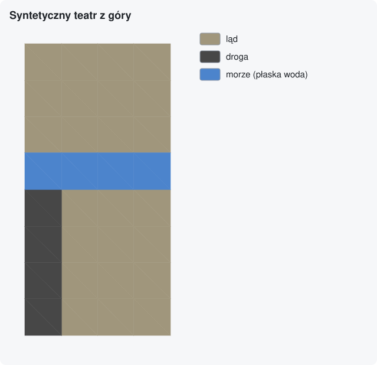
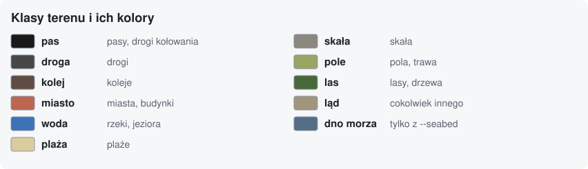

# Pliki poziomu {#the-level-files}

Poziom to model 3D terenu; teatr to w DCS World nazwa mapy.

`<out>/<name>.glb` i obok niego `<name>.json`.

| Część | Co to jest |
|---|---|
| `ground:<Level>` | własne trójkąty terenu, pokolorowane według tego, co gra rysuje na każdym z nich |
| `water:<Level>` | każdy trójkąt, który gra oznacza jako pod morzem, położony płasko na poziomie morza |
| `structure:<Level>` | budynki teatru jako prostopadłościany, tam gdzie gra je umieszcza (niżej) |

Kolory to poniższe klasy:

Kolory widać przy **Zarejestrowany kolor** w panelu **Tło / poziom** przeglądarki. Każdy trójkąt terenu
dostaje klasę nakładki, którą gra go rysuje:

| Klasa | Kolor | Z nakładki gry |
|---|---|---|
| runway | prawie czarny | `Runway` - pasy startowe, drogi kołowania i płyty postojowe |
| road | ciemnoszary | `Road` |
| rail | brązowy | `Rail` |
| town | ceglasty | `Town`, `Building` |
| water | niebieski | `River`, `Lake` (woda śródlądowa, rysowana jak teren) |
| beach | piaskowy | `Beach` |
| rock | szary | `Rock` |
| field | jasnozielony | `Field`, `Grass` |
| forest | ciemnozielony | `Forest`, `Trees` |
| land | khaki | żadna z powyższych |
| seabed | szaroniebieski | tylko z `--seabed` |

Gdy kilka nakładek rysuje ten sam trójkąt, o wyniku decyduje kolejność w tabeli
(droga przez las to droga). Każdy trójkąt nakładki to jeden z trójkątów samego terenu -
sprawdzono to dla każdej klasy wypróbowanych teatrów i każdy pasował - więc klasy są dokładne, a nie zgadywane z pobliskich punktów.

**Współrzędne** to własne metry świata DCS: x na północ, y w górę, z na wschód,
a osie glTF są te same (X = x, Y = y, Z = z). Telemetria w metrach DCS - hak DCS
programu 3DHeat Watcher zapisuje dokładnie taką - trafia na poziom przy domyślnych ustawieniach
przeglądarki (Y w górę, skala 1) i bez kroku ustawiania.

**Szerokość i długość geograficzna:** każdy teatr to projekcja Transverse Mercator z własnymi stałymi;
`<name>.json` je niesie, a także rogi poziomu w szerokości i długości geograficznej oraz każde miasto
z jego szerokością/długością i współrzędnymi x/z DCS. Gdy stałe teatru nie są publikowane, są dopasowywane
do radiolatarni, które podaje jego plik `beacons.lua`, w obu układach (pierwiastek błędu średniokwadratowego
rzędu kilku cm; to samo dopasowanie odtwarza opublikowane stałe innych teatrów z dokładnością do milimetra).
Dla teatru bez stałych [`fit`](fit.md) wyznacza je z dowolnego nagrania, które ma oba układy,
na przykład sesji Watchera z jednego lotu.

**Dno morskie** jest pomijane (mapa cieplna lotów nie potrzebuje dna morskiego); `--seabed` zachowuje je jako teren.
`--no-water` pomija płaskie morze.

**Rozmiar.** Zob. [Budowanie poziomu: Rozmiar](level.md#size).

**Lotniska.** Każdy plik `AirfieldsTaxiways/<name>.rn4` niesie sieć dróg kołowania jednego lotniska,
nazwaną od niego; jego punkty to liczby zmiennoprzecinkowe (x, y, z) w metrach DCS. Plik `.json`
poziomu wymienia każde lotnisko w obszarze wraz z jego nazwą (z pliku), środkiem pudełka punktów,
pudełkiem i terenem w tym miejscu. Na wypróbowanym teatrze odczytano każdy plik lotniska i każdy
umieszczono na jego polu (w odległości kilkuset metrów od oficjalnego punktu odniesienia lotniska: środka dróg kołowania, a nie pasa).

**Budynki.** `Scenes/<theatre>.scn5` umieszcza każdy obiekt teatru (miliony - drzewa, lampy, ogrodzenia, przewody,
domy). Te, które z nazwy i rozmiaru są budynkami (domy, bloki, szopy, hangary, fabryki, wieże, terminale:
ułamek modeli, setki tysięcy umieszczeń), rysowane są jako prostopadłościany: pudełko otaczające każdego modelu
z pliku, obrócone zgodnie z jego kierunkiem i postawione tam, gdzie umieszcza je gra, od maksymalnie 3 m poniżej
jego początku (podstawa na zboczu) do szczytu. Drzewa, krzewy, światła, słupy, przewody, ogrodzenia, mury,
znaki, pojazdy, wagony, łodzie, dźwigi, maszty, słupy wysokiego napięcia i mosty są pomijane. Nie kopiuje się
żadnego kształtu modelu ani tekstury gry: jedno pudełko na budynek, pokolorowane według rodzaju (dom, blok,
przemysłowy, lotniskowy, wieża, inny). `<name>.json` też je wymienia (`buildings.rows`: x, z, podstawa, wysokość,
połowy wymiarów, kierunek, rodzaj) dla hybrydowego tła przeglądarki, które rysuje je w miastach gry zamiast
zmapowanych budynków. `--no-buildings` je pomija.

`<name>.json` zapisuje też plik źródłowy, jego rozmiar i datę, odczytane kafle, liczbę trójkątów na klasę
oraz to, ile miast teatru trafia na ziemię - sprawdzenie projekcji, które powinno pokazać „N z N”.

Poziom to binarny glTF z nazwanymi częściami, jak każdy poziom 3DHeat; strona przeglądarki
[Poziomy](https://holdi601.github.io/3DHeat/levels.html) opisuje, jak je wczytuje.
