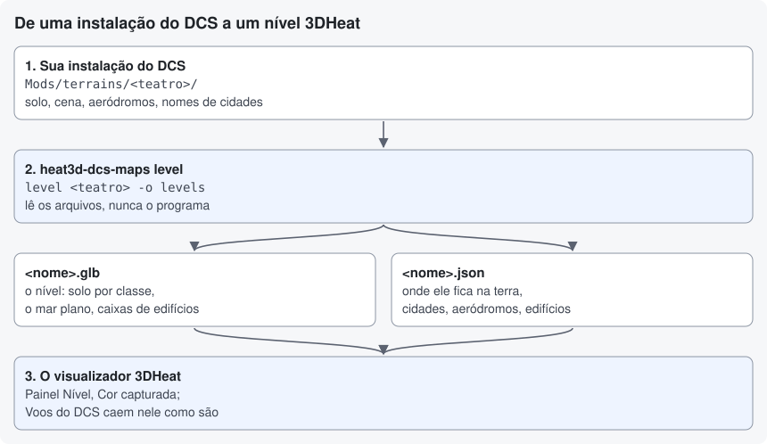

# 3DHeat DCS {#dheat-dcs}

**O que é?** Um teatro é a palavra do DCS World para um mapa: uma região do
mundo sobre a qual você voa. Esta ferramenta transforma o solo de um teatro, lido da
**sua própria instalação**, em um nível 3D - um modelo sobre o qual você pode voar - para o
visualizador [3DHeat](https://github.com/Holdi601/3DHeat)
([documentação](https://holdi601.github.io/3DHeat/)).

**Para que eu usaria?** Para ver os seus voos no DCS sobre o próprio mapa do jogo: os
morros, a costa, os aeródromos, as estradas, as ferrovias, as cidades e os edifícios.

**Exemplo:** `heat3d-dcs-maps level <teatro> -o levels` ->
`levels/<teatro>.glb` (o nível) + `levels/<teatro>.json` (onde ele fica na terra,
suas cidades e aeródromos).

Para que serve:

- **Voos sobre o mapa do próprio jogo.** O fundo de mundo do 3DHeat desenha a terra de hoje
  a partir de dados abertos; isto desenha o teatro como o DCS o desenha.
- **Nenhuma etapa de posicionamento.** O nível está nos metros do mundo do próprio DCS, então a telemetria
  em metros do DCS (o gancho do DCS do 3DHeat Watcher grava exatamente isso) cai nele com
  os padrões do visualizador.
- **Latitude e longitude.** Todo nível traz a sua projeção, os seus cantos e as suas
  cidades nos dois sistemas.



## Início rápido {#quick-start}

Nunca usou a linha de comando? Leia primeiro [Antes de começar](before-you-start.md).
Execute estes comandos na pasta em que você clonou ou descompactou a ferramenta:

```bash
python -m pip install -e .                         # instala o comando heat3d-dcs-maps
heat3d-dcs-maps list                               # os teatros instalados, e se cada um pode ser lido
heat3d-dcs-maps level <teatro> -o levels           # um teatro inteiro (pequeno)
heat3d-dcs-maps level <teatro> --around <lat> <lon> 12 -o levels --name <nome>   # 12 km para cada lado de um ponto
```

Você deve ver uma linha por teatro com `list`, terminando em `readable`.
Depois carregue `levels/<nome>.glb` no painel Fundo / nível do visualizador
([Níveis](https://holdi601.github.io/3DHeat/levels.html)).

Os níveis que ela grava são montados a partir dos dados do jogo: eles ficam na **sua
máquina**, para ver, não para compartilhar ou publicar ([Termos](terms.md)).

Cada leitor de jogo é um pequeno projeto próprio, com seu próprio arquivo de licença, versões e rastreador de issues, para que possa ser instalado, atualizado, mantido - ou retirado a pedido de um titular de direitos - de forma independente, sem afetar o visualizador nem as outras ferramentas.

## Páginas {#pages}

| Página | O que cobre |
|---|---|
| [Antes de começar](before-you-start.md) | Python, um terminal, uma primeira execução |
| [Encontrar teatros: list](list.md) | onde a instalação é encontrada, o que `list` imprime |
| [Montar um nível: level](level.md) | cada opção, regiões, tamanho, passo a passo |
| [Os arquivos do nível](output.md) | as partes `.glb`, as classes do solo e suas cores, o `.json`, as coordenadas |
| [Nomes de lugares: towns](towns.md) | as cidades de um teatro com coordenadas do DCS |
| [Projeções: fit](fit.md) | encontrar a projeção de um teatro a partir de uma gravação |
| [Como os arquivos são lidos](reading.md) | os formatos, o que foi verificado, o que não é lido |
| [Termos e licença](terms.md) | o que é lido, o que não é incluído, a licença |
| [Referência de comandos](../cli-reference.md) | cada opção, gerada a partir do código |
| [Manutenção destas páginas](maintaining.md) | a lista de verificação de cada versão |

## Relacionados {#related}

- O visualizador 3DHeat: [github.com/Holdi601/3DHeat](https://github.com/Holdi601/3DHeat),
  documentação em [holdi601.github.io/3DHeat](https://holdi601.github.io/3DHeat/).
- Telemetria para estes níveis: o [3DHeat Watcher](https://holdi601.github.io/3DHeat-Watcher/)
  grava voos do DCS; os formatos de arquivo do visualizador, incluindo o seu
  contêiner de uma partida em um só arquivo, são descritos em
  [Um arquivo por partida (.3dheat)](https://holdi601.github.io/3DHeat/container.html).

## As ferramentas 3DHeat {#the-3dheat-tools}

| Ferramenta | O que faz | Código | Documentação |
|---|---|---|---|
| Visualizador 3DHeat | mostra os dados: mapas de calor, análise de corrida, revisão de partidas | [3DHeat](https://github.com/Holdi601/3DHeat) | [docs](https://holdi601.github.io/3DHeat/) |
| GameFiles | níveis e percursos a partir dos arquivos do próprio jogo | [3DHeat-GameFiles](https://github.com/Holdi601/3DHeat-GameFiles) | [docs](https://holdi601.github.io/3DHeat-GameFiles/) |
| GameCapture | telemetria de voltas, e níveis reconstruídos a partir de vídeo de jogo | [3DHeat-GameCapture](https://github.com/Holdi601/3DHeat-GameCapture) | [docs](https://holdi601.github.io/3DHeat-GameCapture/) |
| Unreal Exporter | um plugin do Unreal Editor: um nível como um único `.glb` | [3DHeat-UnrealExporter](https://github.com/Holdi601/3DHeat-UnrealExporter) | [docs](https://holdi601.github.io/3DHeat-UnrealExporter/) |
| CS2 | demos e mapas do Counter-Strike 2 | [3DHeat-CS2](https://github.com/Holdi601/3DHeat-CS2) | [docs](https://holdi601.github.io/3DHeat-CS2/) |
| Watcher | registra o que os jogos publicam enquanto você joga | [3DHeat-Watcher](https://github.com/Holdi601/3DHeat-Watcher) | [docs](https://holdi601.github.io/3DHeat-Watcher/) |
| Ext-WarThunder | repetições do War Thunder | [3DHeat-Ext-WarThunder](https://github.com/Holdi601/3DHeat-Ext-WarThunder) | [docs](https://holdi601.github.io/3DHeat-Ext-WarThunder/) |
| Ext-WoT | repetições do World of Tanks | [3DHeat-Ext-WoT](https://github.com/Holdi601/3DHeat-Ext-WoT) | [docs](https://holdi601.github.io/3DHeat-Ext-WoT/) |
| Ext-WoWs | repetições do World of Warships | [3DHeat-Ext-WoWs](https://github.com/Holdi601/3DHeat-Ext-WoWs) | [docs](https://holdi601.github.io/3DHeat-Ext-WoWs/) |
| Ext-Squad | demos de servidores do Squad | [3DHeat-Ext-Squad](https://github.com/Holdi601/3DHeat-Ext-Squad) | [docs](https://holdi601.github.io/3DHeat-Ext-Squad/) |
| Ext-DCS | mapas do DCS World como níveis 3D | [3DHeat-Ext-DCS](https://github.com/Holdi601/3DHeat-Ext-DCS) | [docs](https://holdi601.github.io/3DHeat-Ext-DCS/) |
| Ext-IL2 | mapas do IL-2 Sturmovik como níveis 3D | [3DHeat-Ext-IL2](https://github.com/Holdi601/3DHeat-Ext-IL2) | [docs](https://holdi601.github.io/3DHeat-Ext-IL2/) |
