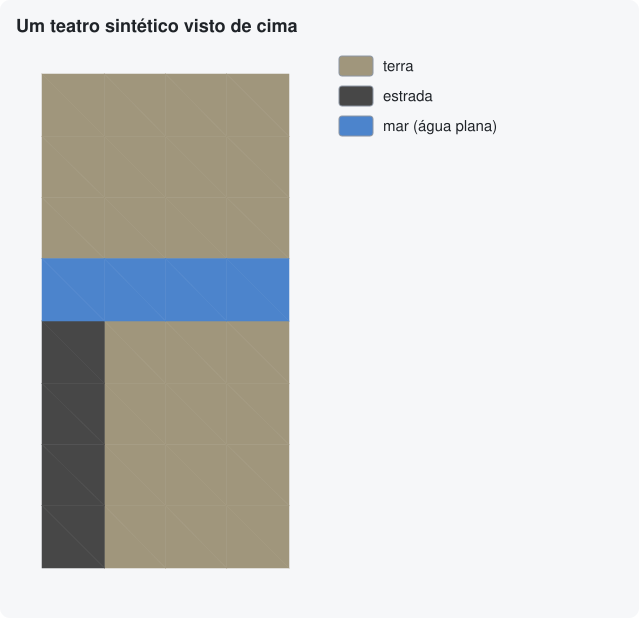
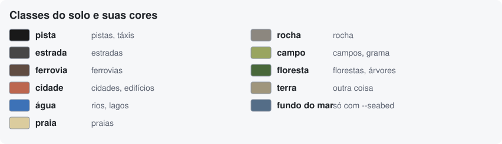

# Os arquivos do nível {#the-level-files}

Um nível é um modelo 3D do solo; um teatro é a palavra do DCS World para um mapa.

`<saída>/<nome>.glb` e `<nome>.json` ao lado.

| Parte | O que é |
|---|---|
| `ground:<Nível>` | os triângulos do próprio terreno, coloridos pelo que o jogo desenha sobre cada um |
| `water:<Nível>` | cada triângulo que o jogo marca como estando sob o mar, deitado no nível do mar |
| `structure:<Nível>` | os edifícios do teatro como caixas, onde o jogo os coloca (abaixo) |

As cores são as classes abaixo:

As cores aparecem com **Cor capturada** no painel Fundo / nível do visualizador. Cada triângulo do solo
assume a classe da sobreposição com que o jogo o desenha:

| Classe | Cor | Da sobreposição do jogo |
|---|---|---|
| pista | quase preto | `Runway` - pistas, táxi e pátios |
| estrada | cinza-escuro | `Road` |
| ferrovia | marrom | `Rail` |
| cidade | vermelho-tijolo | `Town`, `Building` |
| água | azul | `River`, `Lake` (água interior, desenhada como solo) |
| praia | areia | `Beach` |
| rocha | cinza | `Rock` |
| campo | verde-claro | `Field`, `Grass` |
| floresta | verde-escuro | `Forest`, `Trees` |
| terra | cáqui | nenhuma destas |
| fundo do mar | azul-ardósia | só com `--seabed` |

Quando várias sobreposições desenham o mesmo triângulo, a ordem da tabela decide
(uma estrada na floresta é estrada). Todo triângulo de sobreposição é um dos próprios do solo -
verificado em todas as classes dos teatros testados, todos casaram - então as
classes são exatas, não adivinhadas a partir de pontos próximos.

**As coordenadas** são os metros do próprio mundo do DCS: x norte, y para cima, z leste, e os
eixos do glTF são os mesmos (X = x, Y = y, Z = z). A telemetria em metros do DCS - o gancho do DCS do
3DHeat Watcher grava exatamente isso - cai no nível com os padrões do
visualizador (Y para cima, escala 1) e sem nenhuma etapa de posicionamento.

**Latitude e longitude:** todo teatro é uma projeção Transversa de Mercator com as suas
próprias constantes; `<nome>.json` as traz, junto com os cantos do nível em
latitude e longitude, e cada cidade com sua latitude/longitude e
seu x/z do DCS. Quando as constantes de um teatro não são publicadas, elas são ajustadas
aos balizas que o próprio `beacons.lua` dele dá nos dois sistemas (alguns cm de
erro quadrático médio da raiz; o mesmo ajuste devolve as constantes publicadas de outros
teatros até o milímetro).
Para um teatro sem constantes, [`fit`](fit.md) as encontra a partir de qualquer
gravação que tenha as duas, como uma sessão do Watcher de um voo.

**O fundo do mar** fica de fora (um mapa de calor de simulador de voo não precisa dele); `--seabed` o
mantém como solo. `--no-water` deixa de fora o mar
plano.

**Tamanho.** Veja [Montar um nível: Tamanho](level.md#size).

**Aeródromos.** Cada `AirfieldsTaxiways/<nome>.rn4` guarda a rede de táxi de um aeródromo, com o
nome dele; seus pontos são duplas (x, y, z) em metros do DCS. O `.json` do nível lista cada
aeródromo dentro da região com o seu nome (o do arquivo), o centro da caixa dos seus pontos, a caixa, e o
solo ali. No teatro testado, todos os arquivos de aeródromo foram lidos, cada um colocado sobre o seu
campo (a algumas centenas de metros do ponto de referência topográfico do aeroporto: o centro das
pistas de táxi, não o da pista).

**Edifícios.** `Scenes/<teatro>.scn5` coloca todo objeto do teatro
(milhões deles - árvores, postes, cercas, fios, casas). Os que são edifícios pelo nome e
pelo tamanho (casas, prédios, galpões, hangares, fábricas, torres, terminais: uma fração dos
modelos, centenas de milhares de posicionamentos) são desenhados como caixas: a caixa delimitadora
de cada modelo, tirada do próprio arquivo, virada para o seu rumo e apoiada onde o jogo a coloca, de até
3 m abaixo da sua origem (o seu apoio numa encosta) até o topo. Árvores, arbustos,
luzes, postes, fios, cercas, muros, placas, veículos, vagões, barcos, guindastes,
mastros, torres de linha e pontes ficam de fora. Nenhuma forma de modelo nem textura do
jogo é copiada: uma caixa por edifício, colorida pelo tipo (casa, bloco, industrial, aeródromo, torre, outro).
O `<nome>.json` também os lista (`buildings.rows`: x, z, base, altura, meias dimensões, rumo, tipo)
para o fundo híbrido do visualizador, que os desenha nas cidades do jogo em vez dos
edifícios mapeados. `--no-buildings` os deixa de fora.

O `<nome>.json` também registra o arquivo de origem, o seu tamanho e data, os blocos
lidos, a contagem de triângulos por classe, e quantas cidades do teatro caem no
solo - uma verificação da projeção que deve mostrar "N de N".

O nível é um binário glTF com partes nomeadas, como todo nível do 3DHeat; a página
[Níveis](https://holdi601.github.io/3DHeat/levels.html) do visualizador diz como ele os carrega.
