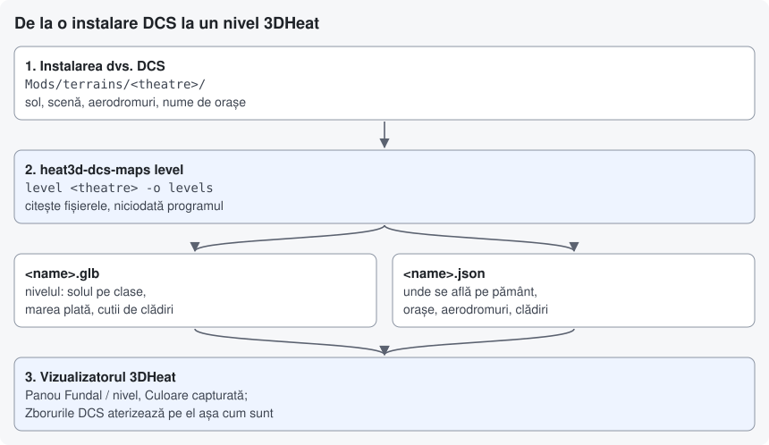

# 3DHeat DCS {#dheat-dcs}

**Ce este?** Un teatru este cuvântul DCS World pentru o hartă: o regiune a lumii peste care zburați. Acest
instrument transformă solul unui teatru, citit din **instalarea dumneavoastră**, într-un nivel 3D - un
model peste care puteți zbura - pentru vizualizatorul [3DHeat](https://github.com/Holdi601/3DHeat)
([documentație](https://holdi601.github.io/3DHeat/)).

**De ce l-aș folosi?** Ca să vedeți zborurile dumneavoastră DCS peste harta proprie a jocului: dealurile,
coasta, aerodromurile, drumurile, căile ferate, orașele și clădirile.

**Exemplu:** `heat3d-dcs-maps level <theatre> -o levels` ->
`levels/<theatre>.glb` (nivelul) + `levels/<theatre>.json` (unde se află pe pământ, orașele și
aerodromurile sale).

La ce este util:

- **Zboruri pe harta proprie a jocului.** Fundalul lumii din 3DHeat desenează azi pământul din date
  deschise; acesta desenează teatrul așa cum îl desenează DCS.
- **Fără pas de plasare.** Nivelul este în metrii lumii proprii ai DCS, deci telemetria în metri DCS
  (hook-ul DCS al 3DHeat Watcher scrie exact asta) ajunge pe el cu valorile implicite ale
  vizualizatorului.
- **Latitudine și longitudine.** Fiecare nivel își poartă proiecția, colțurile și orașele în ambele sisteme.



## Pornire rapidă {#quick-start}

Nu ați mai lucrat în linia de comandă? Citiți mai întâi [Înainte de a începe](before-you-start.md).
Rulați acestea în dosarul în care ați clonat sau dezarhivat instrumentul:

```bash
python -m pip install -e .                         # installs the heat3d-dcs-maps command
heat3d-dcs-maps list                               # the theatres installed, and whether each can be read
heat3d-dcs-maps level <theatre> -o levels          # a whole (small) theatre
heat3d-dcs-maps level <theatre> --around <lat> <lon> 12 -o levels --name <name>   # 12 km either side of a point
```

Ar trebui să vedeți câte o linie pentru fiecare teatru din `list`, care se termină cu `readable`.
Apoi încărcați `levels/<name>.glb` în panoul Fundal / nivel al vizualizatorului
([Niveluri](https://holdi601.github.io/3DHeat/levels.html)).

Nivelurile pe care le scrie sunt construite din datele jocului: ele rămân **pe calculatorul
dumneavoastră**, pentru vizualizare, nu pentru a fi distribuite sau publicate ([Condiții](terms.md)).

## Pagini {#pages}

| Pagina | Ce acoperă |
|---|---|
| [Înainte de a începe](before-you-start.md) | Python, un terminal, o primă rulare |
| [Găsirea teatrelor: list](list.md) | unde se găsește instalarea, ce afișează `list` |
| [Construirea unui nivel: level](level.md) | fiecare opțiune, regiuni, dimensiune, pas cu pas |
| [Fișierele nivelului](output.md) | părțile `.glb`, clasele de sol și culorile lor, `.json`, coordonatele |
| [Nume de locuri: towns](towns.md) | orașele unui teatru, cu coordonatele DCS |
| [Proiecții: fit](fit.md) | aflarea proiecției unui teatru dintr-o înregistrare |
| [Cum se citesc fișierele](reading.md) | formatele, ce s-a verificat, ce nu se citește |
| [Condiții și licență](terms.md) | licența Eagle Dynamics și de ce acesta este un pachet separat |
| [Referința comenzilor](../cli-reference.md) | fiecare opțiune, generată din cod |
| [Întreținerea acestor documente](maintaining.md) | lista de verificare pentru lansare |

## Legături {#related}

- Vizualizatorul 3DHeat: [github.com/Holdi601/3DHeat](https://github.com/Holdi601/3DHeat),
  documentația la [holdi601.github.io/3DHeat](https://holdi601.github.io/3DHeat/).
- Telemetria pentru aceste niveluri: [3DHeat Watcher](https://holdi601.github.io/3DHeat-Watcher/)
  înregistrează zborurile DCS; formatele de fișiere ale vizualizatorului, inclusiv containerul său cu
  un fișier pe meci, sunt descrise în [Un fișier pe meci (.3dheat)](https://holdi601.github.io/3DHeat/container.html).

## Instrumentele 3DHeat {#the-3dheat-tools}

| Instrument | Ce face | Cod | Documentație |
|---|---|---|---|
| Vizualizatorul 3DHeat | arată datele: hărți termice, analiza cursei, revizuirea meciului | [3DHeat](https://github.com/Holdi601/3DHeat) | [documentație](https://holdi601.github.io/3DHeat/) |
| GameFiles | niveluri și trasee din fișierele proprii ale unui joc | [3DHeat-GameFiles](https://github.com/Holdi601/3DHeat-GameFiles) | [documentație](https://holdi601.github.io/3DHeat-GameFiles/) |
| GameCapture | telemetria turelor și niveluri reconstruite din videoclipuri de joc | [3DHeat-GameCapture](https://github.com/Holdi601/3DHeat-GameCapture) | [documentație](https://holdi601.github.io/3DHeat-GameCapture/) |
| Unreal Exporter | un plugin pentru Unreal Editor: un nivel ca un singur `.glb` | [3DHeat-UnrealExporter](https://github.com/Holdi601/3DHeat-UnrealExporter) | [documentație](https://holdi601.github.io/3DHeat-UnrealExporter/) |
| CS2 | demo-uri și hărți Counter-Strike 2 | [3DHeat-CS2](https://github.com/Holdi601/3DHeat-CS2) | [documentație](https://holdi601.github.io/3DHeat-CS2/) |
| Watcher | înregistrează ce publică jocurile cât jucați | [3DHeat-Watcher](https://github.com/Holdi601/3DHeat-Watcher) | [documentație](https://holdi601.github.io/3DHeat-Watcher/) |
| Ext-WarThunder | replay-uri War Thunder | [3DHeat-Ext-WarThunder](https://github.com/Holdi601/3DHeat-Ext-WarThunder) | [documentație](https://holdi601.github.io/3DHeat-Ext-WarThunder/) |
| Ext-WoT | replay-uri World of Tanks | [3DHeat-Ext-WoT](https://github.com/Holdi601/3DHeat-Ext-WoT) | [documentație](https://holdi601.github.io/3DHeat-Ext-WoT/) |
| Ext-WoWs | replay-uri World of Warships | [3DHeat-Ext-WoWs](https://github.com/Holdi601/3DHeat-Ext-WoWs) | [documentație](https://holdi601.github.io/3DHeat-Ext-WoWs/) |
| Ext-Squad | demo-uri de server Squad | [3DHeat-Ext-Squad](https://github.com/Holdi601/3DHeat-Ext-Squad) | [documentație](https://holdi601.github.io/3DHeat-Ext-Squad/) |
| Ext-DCS | hărțile DCS World ca niveluri 3D | [3DHeat-Ext-DCS](https://github.com/Holdi601/3DHeat-Ext-DCS) | [documentație](https://holdi601.github.io/3DHeat-Ext-DCS/) |
| Ext-IL2 | hărțile IL-2 Sturmovik ca niveluri 3D | [3DHeat-Ext-IL2](https://github.com/Holdi601/3DHeat-Ext-IL2) | [documentație](https://holdi601.github.io/3DHeat-Ext-IL2/) |
