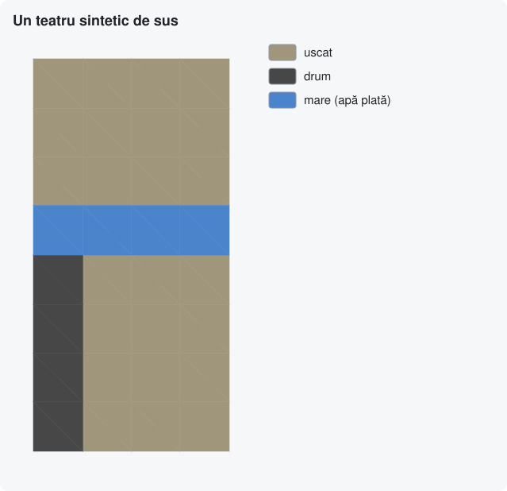
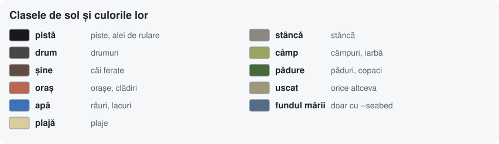

# Fișierele nivelului {#the-level-files}

Un nivel este un model 3D al solului; un teatru este cuvântul DCS World pentru o hartă.

`<out>/<name>.glb` și `<name>.json` alături.

| Parte | Ce este |
|---|---|
| `ground:<Level>` | triunghiurile terenului în sine, colorate după ce desenează jocul peste fiecare |
| `water:<Level>` | fiecare triunghi pe care jocul îl marchează ca fiind sub mare, așezat plat la nivelul mării |
| `structure:<Level>` | clădirile teatrului ca cutii, acolo unde le plasează jocul (mai jos) |

Culorile sunt clasele de mai jos:

Culorile apar cu **Culoare capturată** în panoul Fundal / nivel al vizualizatorului. Fiecare triunghi de sol
primește clasa stratului suprapus cu care îl desenează jocul:

| Clasă | Culoare | Din stratul suprapus al jocului |
|---|---|---|
| runway | aproape negru | `Runway` - piste, alei de rulare și platforme |
| road | gri închis | `Road` |
| rail | maro | `Rail` |
| town | roșu cărămiziu | `Town`, `Building` |
| water | albastru | `River`, `Lake` (apă de uscat, desenată ca sol) |
| beach | nisip | `Beach` |
| rock | gri | `Rock` |
| field | verde deschis | `Field`, `Grass` |
| forest | verde închis | `Forest`, `Trees` |
| land | kaki | niciunul dintre acestea |
| seabed | albastru ardezie | doar cu `--seabed` |

Acolo unde mai multe straturi suprapuse desenează același triunghi, ordinea din tabel decide
(un drum prin pădure este drum). Fiecare triunghi al stratului suprapus este unul al solului
propriu - verificat pe fiecare clasă a teatrelor încercate, toate au fost potrivite - deci
clasele sunt exacte, nu ghicite din punctele vecine.

**Coordonatele** sunt metrii lumii proprii ai DCS: x nord, y sus, z est, iar axele glTF sunt
aceleași (X = x, Y = y, Z = z). Telemetria în metri DCS - hook-ul DCS al 3DHeat Watcher scrie exact
asta - ajunge pe nivel cu valorile implicite ale vizualizatorului (Y sus, scară 1) și fără niciun pas de plasare.

**Latitudinea și longitudinea:** fiecare teatru este o proiecție Transverse Mercator cu constantele
sale proprii; `<name>.json` le conține, împreună cu colțurile nivelului în latitudine și longitudine
și fiecare oraș cu latitudinea/longitudinea sa și cu x/z-ul său DCS. Acolo unde constantele unui
teatru nu sunt publicate, ele sunt ajustate după balizele pe care le dă `beacons.lua` al teatrului,
în ambele sisteme (o eroare pătratică medie de câțiva cm; aceeași potrivire redă constantele publicate
ale altor teatre până la milimetru).
Pentru un teatru fără constante, [`fit`](fit.md) le găsește dintr-o înregistrare care conține ambele,
cum ar fi o sesiune Watcher a unui zbor.

**Fundul mării** este lăsat deoparte (o hartă termică de simulator de zbor nu are nevoie de el);
`--seabed` îl păstrează ca sol. `--no-water` lasă deoparte marea plată.

**Dimensiune.** Vedeți [Construirea unui nivel: Dimensiune](level.md#size).

**Aerodromuri.** Fiecare `AirfieldsTaxiways/<name>.rn4` conține rețeaua de rulare a unui aerodrom,
numită după el; punctele sale sunt (x, y, z) numere reale dublu precizie, în metri DCS. Fișierul `.json`
al nivelului listează fiecare aerodrom din regiune cu numele său (al fișierului), mijlocul casetei
punctelor sale, caseta și solul de acolo. Pe teatrul încercat, fiecare fișier de aerodrom a fost citit,
fiecare fiind plasat pe câmpul său (la câteva sute de metri de punctul de referință topografic al
aeroportului: mijlocul aleilor de rulare, nu al pistei).

**Clădiri.** `Scenes/<theatre>.scn5` plasează fiecare obiect al teatrului (milioane - copaci, lămpi,
garduri, fire, case). Cele care sunt clădiri după nume și dimensiune (case, blocuri, magazii, hangare,
fabrici, turnuri, terminale: o fracțiune din modele, sute de mii de plasări) sunt desenate ca
cutii: caseta proprie a fiecărui model din fișier, rotită după direcția sa și așezată unde o pune jocul,
de la cel mult 3 m sub originea sa (fundația sa pe o pantă) până la vârf. Copacii, arbuștii, luminile,
stâlpii, firele, gardurile, zidurile, panourile, vehiculele, vagoanele, bărcile, macaralele, catargele,
stâlpii de înaltă tensiune și podurile sunt lăsate deoparte. Nu se copiază nicio formă de model sau
nicio textură a jocului: o cutie pentru fiecare clădire, colorată după fel (casă, bloc, industrial,
aerodrom, turn, altele). `<name>.json` le listează și pe ele (`buildings.rows`: x, z, bază, înălțime,
jumătăți de lungime, direcție, fel) pentru fundalul hibrid al vizualizatorului, care le desenează în
orașele jocului în loc de clădirile cartografiate. `--no-buildings` le lasă deoparte.

`<name>.json` mai notează fișierul sursă, dimensiunea și data sa, plăcile citite, numărul de
triunghiuri pe clasă și câte dintre orașele teatrului ajung pe sol - o verificare a proiecției, care
ar trebui să spună „N din N”.

Nivelul este un binar glTF cu părți numite, ca orice nivel 3DHeat; pagina [Niveluri](https://holdi601.github.io/3DHeat/levels.html)
a vizualizatorului spune cum le încarcă.
