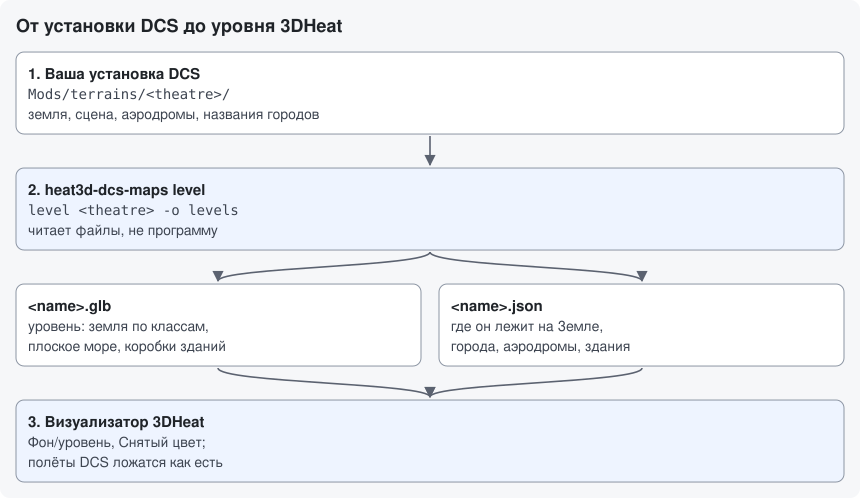

# 3DHeat DCS {#dheat-dcs}

**Что это?** Театр — это слово DCS World для карты: область мира, над которой вы летаете.
Этот инструмент превращает землю одного театра, прочитанную из **вашей собственной установки**,
в 3D-уровень — модель, над которой можно лететь, — для просмотрщика
[3DHeat](https://github.com/Holdi601/3DHeat)
([документация](https://holdi601.github.io/3DHeat/)).

**Зачем это нужно?** Чтобы видеть свои полёты в DCS на собственной карте игры: её холмы,
побережье, аэродромы, дороги, железные дороги, города и здания.

**Пример:** `heat3d-dcs-maps level <theatre> -o levels` ->
`levels/<theatre>.glb` (уровень) + `levels/<theatre>.json` (где он лежит на Земле, его города
и аэродромы).

Для чего это полезно:

- **Полёты на карте игры.** Фон 3DHeat показывает сегодняшнюю Землю по открытым данным; этот
  инструмент рисует театр таким, каким его рисует DCS.
- **Без шага размещения.** Уровень построен в мировых метрах самой DCS, поэтому телеметрия в
  метрах DCS (именно такую пишет хук DCS в 3DHeat Watcher) ложится на него с настройками просмотрщика
  по умолчанию.
- **Широта и долгота.** Каждый уровень несёт свою проекцию, свои углы и свои города в обеих системах координат.



## Быстрый старт {#quick-start}

Впервые в командной строке? Сначала прочитайте [С чего начать](before-you-start.md).
Выполняйте эти команды в папке, которую вы клонировали или распаковали:

```bash
python -m pip install -e .                         # устанавливает команду heat3d-dcs-maps
heat3d-dcs-maps list                               # установленные театры и можно ли прочитать каждый
heat3d-dcs-maps level <theatre> -o levels          # целый (небольшой) театр
heat3d-dcs-maps level <theatre> --around <lat> <lon> 12 -o levels --name <name>   # 12 км в обе стороны от точки
```

Вы увидите одну строку на каждый театр из `list`, оканчивающуюся на `readable`.
Затем загрузите `levels/<name>.glb` в панель «Фон / уровень» просмотрщика
([Уровни](https://holdi601.github.io/3DHeat/levels.html)).

Уровни, которые она пишет, построены по данным игры: они остаются **на вашем компьютере**,
для просмотра, а не для передачи или публикации ([Условия](terms.md)).

Каждый читатель игры — отдельный небольшой проект со своим файлом лицензии, своими релизами и своим трекером задач, поэтому его можно устанавливать, обновлять, сопровождать - или отозвать по просьбе правообладателя - отдельно, не затрагивая просмотрщик и другие инструменты.

## Страницы {#pages}

| Страница | Что в ней |
|---|---|
| [С чего начать](before-you-start.md) | Python, терминал, первый запуск |
| [Поиск театров: list](list.md) | где находится установка, что выводит `list` |
| [Построение уровня: level](level.md) | каждый параметр, регионы, размер, пошагово |
| [Файлы уровня](output.md) | части `.glb`, классы поверхности и их цвета, `.json`, координаты |
| [Названия мест: towns](towns.md) | города театра с координатами DCS |
| [Проекции: fit](fit.md) | поиск проекции театра по записи |
| [Как читаются файлы](reading.md) | форматы, что проверено, что не читается |
| [Условия и лицензия](terms.md) | что читается, что не поставляется, лицензия |
| [Справка по командам](../cli-reference.md) | каждый параметр, создано из кода |
| [Сопровождение документации](maintaining.md) | контрольный список выпуска |

## Связанное {#related}

- Просмотрщик 3DHeat: [github.com/Holdi601/3DHeat](https://github.com/Holdi601/3DHeat),
  документация на [holdi601.github.io/3DHeat](https://holdi601.github.io/3DHeat/).
- Телеметрия для этих уровней: [3DHeat Watcher](https://holdi601.github.io/3DHeat-Watcher/)
  записывает полёты DCS; форматы файлов просмотрщика, включая контейнер «один файл на матч», описаны на
  странице [Один файл на матч (.3dheat)](https://holdi601.github.io/3DHeat/container.html).

## Инструменты 3DHeat {#the-3dheat-tools}

| Инструмент | Что делает | Код | Документация |
|---|---|---|---|
| Просмотрщик 3DHeat | показывает данные: тепловые карты, анализ заездов, разбор матчей | [3DHeat](https://github.com/Holdi601/3DHeat) | [docs](https://holdi601.github.io/3DHeat/) |
| GameFiles | уровни и трассы из собственных файлов игры | [3DHeat-GameFiles](https://github.com/Holdi601/3DHeat-GameFiles) | [docs](https://holdi601.github.io/3DHeat-GameFiles/) |
| GameCapture | телеметрия кругов и уровни, восстановленные по видео игры | [3DHeat-GameCapture](https://github.com/Holdi601/3DHeat-GameCapture) | [docs](https://holdi601.github.io/3DHeat-GameCapture/) |
| Unreal Exporter | плагин редактора Unreal: уровень одним `.glb` | [3DHeat-UnrealExporter](https://github.com/Holdi601/3DHeat-UnrealExporter) | [docs](https://holdi601.github.io/3DHeat-UnrealExporter/) |
| CS2 | демо и карты Counter-Strike 2 | [3DHeat-CS2](https://github.com/Holdi601/3DHeat-CS2) | [docs](https://holdi601.github.io/3DHeat-CS2/) |
| Watcher | записывает то, что игры публикуют во время игры | [3DHeat-Watcher](https://github.com/Holdi601/3DHeat-Watcher) | [docs](https://holdi601.github.io/3DHeat-Watcher/) |
| Ext-WarThunder | реплеи War Thunder | [3DHeat-Ext-WarThunder](https://github.com/Holdi601/3DHeat-Ext-WarThunder) | [docs](https://holdi601.github.io/3DHeat-Ext-WarThunder/) |
| Ext-WoT | реплеи World of Tanks | [3DHeat-Ext-WoT](https://github.com/Holdi601/3DHeat-Ext-WoT) | [docs](https://holdi601.github.io/3DHeat-Ext-WoT/) |
| Ext-WoWs | реплеи World of Warships | [3DHeat-Ext-WoWs](https://github.com/Holdi601/3DHeat-Ext-WoWs) | [docs](https://holdi601.github.io/3DHeat-Ext-WoWs/) |
| Ext-Squad | демо серверов Squad | [3DHeat-Ext-Squad](https://github.com/Holdi601/3DHeat-Ext-Squad) | [docs](https://holdi601.github.io/3DHeat-Ext-Squad/) |
| Ext-DCS | карты DCS World как 3D-уровни | [3DHeat-Ext-DCS](https://github.com/Holdi601/3DHeat-Ext-DCS) | [docs](https://holdi601.github.io/3DHeat-Ext-DCS/) |
| Ext-IL2 | карты IL-2 Sturmovik как 3D-уровни | [3DHeat-Ext-IL2](https://github.com/Holdi601/3DHeat-Ext-IL2) | [docs](https://holdi601.github.io/3DHeat-Ext-IL2/) |
