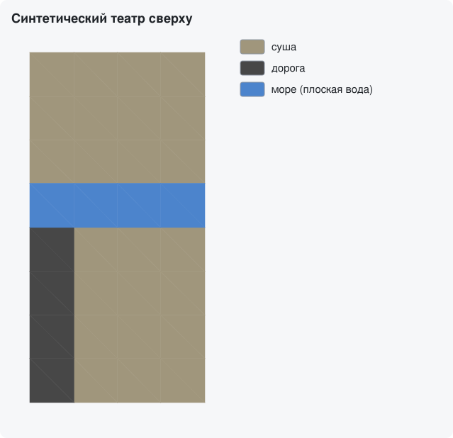
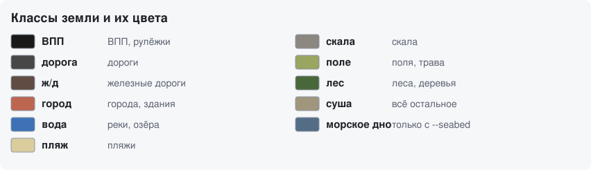

# Файлы уровня {#the-level-files}

Уровень — это 3D-модель земли; театр — это слово DCS World для карты.

`<out>/<name>.glb` и `<name>.json` рядом с ним.

| Часть | Что это |
|---|---|
| `ground:<Level>` | собственные треугольники местности, окрашенные по тому, что игра рисует поверх каждого |
| `water:<Level>` | каждый треугольник, который игра отмечает как находящийся под морем, уложенный плашмя на уровне моря |
| `structure:<Level>` | здания театра как коробки, там, где их ставит игра (ниже) |

Цвета соответствуют классам ниже:

Цвета видны при включённом **Снятом цвете** на панели «Фон / уровень» просмотрщика. Каждый
треугольник земли получает класс того наложения, которым игра его рисует:

| Класс | Цвет | Из наложения игры |
|---|---|---|
| runway | почти чёрный | `Runway` — взлётно-посадочные полосы, рулёжные дорожки и перроны |
| road | тёмно-серый | `Road` |
| rail | коричневый | `Rail` |
| town | кирпично-красный | `Town`, `Building` |
| water | синий | `River`, `Lake` (внутренние воды, нарисованные как земля) |
| beach | песочный | `Beach` |
| rock | серый | `Rock` |
| field | светло-зелёный | `Field`, `Grass` |
| forest | тёмно-зелёный | `Forest`, `Trees` |
| land | хаки | ни одно из этих |
| seabed | сланцево-синий | только с `--seabed` |

Если несколько наложений рисуют один и тот же треугольник, решает порядок таблицы (дорога в лесу —
это дорога). Каждый треугольник наложения — один из треугольников самой земли; это проверено по
каждому классу на опробованных театрах, и каждый совпал, так что классы точные, а не угаданы по
соседним точкам.

**Координаты** — это собственные мировые метры DCS: x — север, y — вверх, z — восток, и оси glTF
те же (X = x, Y = y, Z = z). Телеметрия в метрах DCS — её пишет хук DCS в 3DHeat Watcher — ложится на
уровень с настройками просмотрщика по умолчанию (Y вверх, масштаб 1) без шага размещения.

**Широта и долгота:** каждый театр — это проекция Transverse Mercator со своими константами;
`<name>.json` их содержит, а также углы уровня в широте и долготе и каждый город с его широтой,
долготой и координатами DCS x/z. Если константы театра не опубликованы, их подгоняют под маяки,
которые даёт его собственный `beacons.lua`, в обеих системах координат (среднеквадратичная ошибка в
несколько сантиметров; та же подгонка возвращает опубликованные константы других театров с точностью
до миллиметра). Для театра без констант [`fit`](fit.md) находит их по любой записи, где есть обе
системы, например по сессии Watcher одного полёта.

**Морское дно** не берётся (тепловой карте полётов морское дно не нужно); `--seabed` сохраняет его как
землю. `--no-water` не берёт плоское море.

**Размер.** См. [Построение уровня: Размер](level.md#size).

**Аэродромы.** Каждый `AirfieldsTaxiways/<name>.rn4` содержит рулёжную сеть одного аэродрома, названную
по нему; её точки — это (x, y, z) с двойной точностью в метрах DCS. В `.json` уровня перечислен каждый
аэродром в регионе с его именем (из файла), серединой ящика его точек, самим ящиком и землёй там. На
опробованном театре каждый файл аэродрома прочитался и каждый встал на своё поле (в пределах нескольких
сотен метров от опорной точки аэропорта по съёмке: середины рулёжных дорожек, а не ВПП).

**Здания.** `Scenes/<theatre>.scn5` размещает каждый объект театра (миллионы — деревья, фонари,
заборы, провода, дома). Те, что по имени и размеру являются зданиями (дома, квартиры, сараи, ангары,
заводы, башни, терминалы: доля моделей, сотни тысяч размещений), рисуются коробками: собственный
ограничивающий прямоугольник модели из файла, повёрнутый по её курсу и стоящий там, где его ставит
игра, — от 3 м ниже её начала (опора на склоне) до её верха. Деревья, кусты, фонари, столбы, провода,
заборы, стены, знаки, техника, вагоны, лодки, краны, мачты, опоры и мосты не берутся. Ни форма модели,
ни текстура игры не копируются: коробка на здание, окрашенная по виду (дом, блок, промышленное,
аэродром, башня, прочее). `<name>.json` тоже их перечисляет (`buildings.rows`: x, z, base, height,
half lengths, heading, kind) для гибридного фона просмотрщика, который рисует их в городах игры
вместо наложенных зданий. `--no-buildings` их не берёт.

`<name>.json` также записывает исходный файл, его размер и дату, прочитанные тайлы, число треугольников
по классам и сколько городов театра попадает на землю — проверка проекции, которая должна показать
«N из N».

Уровень — это двоичный glTF с именованными частями, как и любой уровень 3DHeat; страница
просмотрщика [Уровни](https://holdi601.github.io/3DHeat/levels.html) рассказывает, как он их загружает.
