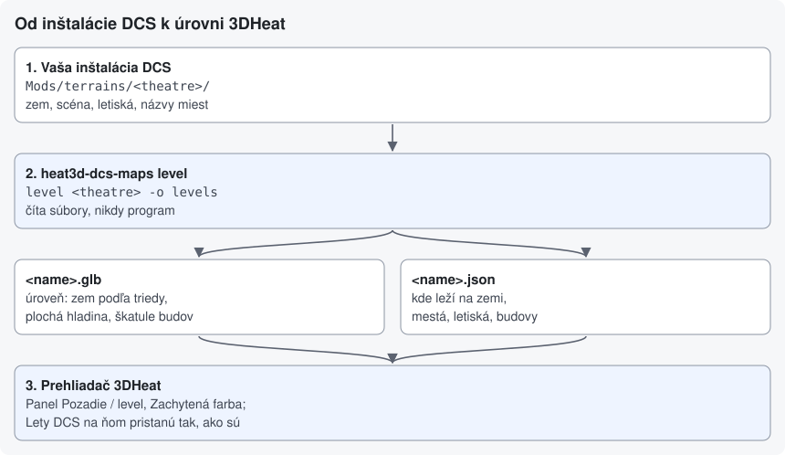

# 3DHeat DCS {#dheat-dcs}

**Čo to je?** Územie (theatre) je v DCS World slovo pre mapu: oblasť sveta, nad ktorou lietate. Tento nástroj premení zem jedného územia, načítanú z **vašej vlastnej inštalácie**, na 3D úroveň – model, nad ktorým môžete lietať – pre prehliadač
[3DHeat](https://github.com/Holdi601/3DHeat) ([dokumentácia](https://holdi601.github.io/3DHeat/)).

**Prečo by som ho použil?** Aby ste videli svoje lety v DCS nad vlastnou mapou hry: jej kopce, pobrežie, letiská, cesty, železnice, mestá a budovy.

**Príklad:** `heat3d-dcs-maps level <theatre> -o levels` ->
`levels/<theatre>.glb` (úroveň) + `levels/<theatre>.json` (kde leží na
zemi, jej mestá a letiská).

Na čo je to užitočné:

- **Lety na vlastnej mape hry.** Pozadie sveta 3DHeat kreslí dnešnú zemu z otvorených dát; toto kreslí územie tak, ako ho kreslí DCS.
- **Žiadny krok umiestňovania.** Úroveň je v metroch sveta DCS, takže telemetria v metroch DCS (háčik DCS nástroja 3DHeat Watcher zapisuje presne to) sa na ňu dostane s predvolenými hodnotami prehliadača.
- **Zemepisná šírka a dĺžka.** Každá úroveň nesie svoju projekciu, svoje rohy a svoje mestá v oboch sústavách.



## Rýchly štart {#quick-start}

Nikdy ste nepracovali s príkazovým riadkom? Najprv si prečítajte [Ako začať](before-you-start.md).
Spustite tieto príkazy v priečinku, do ktorého ste nainštalovali alebo rozbalili nástroj:

```bash
python -m pip install -e .                         # nainštaluje príkaz heat3d-dcs-maps
heat3d-dcs-maps list                               # nainštalované územia a či sa každé dá čítať
heat3d-dcs-maps level <theatre> -o levels          # celé (malé) územie
heat3d-dcs-maps level <theatre> --around <lat> <lon> 12 -o levels --name <name>   # 12 km na každú stranu od bodu
```

Z `list` uvidíte jeden riadok na územie, ktorý končí slovom `readable`.
Potom načítajte `levels/<name>.glb` do panela Pozadie / level prehliadača
([Úrovne](https://holdi601.github.io/3DHeat/levels.html)).

Úrovne, ktoré nástroj zapisuje, sú postavené z dát hry: ostávajú **na vašom počítači**, na zobrazenie, nie na zdieľanie alebo zverejnenie ([Podmienky](terms.md)).

## Stránky {#pages}

| Stránka | Čo obsahuje |
|---|---|
| [Ako začať](before-you-start.md) | Python, terminál, prvé spustenie |
| [Hľadanie území: list](list.md) | kde sa nájde inštalácia, čo vypisuje `list` |
| [Vytvorenie úrovne: level](level.md) | každá možnosť, oblasti, veľkosť, krok za krokom |
| [Súbory úrovne](output.md) | časti `.glb`, triedy zeme a ich farby, `.json`, súradnice |
| [Názvy miest: towns](towns.md) | mestá územia so súradnicami DCS |
| [Projekcie: fit](fit.md) | zistenie projekcie územia zo záznamu |
| [Ako sa čítajú súbory](reading.md) | formáty, čo bolo overené, čo sa nečíta |
| [Podmienky a licencia](terms.md) | licencia Eagle Dynamics a prečo je toto samostatný balík |
| [Referencia príkazov](../cli-reference.md) | každá možnosť, generované z kódu |
| [Údržba týchto dokumentov](maintaining.md) | kontrolný zoznam pri vydaní |

## Súvisiace {#related}

- Prehliadač 3DHeat: [github.com/Holdi601/3DHeat](https://github.com/Holdi601/3DHeat),
  dokumentácia na [holdi601.github.io/3DHeat](https://holdi601.github.io/3DHeat/).
- Telemetria pre tieto úrovne: [3DHeat Watcher](https://holdi601.github.io/3DHeat-Watcher/)
  zaznamenáva lety v DCS; formáty súborov prehliadača vrátane jeho kontajnera jeden súbor na zápas
  sú opísané v [Jeden súbor na zápas (.3dheat)](https://holdi601.github.io/3DHeat/container.html).

## Nástroje 3DHeat {#the-3dheat-tools}

| Nástroj | Čo robí | Kód | Dokumentácia |
|---|---|---|---|
| prehliadač 3DHeat | zobrazuje dáta: heatmapy, analýzu pretekov, prehľad zápasu | [3DHeat](https://github.com/Holdi601/3DHeat) | [dokumentácia](https://holdi601.github.io/3DHeat/) |
| GameFiles | úrovne a trate zo súborov samotnej hry | [3DHeat-GameFiles](https://github.com/Holdi601/3DHeat-GameFiles) | [dokumentácia](https://holdi601.github.io/3DHeat-GameFiles/) |
| GameCapture | telemetria kôl a úrovne zrekonštruované z videa hry | [3DHeat-GameCapture](https://github.com/Holdi601/3DHeat-GameCapture) | [dokumentácia](https://holdi601.github.io/3DHeat-GameCapture/) |
| Unreal Exporter | plugin pre Unreal Editor: úroveň ako jeden `.glb` | [3DHeat-UnrealExporter](https://github.com/Holdi601/3DHeat-UnrealExporter) | [dokumentácia](https://holdi601.github.io/3DHeat-UnrealExporter/) |
| CS2 | dema a mapy Counter-Strike 2 | [3DHeat-CS2](https://github.com/Holdi601/3DHeat-CS2) | [dokumentácia](https://holdi601.github.io/3DHeat-CS2/) |
| Watcher | zaznamenáva, čo hry zverejňujú, kým hráte | [3DHeat-Watcher](https://github.com/Holdi601/3DHeat-Watcher) | [dokumentácia](https://holdi601.github.io/3DHeat-Watcher/) |
| Ext-WarThunder | replaye War Thunder | [3DHeat-Ext-WarThunder](https://github.com/Holdi601/3DHeat-Ext-WarThunder) | [dokumentácia](https://holdi601.github.io/3DHeat-Ext-WarThunder/) |
| Ext-WoT | replaye World of Tanks | [3DHeat-Ext-WoT](https://github.com/Holdi601/3DHeat-Ext-WoT) | [dokumentácia](https://holdi601.github.io/3DHeat-Ext-WoT/) |
| Ext-WoWs | replaye World of Warships | [3DHeat-Ext-WoWs](https://github.com/Holdi601/3DHeat-Ext-WoWs) | [dokumentácia](https://holdi601.github.io/3DHeat-Ext-WoWs/) |
| Ext-Squad | dema zo serverov Squad | [3DHeat-Ext-Squad](https://github.com/Holdi601/3DHeat-Ext-Squad) | [dokumentácia](https://holdi601.github.io/3DHeat-Ext-Squad/) |
| Ext-DCS | mapy DCS World ako 3D úrovne | [3DHeat-Ext-DCS](https://github.com/Holdi601/3DHeat-Ext-DCS) | [dokumentácia](https://holdi601.github.io/3DHeat-Ext-DCS/) |
| Ext-IL2 | mapy IL-2 Sturmovik ako 3D úrovne | [3DHeat-Ext-IL2](https://github.com/Holdi601/3DHeat-Ext-IL2) | [dokumentácia](https://holdi601.github.io/3DHeat-Ext-IL2/) |
