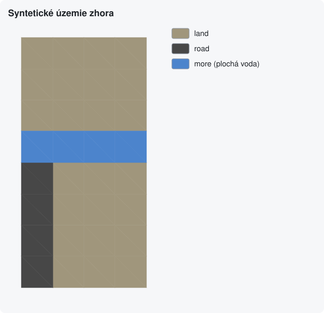
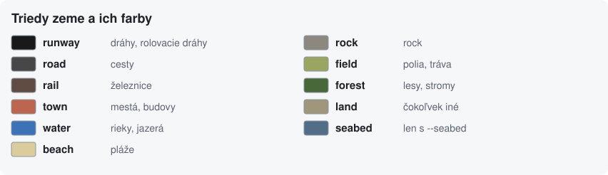

# Súbory úrovne {#the-level-files}

Úroveň je 3D model zeme; územie (theatre) je slovo DCS World pre mapu.

`<out>/<name>.glb` a vedľa neho `<name>.json`.

| Časť | Čo to je |
|---|---|
| `ground:<Level>` | vlastné trojuholníky terénu, zafarbené podľa toho, čo hra nad každým kreslí |
| `water:<Level>` | každý trojuholník, ktorý hra označí ako pod morom, položený naplocho na úroveň mora |
| `structure:<Level>` | budovy územia ako škatule, tam, kde ich hra umiestňuje (nižšie) |

Farby sú triedy uvedené nižšie:

Farby sa zobrazia pri **Zachytená farba** v paneli Pozadie / level prehliadača. Každý trojuholník zeme dostane triedu prekryvu, ktorým ho hra kreslí:

| Trieda | Farba | Z prekryvu hry |
|---|---|---|
| runway | takmer čierna | `Runway` – dráhy, rulžné dráhy a odstavné plochy |
| road | tmavosivá | `Road` |
| rail | hnedá | `Rail` |
| town | tehlovočervená | `Town`, `Building` |
| water | modrá | `River`, `Lake` (vnútrozemská voda, kreslená ako zem) |
| beach | piesková | `Beach` |
| rock | sivá | `Rock` |
| field | svetlozelená | `Field`, `Grass` |
| forest | tmavozelená | `Forest`, `Trees` |
| land | khaki | žiadny z nich |
| seabed | bridlicovomodrá | len s `--seabed` |

Keď viacero prekryvov kreslí ten istý trojuholník, rozhoduje poradie v tabuľke
(cesta cez les je cesta). Každý trojuholník prekryvu je jedným z trojuholníkov samotnej zeme – overené pri každej triede vyskúšaných území, každý sa zhodol – takže triedy sú presné, nie odhadnuté z blízkych bodov.

**Súradnice** sú vlastné svetové metre DCS: x na sever, y nahor, z na východ, a osi glTF sú
rovnaké (X = x, Y = y, Z = z). Telemetria v metroch DCS – háčik DCS nástroja 3DHeat Watcher zapisuje presne to – sa dostane na úroveň s predvolenými hodnotami prehliadača (Y nahor, mierka 1) a bez kroku umiestňovania.

**Zemepisná šírka a dĺžka:** každé územie je projekcia Transverse Mercator so svojimi konštantami; `<name>.json` ich obsahuje, rohy úrovne v zemepisnej šírke a dĺžke a každé mesto s jeho zemepisnou šírkou a dĺžkou aj súradnicami x/z DCS. Kde konštanty územia nie sú zverejnené, prispôsobia sa majákom, ktoré dáva jeho vlastný súbor `beacons.lua` v oboch sústavách (stredná kvadratická chyba niekoľko cm; rovnaké prispôsobenie vráti zverejnené konštanty iných území až na milimeter).
Pre územie bez konštánt nájde [`fit`](fit.md) ich z ľubovoľného záznamu, ktorý obsahuje oboje, napríklad zo session Watchera jedného letu.

**Morské dno** sa vynechá (heatmapa leteckého simulátora ho nepotrebuje); `--seabed` ho ponechá ako zem. `--no-water` vynechá plochú hladinu mora.

**Veľkosť.** Pozri [Vytvorenie úrovne: Veľkosť](level.md#size).

**Letiská.** Každý `AirfieldsTaxiways/<name>.rn4` obsahuje sieť rolovania jedného letiska, pomenovanú podľa neho; jej body sú (x, y, z) ako čísla double v metroch DCS. `.json` úrovne vypisuje každé letisko v oblasti s jeho názvom (názvom zo súboru), stredom škatule jeho bodov, škatuľou a zemou pod ním. Na vyskúšanom území sa prečítal každý súbor letiska, každý sa umiestnil na svoje pole (do niekoľkých stoviek metrov od zameraného referenčného bodu letiska: stred rolovacích dráh, nie dráhy).

**Budovy.** `Scenes/<theatre>.scn5` umiestňuje každý objekt územia
(milióny – stromy, lampy, ploty, drôty, domy). Tie, ktoré sú budovami podľa názvu a veľkosti (domy, byty, prístrešky, hangáre,
továrne, veže, terminály: zlomok modelov, stovky tisíc umiestnení), sa kreslia ako škatule: každá vlastná ohraničujúca škatuľa modelu zo súboru, otočená podľa svojho smeru a stojaca tam, kam ju hra položí, od najviac 3 m pod svojím začiatkom (jej podložie na svahu) po vrchol. Stromy, kry,
svetlá, stĺpy, drôty, ploty, múry, značky, vozidlá, vagóny, lode, žeriavy,
stožiare, pylóny a mosty sa vynechávajú. Netvar modelu ani textúra hry sa nekopíruje: jedna škatuľa na budovu, zafarbená podľa druhu (dom, blok, priemyselná, letisková, veža, iná). `<name>.json` ich tiež vypisuje
(`buildings.rows`: x, z, základňa, výška, polovičné dĺžky, smer, druh) pre hybridné pozadie prehliadača, ktoré ich kreslí v mestách hry namiesto mapovaných budov. `--no-buildings` ich vynechá.

`<name>.json` tiež zaznamenáva zdrojový súbor, jeho veľkosť a dátum, prečítané dlaždice,
počet trojuholníkov na triedu a koľko miest územia leží na zemi – kontrolu projekcie, ktorá by mala ukázať „N z N“.

Úroveň je binárny glTF s pomenovanými časťami, ako každá úroveň 3DHeat; stránka prehliadača
[Úrovne](https://holdi601.github.io/3DHeat/levels.html) hovorí, ako ich načítava.
