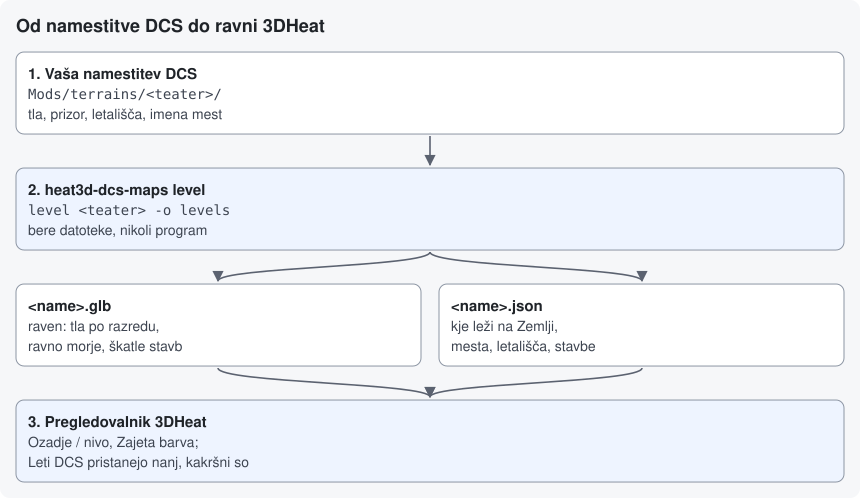

# 3DHeat DCS {#dheat-dcs}

**Kaj je to?** Teater je v DCS World beseda za zemljevid: pokrajina, nad katero letiš.
To orodje pretvori tla enega teatra, prebrana iz **tvoje lastne namestitve**, v 3D raven -
model, nad katerim lahko letiš - za pregledovalnik [3DHeat](https://github.com/Holdi601/3DHeat)
([dokumentacija](https://holdi601.github.io/3DHeat/)).

**Zakaj bi ga uporabil?** Da svoje lete DCS vidiš nad igrinim lastnim zemljevidom: njene hribe,
obalo, letališča, ceste, železnice, mesta in stavbe.

**Primer:** `heat3d-dcs-maps level <teater> -o levels` ->
`levels/<teater>.glb` (raven) + `levels/<teater>.json` (kje leži na Zemlji, njena mesta in
letališča).

Uporabno za:

- **Leti na igrinem lastnem zemljevidu.** Ozadje sveta v 3DHeat danes riše Zemljo iz odprtih
  podatkov; to riše teater tako, kot ga riše DCS.
- **Brez koraka postavljanja.** Raven je v DCS-jevih svetovnih metrih, zato telemetrija v DCS metrih (DCS-ova skripta v 3DHeat Watcherju zapisuje prav to) pristane nanjo s privzetimi nastavitvami
  pregledovalnika.
- **Zemljepisna širina in dolžina.** Vsaka raven nosi svojo projekcijo, svoje vogale in svoja mesta
  v obeh koordinatnih sistemih.



## Hitri začetek {#quick-start}

Še nisi vajen ukazne vrstice? Najprej preberi [Preden začneš](before-you-start.md).
Zaženi to v mapi, v katero si kloniral ali razpakiral datoteke:

```bash
python -m pip install -e .                         # namesti ukaz heat3d-dcs-maps
heat3d-dcs-maps list                               # nameščeni teatri in ali je vsak mogoče prebrati
heat3d-dcs-maps level <teater> -o levels          # cel (majhen) teater
heat3d-dcs-maps level <teater> --around <lat> <lon> 12 -o levels --name <ime>   # 12 km na vse strani od točke
```

Iz `list` bi moral videti eno vrstico na teater, ki se konča z `readable`.
Nato naloži `levels/<ime>.glb` na plošči Ozadje / nivo pregledovalnika
([Ravni](https://holdi601.github.io/3DHeat/levels.html)).

Ravni, ki jih zapiše, so zgrajene iz igrinih podatkov in ostanejo **na tvojem računalniku**, za
ogled, ne za deljenje ali objavo ([Pogoji](terms.md)).

Vsak bralnik igre je samostojen majhen projekt z lastno licenčno datoteko, lastnimi izdajami in lastnim sledilnikom težav, zato ga je mogoče namestiti, posodobiti, vzdrževati - ali na zahtevo imetnika pravic umakniti - samostojno, ne da bi to vplivalo na pregledovalnik ali druga orodja.

## Strani {#pages}

| Stran | Kaj obravnava |
|---|---|
| [Preden začneš](before-you-start.md) | Python, terminal, prvi zagon |
| [Iskanje teatrov: list](list.md) | kje je najdena namestitev, kaj izpiše `list` |
| [Gradnja ravni: level](level.md) | vsaka možnost, območja, velikost, korak za korakom |
| [Datoteke ravni](output.md) | deli `.glb`, razredi tal in njihove barve, `.json`, koordinate |
| [Imena krajev: towns](towns.md) | mesta teatra z DCS koordinatami |
| [Projekcije: fit](fit.md) | iskanje projekcije teatra iz posnetka |
| [Kako se datoteke berejo](reading.md) | formati, kaj je bilo preverjeno, kaj ni prebrano |
| [Pogoji in licenca](terms.md) | kaj se bere, kaj ni priloženo, licenca |
| [Priročnik ukazov](../cli-reference.md) | vsaka možnost, ustvarjena iz kode |
| [Vzdrževanje teh strani](maintaining.md) | kontrolni seznam ob izdaji |

## Povezano {#related}

- Pregledovalnik 3DHeat: [github.com/Holdi601/3DHeat](https://github.com/Holdi601/3DHeat),
  dokumentacija na [holdi601.github.io/3DHeat](https://holdi601.github.io/3DHeat/).
- Telemetrija za te ravni: [3DHeat Watcher](https://holdi601.github.io/3DHeat-Watcher/)
  zapisuje lete DCS; formati datotek pregledovalnika, vključno z vsebnikom ene datoteke na
  let, so opisani na [Ena datoteka na tekmo (.3dheat)](https://holdi601.github.io/3DHeat/container.html).

## Orodja 3DHeat {#the-3dheat-tools}

| Orodje | Kaj počne | Koda | Dokumentacija |
|---|---|---|---|
| 3DHeat pregledovalnik | prikazuje podatke: toplotne zemljevide, analizo dirk, pregled tekme | [3DHeat](https://github.com/Holdi601/3DHeat) | [dokumentacija](https://holdi601.github.io/3DHeat/) |
| GameFiles | ravni in proge iz datotek same igre | [3DHeat-GameFiles](https://github.com/Holdi601/3DHeat-GameFiles) | [dokumentacija](https://holdi601.github.io/3DHeat-GameFiles/) |
| GameCapture | telemetrija krogov in ravni, obnovljene iz videoposnetka igre | [3DHeat-GameCapture](https://github.com/Holdi601/3DHeat-GameCapture) | [dokumentacija](https://holdi601.github.io/3DHeat-GameCapture/) |
| Unreal Exporter | vtičnik za urejevalnik Unreal: raven kot ena datoteka `.glb` | [3DHeat-UnrealExporter](https://github.com/Holdi601/3DHeat-UnrealExporter) | [dokumentacija](https://holdi601.github.io/3DHeat-UnrealExporter/) |
| CS2 | posnetki in zemljevidi igre Counter-Strike 2 | [3DHeat-CS2](https://github.com/Holdi601/3DHeat-CS2) | [dokumentacija](https://holdi601.github.io/3DHeat-CS2/) |
| Watcher | zapisuje, kar igre objavijo med igranjem | [3DHeat-Watcher](https://github.com/Holdi601/3DHeat-Watcher) | [dokumentacija](https://holdi601.github.io/3DHeat-Watcher/) |
| Ext-WarThunder | posnetki igre War Thunder | [3DHeat-Ext-WarThunder](https://github.com/Holdi601/3DHeat-Ext-WarThunder) | [dokumentacija](https://holdi601.github.io/3DHeat-Ext-WarThunder/) |
| Ext-WoT | posnetki igre World of Tanks | [3DHeat-Ext-WoT](https://github.com/Holdi601/3DHeat-Ext-WoT) | [dokumentacija](https://holdi601.github.io/3DHeat-Ext-WoT/) |
| Ext-WoWs | posnetki igre World of Warships | [3DHeat-Ext-WoWs](https://github.com/Holdi601/3DHeat-Ext-WoWs) | [dokumentacija](https://holdi601.github.io/3DHeat-Ext-WoWs/) |
| Ext-Squad | posnetki strežnikov Squad | [3DHeat-Ext-Squad](https://github.com/Holdi601/3DHeat-Ext-Squad) | [dokumentacija](https://holdi601.github.io/3DHeat-Ext-Squad/) |
| Ext-DCS | zemljevidi igre DCS World kot 3D ravni | [3DHeat-Ext-DCS](https://github.com/Holdi601/3DHeat-Ext-DCS) | [dokumentacija](https://holdi601.github.io/3DHeat-Ext-DCS/) |
| Ext-IL2 | zemljevidi igre IL-2 Sturmovik kot 3D ravni | [3DHeat-Ext-IL2](https://github.com/Holdi601/3DHeat-Ext-IL2) | [dokumentacija](https://holdi601.github.io/3DHeat-Ext-IL2/) |
