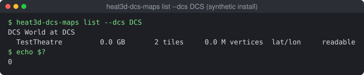

# Iskanje teatrov: `list` {#finding-theatres-list}

```text
heat3d-dcs-maps list [--dcs MAPA]
```

Še nisi vajen ukazne vrstice? Najprej preberi [Preden začneš](before-you-start.md).

1. Namesti enkrat: `git clone https://github.com/Holdi601/3DHeat-Ext-DCS`, odpri terminal v tej
   mapi in zaženi `python -m pip install -e .` (Python 3.10 ali novejši; prinese numpy in za
   `fit` na `.parquet` še pyarrow).
2. Zaženi `heat3d-dcs-maps list`.
3. Vsak nameščeni teater izpiše eno vrstico: ime mape (ime, ki ga sprejmejo drugi ukazi), velikost
   njegove datoteke tal, njegove ploščice in točke, ali je njegova projekcija zemljepisne širine in
   dolžine znana in ali se da prebrati. Na koncu vsake vrstice bi moral videti `readable`.



Slika je zagon na namestitvi, ki jo ustvarijo testi (`tests/synth.py`), ne na igri.

## Kje je najdena namestitev {#where-the-install-is-found}

`--dcs <mapa>` (mapa, ki vsebuje `Mods\terrains`) ali spremenljivka okolja `DCS_PATH`; sicer se
pregledajo register, knjižnice Steam in običajne mape.

| Možnost | Naredi |
|---|---|
| `--dcs MAPA` | mapa DCS World, tista, ki vsebuje `Mods\terrains` |

Izhodna koda: 0 opravljeno, 2 namestitev ali teater ni najden.
