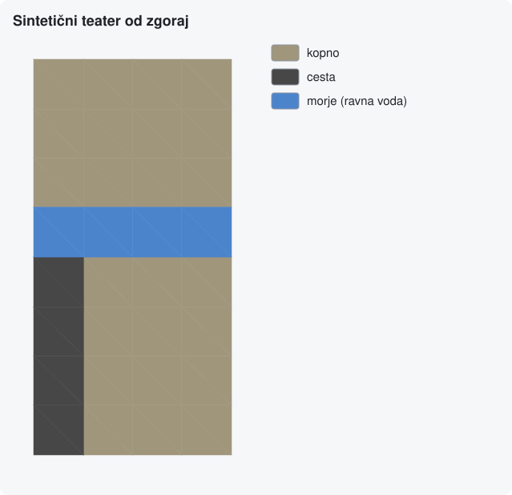
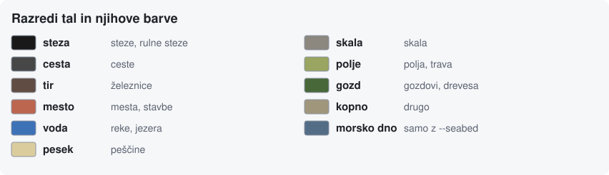

# Datoteke ravni {#the-level-files}

Raven je 3D model tal; teater je v DCS World beseda za zemljevid.

`<mapa>/<ime>.glb` in poleg njega `<ime>.json`.

| Del | Kaj je |
|---|---|
| `ground:<Raven>` | lastni trikotniki terena, obarvani glede na to, kar igra riše čez vsako točko |
| `water:<Raven>` | vsak trikotnik, ki ga igra označi pod morjem, položen ravno na morsko gladino |
| `structure:<Raven>` | stavbe teatra kot škatle, kjer jih igra postavi (spodaj) |

Barve so razredi spodaj:

Barve se pokažejo z **Zajeta barva** na plošči Ozadje / nivo pregledovalnika. Vsak trikotnik tal
dobi razred prekrivne plasti, s katero ga igra riše:

| Razred | Barva | Iz prekrivne plasti igre |
|---|---|---|
| runway | skoraj črna | `Runway` - vzletno-pristajalne steze, zunanje steze in ploščadi |
| road | temno siva | `Road` |
| rail | rjava | `Rail` |
| town | opečno rdeča | `Town`, `Building` |
| water | modra | `River`, `Lake` (celinska voda, narisana kot tla) |
| beach | peščena | `Beach` |
| rock | siva | `Rock` |
| field | svetlo zelena | `Field`, `Grass` |
| forest | temno zelena | `Forest`, `Trees` |
| land | kaki | nič od tega |
| seabed | skriljasto modra | samo z `--seabed` |

Kadar več prekrivnih plasti riše isti trikotnik, odloča vrstni red v tabeli (cesta skozi
gozd je cesta). Vsak trikotnik prekrivne plasti je eden od trikotnikov samih tal - preverjeno pri
vsakem razredu teatrov, ki so bili preizkušeni, vsak se je ujemal - zato so razredi natančni in
niso uganjeni iz bližnjih točk.

**Koordinate** so svetovni metri DCS: x proti severu, y navzgor, z proti vzhodu, in osi glTF so
iste (X = x, Y = y, Z = z). Telemetrija v metrih DCS - DCS-ova skripta v 3DHeat Watcherju zapisuje
prav to - pristane na ravni s privzetimi nastavitvami pregledovalnika (Y navzgor, merilo 1) brez
koraka postavljanja.

**Zemljepisna širina in dolžina:** vsak teater je projekcija Transverse Mercator s svojimi
konstantami; `<ime>.json` jih nosi, vogale ravni v zemljepisni širini in dolžini ter vsako mesto
z obema koordinatama, zemljepisno širino/dolžino in DCS x/z. Kjer konstante teatra niso objavljene,
so prilagojene svetilnikom, ki jih da njegova lastna datoteka `beacons.lua` v obeh koordinatnih
sistemih (koren povprečne kvadratne napake nekaj cm; isto prilagajanje vrne objavljene konstante
drugih teatrov na milimeter natančno). Za teater brez konstant [`fit`](fit.md) poišče konstante iz
vsakega posnetka, ki vsebuje oboje, na primer seje Watcherja enega leta.

**Morsko dno** je izpuščeno (zemljevid toplote za letalski simulator ne potrebuje morskega dna);
`--seabed` ga ohrani kot tla. `--no-water` izpusti ravno morje.

**Velikost.** Glej [Gradnja ravni: Velikost](level.md#size).

**Letališča.** Vsaka datoteka `AirfieldsTaxiways/<ime>.rn4` vsebuje omrežje rulanja enega
letališča, poimenovano po njem; njene točke so (x, y, z) dvojne natančnosti v metrih DCS. Datoteka
`.json` ravni navaja vsako letališče znotraj območja z njegovim imenom (imenom datoteke), sredino
škatle njegovih točk, škatlo in tla tam. Na preizkušenem teatru je bila prebrana vsaka datoteka
letališča, vsaka je bila postavljena na svoje polje (znotraj nekaj sto metrov od izmerjene referenčne
točke letališča: sredine rularnih stez, ne steze).

**Stavbe.** `Scenes/<teater>.scn5` postavi vsak objekt teatra (milijone - drevesa, svetilke,
ograje, žice, hiše). Tiste, ki so stavbe po imenu in velikosti (hiše, stanovanja, lope, hangarji,
tovarne, stolpi, terminali: nekaj modelov, na stotine tisoč postavitev), so narisane kot škatle: vsak
model ima svojo lastno omejitveno škatlo iz datoteke, obrnjeno v svojo smer in postavljeno, kjer jo
igra postavi, od največ 3 m pod njeno točko (njeno podlago na pobočju) do vrha. Drevesa, grmovje,
luči, drogovi, žice, ograje, zidovi, znaki, vozila, vagoni, čolni, dvigala, jambori, stebri in mostovi
so izpuščeni. Ni kopirana nobena oblika modela ali tekstura igre: ena škatla na stavbo, obarvana po
vrsti (hiša, blok, industrijska, letališka, stolp, druga). `<ime>.json` jih prav tako navaja
(`buildings.rows`: x, z, osnova, višina, polovice dolžin, smer, vrsta) za hibridno ozadje
pregledovalnika, ki jih riše v mestih igre namesto preslikanih stavb. `--no-buildings` jih izpusti.

`<ime>.json` beleži tudi izvorno datoteko, njeno velikost in datum, prebrane ploščice, število
trikotnikov na razred in koliko mest teatra pristane na tleh - preverjanje projekcije, ki bi moralo
pisati »N od N«.

Raven je binarni glTF z imenovanimi deli, kot je vsaka raven 3DHeat; stran pregledovalnika
[Ravni](https://holdi601.github.io/3DHeat/levels.html) pove, kako jih naloži.
