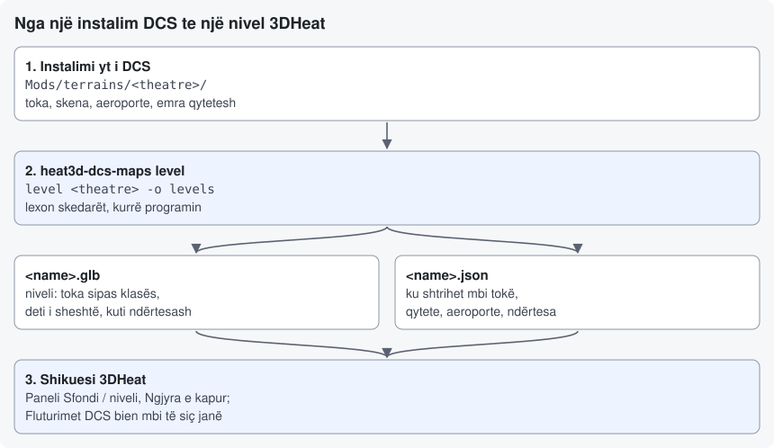

# 3DHeat DCS {#dheat-dcs}

**Çfarë është?** Teatër është fjala e DCS World për një hartë: një rajon të
botës mbi të cilin fluturon. Ky mjet e kthen tokën e një teatri, të lexuar nga
**instalimi yt**, në një nivel 3D - një model mbi të cilin mund të fluturosh - për shikuesin
[3DHeat](https://github.com/Holdi601/3DHeat)
([dokumentacioni](https://holdi601.github.io/3DHeat/)).

**Pse ta përdor?** Për t'i parë fluturimet e tua në DCS mbi hartën e vetë lojës: kodrat,
bregdetin, aeroportet, rrugët, hekurudhat, qytetet dhe ndërtesat e saj.

**Shembull:** `heat3d-dcs-maps level <theatre> -o levels` ->
`levels/<theatre>.glb` (niveli) + `levels/<theatre>.json` (ku shtrihet mbi
tokë, qytetet dhe aeroportet e tij).

Për çfarë është e dobishme:

- **Fluturime mbi hartën e vetë lojës.** Sfondi i botës i 3DHeat vizaton sot
  tokën nga të dhëna të hapura; ky vizaton teatrin ashtu si e vizaton DCS.
- **Pa hap vendosjeje.** Niveli është në metrat e vetë botës së DCS, kështu që telemetria
  në metra DCS (grepi DCS i 3DHeat Watcher shkruan pikërisht këtë) bie mbi të
  me parazgjedhjet e shikuesit.
- **Gjerësia dhe gjatësia gjeografike.** Çdo nivel mban projeksionin e vet, qoshet e tij
  dhe qytetet e tij në të dyja kornizat.



## Fillimi i shpejtë {#quick-start}

Je i ri me rreshtin e komandave? Lexo së pari [Para se të fillosh](before-you-start.md).
Ekzekuto këto në dosjen që klonove ose shpaketove:

```bash
python -m pip install -e .                         # installs the heat3d-dcs-maps command
heat3d-dcs-maps list                               # the theatres installed, and whether each can be read
heat3d-dcs-maps level <theatre> -o levels          # a whole (small) theatre
heat3d-dcs-maps level <theatre> --around <lat> <lon> 12 -o levels --name <name>   # 12 km either side of a point
```

Nga `list` duhet të shohësh një rresht për çdo teatër, që mbaron me `readable`.
Pastaj ngarko `levels/<name>.glb` te paneli Sfondi / niveli i shikuesit
([Levels](https://holdi601.github.io/3DHeat/levels.html)).

Nivelet që shkruan ndërtohen nga të dhënat e lojës: ato mbeten **në kompjuterin
tënd**, për t'u parë, jo për t'u ndarë ose botuar ([Kushtet](terms.md)).

Çdo lexues loje është një projekt i vogël më vete, me skedarin e vet të licencës, versionet e veta dhe gjurmuesin e vet të problemeve, kështu që mund të instalohet, përditësohet, mirëmbahet - ose tërhiqet me kërkesë të një mbajtësi të drejtash - më vete, pa prekur shikuesin ose mjetet e tjera.

## Faqet {#pages}

| Faqja | Çfarë mbulon |
|---|---|
| [Para se të fillosh](before-you-start.md) | Python, një terminal, një ekzekutim i parë |
| [Gjetja e teatrove: list](list.md) | ku gjendet instalimi, çfarë shtyp `list` |
| [Ndërtimi i një niveli: level](level.md) | çdo opsion, rajonet, madhësia, hap pas hapi |
| [Skedarët e nivelit](output.md) | pjesët e `.glb`, klasat e tokës dhe ngjyrat e tyre, `.json`, koordinatat |
| [Emrat e vendeve: towns](towns.md) | qytetet e një teatri me koordinata DCS |
| [Projeksionet: fit](fit.md) | gjetja e projeksionit të një teatri nga një regjistrim |
| [Si lexohen skedarët](reading.md) | formatet, çfarë u verifikua, çfarë nuk lexohet |
| [Kushtet dhe licenca](terms.md) | çfarë lexohet, çfarë nuk shpërndahet, licenca |
| [Referenca e komandave](../cli-reference.md) | çdo opsion, e gjeneruar nga kodi |
| [Mirëmbajtja e këtyre dokumenteve](maintaining.md) | lista e kontrollit të botimit |

## Të lidhura {#related}

- Shikuesi 3DHeat: [github.com/Holdi601/3DHeat](https://github.com/Holdi601/3DHeat),
  dokumentacioni te [holdi601.github.io/3DHeat](https://holdi601.github.io/3DHeat/).
- Telemetria për këto nivele: [3DHeat Watcher](https://holdi601.github.io/3DHeat-Watcher/)
  regjistron fluturimet në DCS; formatet e skedarëve të shikuesit, përfshirë kontejnerin e tij
  një-skedar-për-ndeshje, përshkruhen te
  [One file a match (.3dheat)](https://holdi601.github.io/3DHeat/container.html).

## Mjetet 3DHeat {#the-3dheat-tools}

| Mjeti | Çfarë bën | Kodi | Dokumentet |
|---|---|---|---|
| Shikuesi 3DHeat | shfaq të dhënat: harta nxehtësie, analizë gare, rishikim ndeshjesh | [3DHeat](https://github.com/Holdi601/3DHeat) | [dokumentet](https://holdi601.github.io/3DHeat/) |
| GameFiles | nivele dhe pista nga skedarët e vetë lojës | [3DHeat-GameFiles](https://github.com/Holdi601/3DHeat-GameFiles) | [dokumentet](https://holdi601.github.io/3DHeat-GameFiles/) |
| GameCapture | telemetri xhirimesh, dhe nivele të rindërtuara nga video loje | [3DHeat-GameCapture](https://github.com/Holdi601/3DHeat-GameCapture) | [dokumentet](https://holdi601.github.io/3DHeat-GameCapture/) |
| Unreal Exporter | një shtojcë e Unreal Editor: një nivel si një `.glb` | [3DHeat-UnrealExporter](https://github.com/Holdi601/3DHeat-UnrealExporter) | [dokumentet](https://holdi601.github.io/3DHeat-UnrealExporter/) |
| CS2 | demo dhe harta të Counter-Strike 2 | [3DHeat-CS2](https://github.com/Holdi601/3DHeat-CS2) | [dokumentet](https://holdi601.github.io/3DHeat-CS2/) |
| Watcher | regjistron çfarë botojnë lojërat ndërsa luaj | [3DHeat-Watcher](https://github.com/Holdi601/3DHeat-Watcher) | [dokumentet](https://holdi601.github.io/3DHeat-Watcher/) |
| Ext-WarThunder | riluajtje të War Thunder | [3DHeat-Ext-WarThunder](https://github.com/Holdi601/3DHeat-Ext-WarThunder) | [dokumentet](https://holdi601.github.io/3DHeat-Ext-WarThunder/) |
| Ext-WoT | riluajtje të World of Tanks | [3DHeat-Ext-WoT](https://github.com/Holdi601/3DHeat-Ext-WoT) | [dokumentet](https://holdi601.github.io/3DHeat-Ext-WoT/) |
| Ext-WoWs | riluajtje të World of Warships | [3DHeat-Ext-WoWs](https://github.com/Holdi601/3DHeat-Ext-WoWs) | [dokumentet](https://holdi601.github.io/3DHeat-Ext-WoWs/) |
| Ext-Squad | demo serveri të Squad | [3DHeat-Ext-Squad](https://github.com/Holdi601/3DHeat-Ext-Squad) | [dokumentet](https://holdi601.github.io/3DHeat-Ext-Squad/) |
| Ext-DCS | harta të DCS World si nivele 3D | [3DHeat-Ext-DCS](https://github.com/Holdi601/3DHeat-Ext-DCS) | [dokumentet](https://holdi601.github.io/3DHeat-Ext-DCS/) |
| Ext-IL2 | harta të IL-2 Sturmovik si nivele 3D | [3DHeat-Ext-IL2](https://github.com/Holdi601/3DHeat-Ext-IL2) | [dokumentet](https://holdi601.github.io/3DHeat-Ext-IL2/) |
