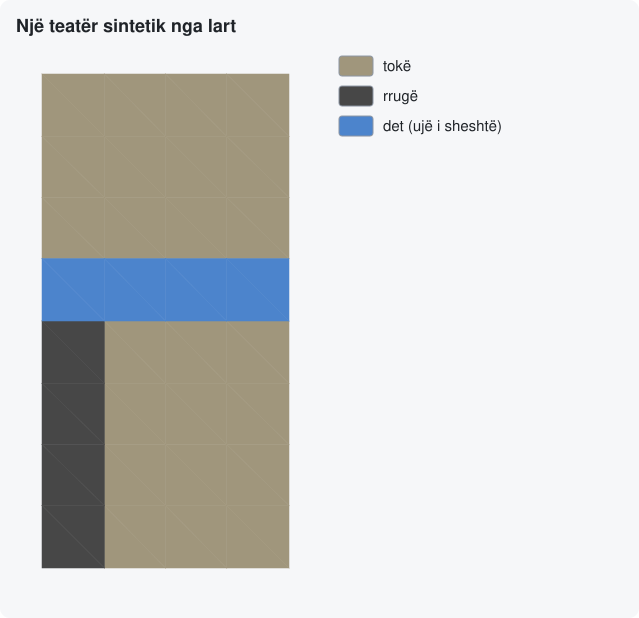
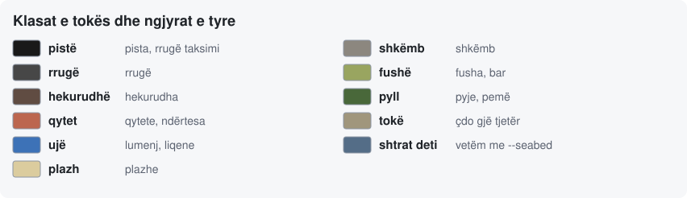

# Skedarët e nivelit {#the-level-files}

Një nivel është një model 3D i tokës; teatër është fjala e DCS World për një hartë.

`<out>/<name>.glb` dhe `<name>.json` pranë tij.

| Pjesa | Çfarë është |
|---|---|
| `ground:<Level>` | trekëndëshat e vetë terrenit, të ngjyrosur sipas asaj që loja vizaton mbi secilin |
| `water:<Level>` | çdo trekëndësh që loja e shënon si nën det, i shtrirë në nivelin e detit |
| `structure:<Level>` | ndërtesat e teatrit si kuti, aty ku i vendos loja (më poshtë) |

Ngjyrat janë klasat më poshtë:

Ngjyrat shfaqen me **Ngjyra e kapur** në panelin Sfondi / niveli të shikuesit. Çdo
trekëndësh toke merr klasën e mbivendosjes me të cilën e vizaton loja:

| Klasa | Ngjyra | Nga mbivendosja e lojës |
|---|---|---|
| runway | pothuaj e zezë | `Runway` - pista, rrugët e taksimit dhe platformat |
| road | gri e errët | `Road` |
| rail | kafe | `Rail` |
| town | e kuqe tulle | `Town`, `Building` |
| water | blu | `River`, `Lake` (ujë i brendshëm, vizatuar si tokë) |
| beach | ranore | `Beach` |
| rock | gri | `Rock` |
| field | jeshile e çelët | `Field`, `Grass` |
| forest | jeshile e errët | `Forest`, `Trees` |
| land | kaki | asnjë nga këto |
| seabed | blu çative | vetëm me `--seabed` |

Kur disa mbivendosje vizatojnë të njëjtin trekëndësh, vendos rendi i tabelës
(një rrugë nëpër pyll është rrugë). Çdo trekëndësh i mbivendosjes është një nga ata të
tokës - kontrolluar në çdo klasë të teatrove të provuar, secili përputhet - kështu që
klasat janë të sakta, jo të hamendësuara nga pikat aty pranë.

**Koordinatat** janë metrat e vetë botës së DCS: x veri, y lart, z lindje, dhe
boshtet e glTF janë të njëjta (X = x, Y = y, Z = z). Telemetria në metra DCS - grepi DCS i
3DHeat Watcher shkruan pikërisht këtë - bie mbi nivel me parazgjedhjet e
shikuesit (Y lart, shkalla 1) dhe pa hap vendosjeje.

**Gjerësia dhe gjatësia gjeografike:** çdo teatër është një projeksion Transverse Mercator
me konstantet e veta; `<name>.json` i mban ato, qoshet e nivelit në
gjerësi dhe gjatësi gjeografike, dhe çdo qytet si me gjerësi/gjatësinë e tij gjeografike ashtu edhe me
x/z të tij DCS. Aty ku konstantet e një teatri nuk janë botuar, ato përshtaten
me fenerët që jep `beacons.lua` i tij në të dyja kornizat (disa cm gabim mesatar
katror; e njëjta përshtatje i jep prapë konstantet e botuara të teatrove të tjerë deri në
milimetër).
Për një teatër pa konstante, [`fit`](fit.md) i gjen nga çdo
regjistrim që i mban të dyja, si një seancë Watcher e një fluturimi.

**Shtrati i detit** lihet jashtë (një hartë nxehtësie për simulator fluturimi nuk ka nevojë për
shtratin e detit); `--seabed` e mban si tokë. `--no-water` lë jashtë
detin e sheshtë.

**Madhësia.** Shih [Ndërtimi i një niveli: Madhësia](level.md#size).

**Aeroportet.** Çdo `AirfieldsTaxiways/<name>.rn4` mban rrjetin e taksimit të një
aeroporti, të emërtuar sipas tij; pikat e tij janë double (x, y, z) në metra DCS. `.json` i
nivelit liston çdo aeroport brenda rajonit me emrin e tij (atë të skedarit), mesin e
kutisë së pikave të tij, kutinë, dhe tokën aty. Në teatrin e provuar, çdo skedar aeroporti u lexua, secili i vendosur mbi fushën e vet
(brenda disa qindra metrash nga pika e referencës së matur të aeroportit: mesi i
rrugëve të taksimit, jo i pistës).

**Ndërtesat.** `Scenes/<theatre>.scn5` vendos çdo objekt të teatrit
(miliona prej tyre - pemë, llamba, rrethime, tela, shtëpi). Ato
që janë ndërtesa sipas emrit dhe madhësisë (shtëpi, apartamente, depo, hangarë,
fabrika, kulla, terminale: një pjesë e modeleve, qindra mijëra vendosje)
vizatohen si kuti: kutia kufizuese e vetë çdo modeli nga skedari,
e rrotulluar sipas drejtimit të saj dhe e vendosur aty ku e vë loja, nga deri
3 m nën origjinën e saj (themeli i saj mbi një shpat) deri në majë. Pemët, shkurret,
dritat, shtyllat, telat, rrethimet, muret, shenjat, automjetet, vagonët, varkat, vinçat,
direkët, pilonët dhe urat lihen jashtë. Asnjë formë ose teksturë modeli e
lojës nuk kopjohet: një kuti për ndërtesë, e ngjyrosur sipas llojit (shtëpi, bllok,
industriale, aeroport, kullë, tjetër). `<name>.json` i liston edhe ato
(`buildings.rows`: x, z, bazë, lartësi, gjysmë-gjatësi, drejtim, lloj) për
sfondin hibrid të shikuesit, që i vizaton në qytetet e lojës në vend të
ndërtesave të hartës. `--no-buildings` i lë jashtë.

`<name>.json` regjistron edhe skedarin burim, madhësinë dhe datën e tij, pllakat e
lexuara, numrin e trekëndëshave për klasë, dhe sa nga qytetet e teatrit bien
mbi tokë - një kontroll i projeksionit që duhet të lexohet "N of N".

Niveli është një glTF binar me pjesë të emërtuara, si çdo nivel 3DHeat; faqja
[Levels](https://holdi601.github.io/3DHeat/levels.html) e shikuesit thotë si i ngarkon.
