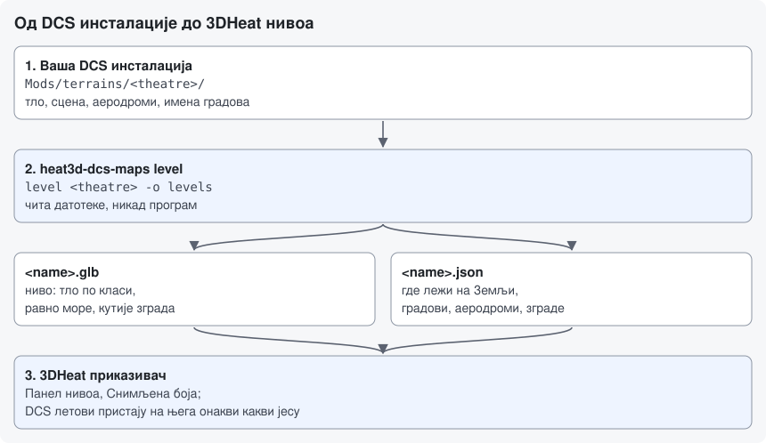

# 3DHeat DCS {#dheat-dcs}

**Шта је то?** Театар је назив DCS World-а за мапу: регион света преко којег летите. Овај алат претвара тло једног театра, очитано из **ваше сопствене инсталације**, у 3D ниво - модел преко којег можете да летите - за
[3DHeat](https://github.com/Holdi601/3DHeat) приказивач
([документација](https://holdi601.github.io/3DHeat/)).

**Зашто бих га користио?** Да видите своје DCS летове над мапом игре: брда, обалу, аеродроме, путеве, пруге, градове и зграде.

**Пример:** `heat3d-dcs-maps level <theatre> -o levels` ->
`levels/<theatre>.glb` (ниво) + `levels/<theatre>.json` (где лежи на
Земљи, њени градови и аеродроми).

Чему служи:

- **Летови над мапом игре.** Позадина 3DHeat света данас црта
  данашњу Земљу из отворених података; ово црта театар онако како га DCS црта.
- **Нема корака постављања.** Ниво је у DCS-овим светским метрима, па телеметрија
  у DCS метрима (DCS кука из 3DHeat Watcher-а управо то пише) на њега
  пада са подразумеваним подешавањима приказивача.
- **Географска ширина и дужина.** Сваки ниво носи своју пројекцију, своје углове
  и своје градове у оба система.



## Брзи почетак {#quick-start}

Први пут у командној линији? Прво прочитајте [Пре почетка](before-you-start.md).
Покрените ово у фасцикли у коју сте клонирали или распаковали алат:

```bash
python -m pip install -e .                         # инсталира команду heat3d-dcs-maps
heat3d-dcs-maps list                               # инсталирани театри и може ли се сваки прочитати
heat3d-dcs-maps level <theatre> -o levels          # цео (мали) театар
heat3d-dcs-maps level <theatre> --around <lat> <lon> 12 -o levels --name <name>   # 12 km с обе стране тачке
```

Требало би да видите по један ред за сваки театар из `list`, а на крају `readable`.
Затим учитајте `levels/<name>.glb` на панел Позадина / ниво приказивача
([Нивои](https://holdi601.github.io/3DHeat/levels.html)).

Нивои које алат пише састављени су од података игре: остају **на вашем
рачунару**, за гледање, не за дељење или објављивање ([Услови](terms.md)).

Сваки читач игре је засебан мали пројекат са сопственом датотеком лиценце, сопственим издањима и сопственим системом пријава, па се може инсталирати, ажурирати, одржавати - или повући на захтев носиоца права - засебно, без утицаја на прегледач и остале алате.

## Странице {#pages}

| Страница | Шта обухвата |
|---|---|
| [Пре почетка](before-you-start.md) | Python, терминал, прво покретање |
| [Налажење театара: list](list.md) | где се инсталација налази, шта `list` исписује |
| [Прављење нивоа: level](level.md) | свака опција, региони, величина, корак по корак |
| [Датотеке нивоа](output.md) | `.glb` делови, класе тла и њихове боје, `.json`, координате |
| [Имена места: towns](towns.md) | градови театра с DCS координатама |
| [Пројекције: fit](fit.md) | налажење пројекције театра из снимка |
| [Како се датотеке читају](reading.md) | формати, шта је проверено, шта се не чита |
| [Услови и лиценца](terms.md) | шта се чита, шта се не испоручује, лиценца |
| [Референца команди](../cli-reference.md) | свака опција, генерисано из кода |
| [Одржавање ове документације](maintaining.md) | контролна листа за издање |

## Повезано {#related}

- 3DHeat приказивач: [github.com/Holdi601/3DHeat](https://github.com/Holdi601/3DHeat),
  документација на [holdi601.github.io/3DHeat](https://holdi601.github.io/3DHeat/).
- Телеметрија за ове нивое: [3DHeat Watcher](https://holdi601.github.io/3DHeat-Watcher/)
  бележи DCS летове; формати датотека приказивача, укључујући његов
  контејнер једног меча у једној датотеци, описани су у
  [Једна датотека по мечу (.3dheat)](https://holdi601.github.io/3DHeat/container.html).

## Алати 3DHeat-а {#the-3dheat-tools}

| Алат | Шта ради | Код | Документација |
|---|---|---|---|
| 3DHeat приказивач | приказује податке: топлотне мапе, анализу трке, преглед мечева | [3DHeat](https://github.com/Holdi601/3DHeat) | [документација](https://holdi601.github.io/3DHeat/) |
| GameFiles | нивои и стазе из сопствених датотека игре | [3DHeat-GameFiles](https://github.com/Holdi601/3DHeat-GameFiles) | [документација](https://holdi601.github.io/3DHeat-GameFiles/) |
| GameCapture | телеметрија кругова, и нивои реконструисани из снимка игре | [3DHeat-GameCapture](https://github.com/Holdi601/3DHeat-GameCapture) | [документација](https://holdi601.github.io/3DHeat-GameCapture/) |
| Unreal Exporter | додатак за Unreal Editor: ниво као један `.glb` | [3DHeat-UnrealExporter](https://github.com/Holdi601/3DHeat-UnrealExporter) | [документација](https://holdi601.github.io/3DHeat-UnrealExporter/) |
| CS2 | Counter-Strike 2 демои и мапе | [3DHeat-CS2](https://github.com/Holdi601/3DHeat-CS2) | [документација](https://holdi601.github.io/3DHeat-CS2/) |
| Watcher | бележи оно што игре објављују док играте | [3DHeat-Watcher](https://github.com/Holdi601/3DHeat-Watcher) | [документација](https://holdi601.github.io/3DHeat-Watcher/) |
| Ext-WarThunder | War Thunder репризе | [3DHeat-Ext-WarThunder](https://github.com/Holdi601/3DHeat-Ext-WarThunder) | [документација](https://holdi601.github.io/3DHeat-Ext-WarThunder/) |
| Ext-WoT | World of Tanks репризе | [3DHeat-Ext-WoT](https://github.com/Holdi601/3DHeat-Ext-WoT) | [документација](https://holdi601.github.io/3DHeat-Ext-WoT/) |
| Ext-WoWs | World of Warships репризе | [3DHeat-Ext-WoWs](https://github.com/Holdi601/3DHeat-Ext-WoWs) | [документација](https://holdi601.github.io/3DHeat-Ext-WoWs/) |
| Ext-Squad | Squad демои са сервера | [3DHeat-Ext-Squad](https://github.com/Holdi601/3DHeat-Ext-Squad) | [документација](https://holdi601.github.io/3DHeat-Ext-Squad/) |
| Ext-DCS | DCS World мапе као 3D нивои | [3DHeat-Ext-DCS](https://github.com/Holdi601/3DHeat-Ext-DCS) | [документација](https://holdi601.github.io/3DHeat-Ext-DCS/) |
| Ext-IL2 | мапе IL-2 Sturmovik као 3D нивои | [3DHeat-Ext-IL2](https://github.com/Holdi601/3DHeat-Ext-IL2) | [документација](https://holdi601.github.io/3DHeat-Ext-IL2/) |
