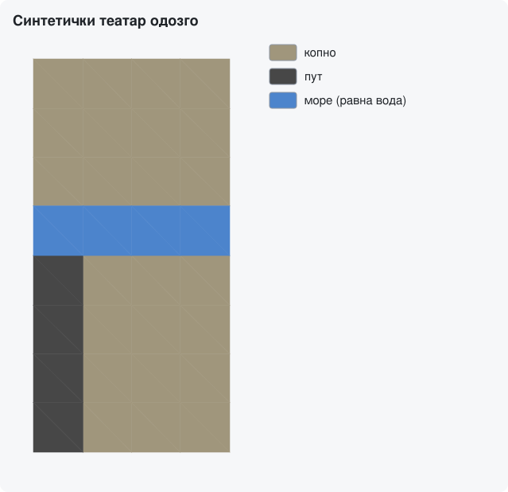
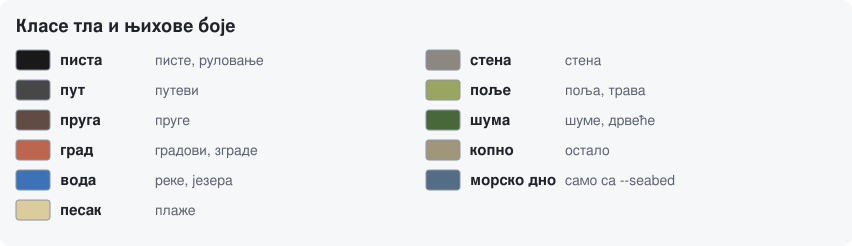

# Датотеке нивоа {#the-level-files}

Ниво је 3D модел тла; театар је назив DCS World-а за мапу.

`<out>/<name>.glb` и `<name>.json` поред њега.

| Део | Шта је |
|---|---|
| `ground:<Level>` | сопствени троуглови терена, обојени према ономе што игра црта преко сваког |
| `water:<Level>` | сваки троугао који игра означава као испод мора, положен равно на ниво мора |
| `structure:<Level>` | зграде театра као кутије, где их игра поставља (испод) |

Боје су класе испод:

Боје се виде са **Снимљена боја** на панелу нивоа приказивача. Сваки троугао тла
добија класу преклопа којим га игра црта:

| Класа | Боја | Из игриног преклопа |
|---|---|---|
| runway | скоро црна | `Runway` - писте, стазе за руловање и платои |
| road | тамно сива | `Road` |
| rail | смеђа | `Rail` |
| town | цигла | `Town`, `Building` |
| water | плава | `River`, `Lake` (копнене воде, црта се као тло) |
| beach | песак | `Beach` |
| rock | сива | `Rock` |
| field | светло зелена | `Field`, `Grass` |
| forest | тамно зелена | `Forest`, `Trees` |
| land | хаки | ниједан од ових |
| seabed | шкриљасто плава | само са `--seabed` |

Где више преклопа црта исти троугао, одлучује редослед табеле (пут кроз шуму је
пут). Сваки троугао преклопа је један од самог тла игре - проверавано на свакој
класи испробаних театара, сваки се поклопио - па су класе тачне, а не погођене
из околних тачака.

**Координате** су DCS-ови светски метри: x на север, y навише, z на исток, а
glTF осе су исте (X = x, Y = y, Z = z). Телеметрија у DCS метрима - DCS кука из
3DHeat Watcher-а управо то пише - пада на ниво с подразумеваним подешавањима
приказивача (Y навише, размера 1) и без корака постављања.

**Географска ширина и дужина:** сваки театар је Transverse Mercator пројекција са
сопственим константама; `<name>.json` их носи, углове нивоа у географској ширини
и дужини, и сваки град са и својом географском ширином/дужином и својим DCS x/z.
Где константе театра нису објављене, уклапају се према светионицима које даје
његов `beacons.lua` у оба система (корен средње квадратне грешке неколико cm; исто
уклапање враћа објављене константе других театара до милиметра).
За театар без константи, [`fit`](fit.md) их налази из било ког снимка који садржи
оба, на пример сесију Watcher-а једног лета.

**Морско дно** се изоставља (топлотној мапи лета дно мора није потребно);
`--seabed` га задржава као тло. `--no-water` изоставља равно море.

**Величина.** Видите [Прављење нивоа: Величина](level.md#size).

**Аеродроми.** Сваки `AirfieldsTaxiways/<name>.rn4` носи мрежу руловања једног
аеродрома, именовану по њему; његове тачке су (x, y, z) double вредности у DCS
метрима. `.json` нивоа наводи сваки аеродром унутар региона с његовим именом (из
датотеке), средином кутије његових тачака, самом кутијом и тлом на том месту. На
испробаном театру, свака датотека аеродрома је прочитана, сваки се смештио на свој
терен (у границама неколико стотина метара од референтне тачке аеродрома са мерења:
средина руловања, не писте).

**Зграде.** `Scenes/<theatre>.scn5` поставља сваки објекат театра (милиони -
дрвеће, лампе, ограде, жице, куће). Они који су по имену и величини зграде
(куће, станови, шупе, хангари, фабрике, торњеви, терминали: део модела, стотине
хиљада постављања) црта се као кутије: сваки модел-ов сопствени обухватни
правоугаоник из датотеке, окренут према свом правцу и постављен тамо где га игра
ставља, од до 3 m испод свог порекла (његово ослонац на падини) до врха. Дрвеће,
грмље, светла, стубови, жице, ограде, зидови, знакови, возила, вагони, чамци,
дизалице, јарболи, стубови далековода и мостови се изостављају. Ниједан облик или
текстура модела игре се не копира: једна кутија по згради, обојена према врсти
(кућа, блок, индустријска, аеродромска, торањ, остало). `<name>.json` их такође
наводи (`buildings.rows`: x, z, база, висина, полудужине, правац, врста) за
хибридну позадину приказивача, која их црта у играним градовима уместо
мапираних зграда. `--no-buildings` их изоставља.

`<name>.json` такође бележи изворну датотеку, њену величину и датум, прочитане
плочице, број троуглова по класи, и колико градова театра пада на тло - провера
пројекције која би требало да пише „N од N".

Ниво је glTF бинарна датотека са именованим деловима, као сваки 3DHeat ниво; страница
приказивача [Нивои](https://holdi601.github.io/3DHeat/levels.html) каже како их учитава.
