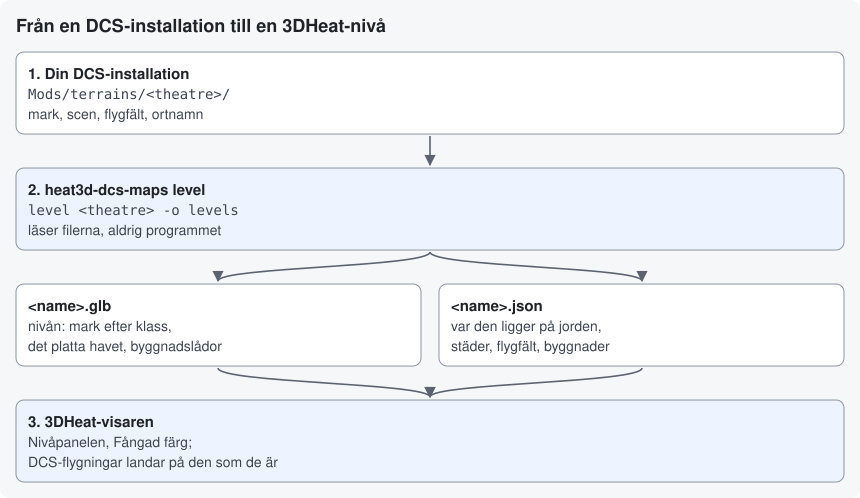

# 3DHeat DCS {#dheat-dcs}

**Vad är det?** En teater är DCS Worlds ord för en karta: en region i världen du flyger över. Verktyget gör marken i en teater, läst från **din egen installation**, till en 3D-nivå - en modell du kan flyga över - för [3DHeat](https://github.com/Holdi601/3DHeat)-visaren
([dokumentation](https://holdi601.github.io/3DHeat/)).

**Varför skulle jag använda det?** För att se dina DCS-flygningar över spelets egen karta: dess kullar, kust, flygfält, vägar, järnvägar, städer och byggnader.

**Exempel:** `heat3d-dcs-maps level <theatre> -o levels` ->
`levels/<theatre>.glb` (nivån) + `levels/<theatre>.json` (var den ligger på jorden, dess städer och flygfält).

Det här är användbart för:

- **Flygningar på spelets egen karta.** 3DHeat-världens bakgrund ritar dagens jord från öppna data; det här ritar teatern så som DCS ritar den.
- **Inget placeringssteg.** Nivån ligger i DCS egna världsmeter, så telemetri i DCS-meter (3DHeat Watcher:s DCS-krok skriver exakt det) hamnar på den med visarens standardinställningar.
- **Latitud och longitud.** Varje nivå bär sin projektion, sina hörn och sina städer i båda koordinatsystemen.



## Snabbstart {#quick-start}

Har du aldrig använt kommandoraden förut? Läs [Innan du börjar](before-you-start.md) först.
Kör dessa i mappen du klonade eller packade upp:

```bash
python -m pip install -e .                         # installerar kommandot heat3d-dcs-maps
heat3d-dcs-maps list                               # de installerade teatrarna, och om var och en kan läsas
heat3d-dcs-maps level <theatre> -o levels          # en hel (liten) teater
heat3d-dcs-maps level <theatre> --around <lat> <lon> 12 -o levels --name <name>   # 12 km åt vardera hållet från en punkt
```

Du ser en rad per teater från `list`, som slutar med `readable`.
Läs sedan in `levels/<name>.glb` i visarens panel Bakgrund / nivå
([Nivåer](https://holdi601.github.io/3DHeat/levels.html)).

Nivåerna den skriver är byggda av spelets data: de stannar på **din dator**, för att titta på, inte för att dela eller publicera ([Villkor](terms.md)).

## Sidor {#pages}

| Sida | Vad den täcker |
|---|---|
| [Innan du börjar](before-you-start.md) | Python, en terminal, en första körning |
| [Hitta teatrar: list](list.md) | var installationen hittas, vad `list` skriver ut |
| [Bygga en nivå: level](level.md) | varje alternativ, regioner, storlek, steg för steg |
| [Nivåfilerna](output.md) | delarna `.glb`, markklasserna och deras färger, `.json`, koordinaterna |
| [Ortnamn: towns](towns.md) | en teaters städer med DCS-koordinater |
| [Projektioner: fit](fit.md) | att hitta en teaters projektion från en inspelning |
| [Så läses filerna](reading.md) | formaten, vad som kontrollerats, vad som inte läses |
| [Villkor och licens](terms.md) | Eagle Dynamics licens, och varför detta är ett separat paket |
| [Kommandoreferens](../cli-reference.md) | varje alternativ, genererat från koden |
| [Underhålla dokumentationen](maintaining.md) | checklistan för utgivning |

## Relaterat {#related}

- 3DHeat-visaren: [github.com/Holdi601/3DHeat](https://github.com/Holdi601/3DHeat),
  dokumentation på [holdi601.github.io/3DHeat](https://holdi601.github.io/3DHeat/).
- Telemetri för de här nivåerna: [3DHeat Watcher](https://holdi601.github.io/3DHeat-Watcher/)
  spelar in DCS-flygningar; visarens filformat, inklusive behållaren som samlar en match i en fil,
  beskrivs i [En fil per match (.3dheat)](https://holdi601.github.io/3DHeat/container.html).

## 3DHeat-verktygen {#the-3dheat-tools}

| Verktyg | Vad det gör | Kod | Dokumentation |
|---|---|---|---|
| 3DHeat-visaren | visar datan: värmekartor, Racinganalys, matchgenomgång | [3DHeat](https://github.com/Holdi601/3DHeat) | [dokumentation](https://holdi601.github.io/3DHeat/) |
| GameFiles | nivåer och banor från ett spels egna filer | [3DHeat-GameFiles](https://github.com/Holdi601/3DHeat-GameFiles) | [dokumentation](https://holdi601.github.io/3DHeat-GameFiles/) |
| GameCapture | varvtelemetri, och nivåer återskapade från spelvideo | [3DHeat-GameCapture](https://github.com/Holdi601/3DHeat-GameCapture) | [dokumentation](https://holdi601.github.io/3DHeat-GameCapture/) |
| Unreal Exporter | ett Unreal Editor-tillägg: en nivå som en `.glb`-fil | [3DHeat-UnrealExporter](https://github.com/Holdi601/3DHeat-UnrealExporter) | [dokumentation](https://holdi601.github.io/3DHeat-UnrealExporter/) |
| CS2 | Counter-Strike 2-demos och kartor | [3DHeat-CS2](https://github.com/Holdi601/3DHeat-CS2) | [dokumentation](https://holdi601.github.io/3DHeat-CS2/) |
| Watcher | spelar in det spel publicerar medan du spelar | [3DHeat-Watcher](https://github.com/Holdi601/3DHeat-Watcher) | [dokumentation](https://holdi601.github.io/3DHeat-Watcher/) |
| Ext-WarThunder | War Thunder-repriser | [3DHeat-Ext-WarThunder](https://github.com/Holdi601/3DHeat-Ext-WarThunder) | [dokumentation](https://holdi601.github.io/3DHeat-Ext-WarThunder/) |
| Ext-WoT | World of Tanks-repriser | [3DHeat-Ext-WoT](https://github.com/Holdi601/3DHeat-Ext-WoT) | [dokumentation](https://holdi601.github.io/3DHeat-Ext-WoT/) |
| Ext-WoWs | World of Warships-repriser | [3DHeat-Ext-WoWs](https://github.com/Holdi601/3DHeat-Ext-WoWs) | [dokumentation](https://holdi601.github.io/3DHeat-Ext-WoWs/) |
| Ext-Squad | Squad-serverdemos | [3DHeat-Ext-Squad](https://github.com/Holdi601/3DHeat-Ext-Squad) | [dokumentation](https://holdi601.github.io/3DHeat-Ext-Squad/) |
| Ext-DCS | DCS World-kartor som 3D-nivåer | [3DHeat-Ext-DCS](https://github.com/Holdi601/3DHeat-Ext-DCS) | [dokumentation](https://holdi601.github.io/3DHeat-Ext-DCS/) |
| Ext-IL2 | IL-2 Sturmovik-kartor som 3D-nivåer | [3DHeat-Ext-IL2](https://github.com/Holdi601/3DHeat-Ext-IL2) | [dokumentation](https://holdi601.github.io/3DHeat-Ext-IL2/) |
