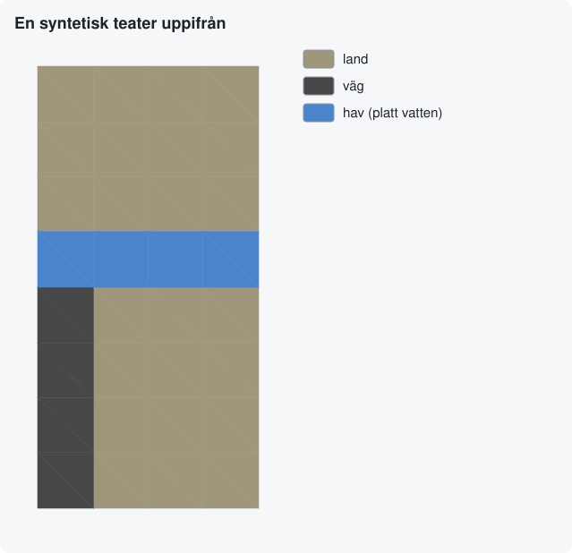
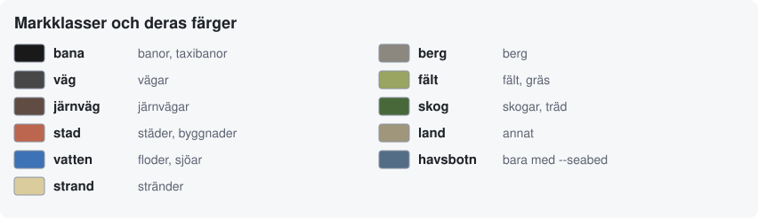

# Nivåfilerna {#the-level-files}

En nivå är en 3D-modell av marken; en teater är DCS Worlds ord för en karta.

`<out>/<name>.glb` och `<name>.json` bredvid den.

| Del | Vad den är |
|---|---|
| `ground:<Level>` | terrängens egna trianglar, färgade efter vad spelet ritar över varje |
| `water:<Level>` | varje triangel som spelet markerar som under havet, lagd platt på havsnivå |
| `structure:<Level>` | teaterns byggnader som lådor, där spelet placerar dem (nedan) |

Färgerna är klasserna nedan:

Färgerna visas med **Fångad färg** i visarens panel Bakgrund / nivå. Varje marktriangel får klassen för överlagringen som spelet ritar den med:

| Klass | Färg | Från spelets överlagring |
|---|---|---|
| runway | nästan svart | `Runway` - startbanor, taxibanor och uppställningsplatser |
| road | mörkgrå | `Road` |
| rail | brun | `Rail` |
| town | tegelröd | `Town`, `Building` |
| water | blå | `River`, `Lake` (inlandsvatten, ritat som mark) |
| beach | sand | `Beach` |
| rock | grå | `Rock` |
| field | ljusgrön | `Field`, `Grass` |
| forest | mörkgrön | `Forest`, `Trees` |
| land | khaki | ingen av dessa |
| seabed | skifferblå | bara med `--seabed` |

Där flera överlagringar ritar samma triangel avgör tabellens ordning (en väg genom en skog är väg). Varje överlagringstriangel är en av markens egna - kontrollerat för varje klass i de teatrar som prövats, och alla stämde - så klasserna är exakta, inte gissade från närliggande punkter.

**Koordinaterna** är DCS egna världsmeter: x norrut, y uppåt, z österut, och glTF-axlarna är desamma (X = x, Y = y, Z = z). Telemetri i DCS-meter - 3DHeat Watcher:s DCS-krok skriver exakt det - hamnar på nivån med visarens standardinställningar (Y uppåt, skala 1) och utan något placeringssteg.

**Latitud och longitud:** varje teater är en Transversal Mercator-projektion med egna konstanter; `<name>.json` bär dem, nivåns hörn i latitud och longitud, och varje stad med både sin latitud/longitud och sina DCS x/z. Där en teaters konstanter inte är publicerade anpassas de till de radiofyrar som dess egen `beacons.lua` ger i båda koordinatsystemen (några cm medelkvadratfel; samma anpassning ger de publicerade konstanterna för andra teatrar tillbaka ner till millimetern).
För en teater utan konstanter hittar [`fit`](fit.md) dem från en inspelning som innehåller båda, till exempel en Watcher-session från en flygning.

**Havsbotten** utelämnas (en karta för flygsimulatorn behöver inte havsbotten); `--seabed` behåller den som mark. `--no-water` utelämnar det platta havet.

**Storlek.** Se [Bygga en nivå: Storlek](level.md#size).

**Flygfält.** Varje `AirfieldsTaxiways/<name>.rn4` innehåller ett flygfälts taxinät, uppkallat efter det; dess punkter är (x, y, z) som dubbla tal i DCS-meter. Nivåns `.json` listar varje flygfält inom regionen med dess namn (filens), mitten av dess punkters ruta, rutan, och marken där. På den testade teatern lästes varje flygfältsfil, och varje placerades på sin plan (inom några hundra meter från den uppmätta flygplatsens referenspunkt: mitten av taxibanorna, inte startbanan).

**Byggnader.** `Scenes/<theatre>.scn5` placerar varje objekt i teatern (miljoner av dem - träd, lampor, staket, ledningar, hus). De som är byggnader till namn och storlek (hus, lägenheter, skjul, hangarer, fabriker, torn, terminaler: en bråkdel av modellerna, hundratusentals placeringar) ritas som lådor: varje modells egna omslutande låda från filen, vriden till dess riktning och stående där spelet placerar den, från upp till 3 m under dess origo (dess fästpunkt i en sluttning) till dess topp. Träd, buskar, lampor, stolpar, ledningar, staket, murar, skyltar, fordon, vagnar, båtar, kranar, master, pylonerna och broar utelämnas. Ingen modellform eller struktur från spelet kopieras: en låda per byggnad, färgad efter sort (hus, block, industri, flygfält, torn, övrigt). `<name>.json` listar dem också (`buildings.rows`: x, z, base, height, half lengths, heading, kind) för visarens hybridbakgrund, som ritar dem i spelets städer i stället för de kartlagda byggnaderna. `--no-buildings` utelämnar dem.

`<name>.json` innehåller också källfilen, dess storlek och datum, de lästa kakelrutorna, antalet trianglar per klass, och hur många av teaterns städer som hamnar på marken - en kontroll av projektionen som bör visa "N av N".

Nivån är en glTF-binärfil med namngivna delar, som alla 3DHeat-nivåer är; visarens sida [Nivåer](https://holdi601.github.io/3DHeat/levels.html) beskriver hur den läser in dem.
