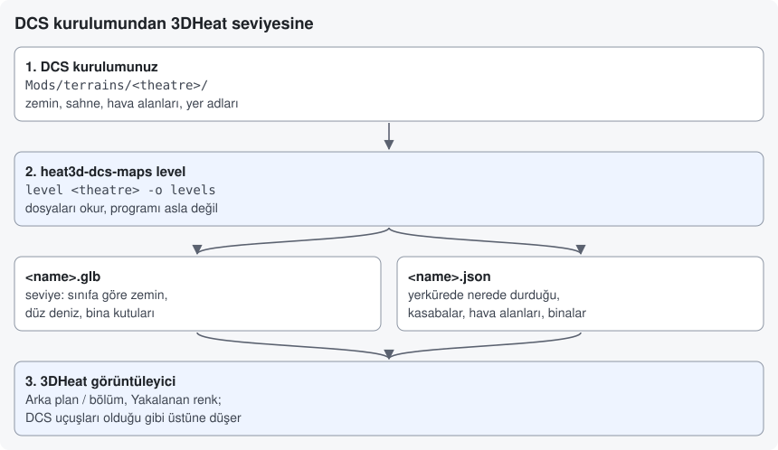

# 3DHeat DCS {#dheat-dcs}

**Nedir?** Bir tiyatro (theatre), DCS World'ün bir harita için kullandığı sözcüktür: üzerinde uçtuğunuz bir dünya bölgesi. Bu araç, bir tiyatronun zeminini **kendi kurulumunuzdan** okur ve bunu bir 3D seviyeye çevirir: üstünden uçabileceğiniz bir model. Seviye, [3DHeat](https://github.com/Holdi601/3DHeat) görüntüleyicisi içindir ([belgeler](https://holdi601.github.io/3DHeat/)).

**Neden kullanmalıyım?** DCS uçuşlarınızı oyunun kendi haritasında görmek için: tepeleri, kıyısı, hava alanları, yolları, demiryolları, kasabaları ve binalarıyla.

**Örnek:** `heat3d-dcs-maps level <theatre> -o levels` -> `levels/<theatre>.glb` (seviye) + `levels/<theatre>.json` (yerkürede nerede durduğu, kasabaları ve hava alanları).

Bu şunlar için işe yarar:

- **Oyunun kendi haritasında uçuşlar.** 3DHeat'in dünya arka planı bugünkü yeryüzünü açık verilerden çizer; bu araç ise tiyatroyu DCS'nin çizdiği gibi çizer.
- **Yerleştirme adımı yok.** Seviye DCS'nin kendi dünya metrelerindedir; bu yüzden DCS metrelerindeki telemetri (3DHeat Watcher'ın DCS kancası tam olarak bunu yazar) görüntüleyicinin varsayılanlarıyla oraya düşer.
- **Enlem ve boylam.** Her seviye, kendi izdüşümünü, köşelerini ve kasabalarını iki çerçevede de taşır.



## Hızlı başlangıç {#quick-start}

Komut satırında yeni misiniz? Önce [Başlamadan önce](before-you-start.md) sayfasını okuyun. Bunları klonladığınız ya da açtığınız klasörde çalıştırın:

```bash
python -m pip install -e .                         # heat3d-dcs-maps komutunu kurar
heat3d-dcs-maps list                               # kurulu tiyatrolar ve her birinin okunup okunamayacağı
heat3d-dcs-maps level <theatre> -o levels          # küçük bir tiyatronun tamamı
heat3d-dcs-maps level <theatre> --around <lat> <lon> 12 -o levels --name <name>   # bir noktanın iki yanındaki 12 km'lik bölge
```

`list` komutundan her tiyatro için bir satır görmelisiniz; her satır `readable` (okunabilir) ile biter. Sonra `levels/<name>.glb` dosyasını görüntüleyicinin Arka plan / bölüm panelinde yükleyin ([Seviyeler](https://holdi601.github.io/3DHeat/levels.html)).

Yazdığı seviyeler oyunun verilerinden yapılır: **kendi makinenizde** kalırlar, görüntülemek içindir; paylaşmak ya da yayımlamak için değil ([Koşullar](terms.md)).

## Sayfalar {#pages}

| Sayfa | Neyi anlatır |
|---|---|
| [Başlamadan önce](before-you-start.md) | Python, bir terminal, ilk çalıştırma |
| [Tiyatroları bulma: list](list.md) | kurulumun nerede bulunduğu, `list`'in ne yazdığı |
| [Seviye oluşturma: level](level.md) | her seçenek, bölgeler, boyut, adım adım |
| [Seviye dosyaları](output.md) | `.glb` parçaları, zemin sınıfları ve renkleri, `.json`, koordinatlar |
| [Yer adları: towns](towns.md) | bir tiyatronun kasabaları, DCS koordinatlarıyla |
| [İzdüşümler: fit](fit.md) | bir kayıttan tiyatronun izdüşümünü bulmak |
| [Dosyalar nasıl okunur](reading.md) | biçimler, neyin doğrulandığı, neyin okunmadığı |
| [Koşullar ve lisans](terms.md) | Eagle Dynamics'in lisansı ve bunun neden ayrı bir paket olduğu |
| [Komut başvurusu](../cli-reference.md) | her seçenek, koddan üretilmiş |
| [Bu belgelerin bakımı](maintaining.md) | sürüm kontrol listesi |

## İlgili {#related}

- 3DHeat görüntüleyici: [github.com/Holdi601/3DHeat](https://github.com/Holdi601/3DHeat), belgeleri [holdi601.github.io/3DHeat](https://holdi601.github.io/3DHeat/) adresinde.
- Bu seviyelerin telemetrisi: [3DHeat Watcher](https://holdi601.github.io/3DHeat-Watcher/) DCS uçuşlarını kaydeder. Görüntüleyicinin dosya biçimleri, maç başına tek dosyalık kapsayıcı dahil, [Maç başına tek dosya (.3dheat)](https://holdi601.github.io/3DHeat/container.html) sayfasında anlatılır.

## 3DHeat araçları {#the-3dheat-tools}

| Araç | Ne yapar | Kod | Belgeler |
|---|---|---|---|
| 3DHeat görüntüleyici | verileri gösterir: ısı haritaları, yarış analizi, maç incelemesi | [3DHeat](https://github.com/Holdi601/3DHeat) | [belgeler](https://holdi601.github.io/3DHeat/) |
| GameFiles | bir oyunun kendi dosyalarından seviyeler ve parkurlar | [3DHeat-GameFiles](https://github.com/Holdi601/3DHeat-GameFiles) | [belgeler](https://holdi601.github.io/3DHeat-GameFiles/) |
| GameCapture | tur telemetrisi ve oynanış videosundan yeniden kurulan seviyeler | [3DHeat-GameCapture](https://github.com/Holdi601/3DHeat-GameCapture) | [belgeler](https://holdi601.github.io/3DHeat-GameCapture/) |
| Unreal Exporter | bir Unreal Editor eklentisi: bir seviye tek bir `.glb` olarak | [3DHeat-UnrealExporter](https://github.com/Holdi601/3DHeat-UnrealExporter) | [belgeler](https://holdi601.github.io/3DHeat-UnrealExporter/) |
| CS2 | Counter-Strike 2 demoları ve haritaları | [3DHeat-CS2](https://github.com/Holdi601/3DHeat-CS2) | [belgeler](https://holdi601.github.io/3DHeat-CS2/) |
| Watcher | oynarken oyunların yayımladıklarını kaydeder | [3DHeat-Watcher](https://github.com/Holdi601/3DHeat-Watcher) | [belgeler](https://holdi601.github.io/3DHeat-Watcher/) |
| Ext-WarThunder | War Thunder tekrarları | [3DHeat-Ext-WarThunder](https://github.com/Holdi601/3DHeat-Ext-WarThunder) | [belgeler](https://holdi601.github.io/3DHeat-Ext-WarThunder/) |
| Ext-WoT | World of Tanks tekrarları | [3DHeat-Ext-WoT](https://github.com/Holdi601/3DHeat-Ext-WoT) | [belgeler](https://holdi601.github.io/3DHeat-Ext-WoT/) |
| Ext-WoWs | World of Warships tekrarları | [3DHeat-Ext-WoWs](https://github.com/Holdi601/3DHeat-Ext-WoWs) | [belgeler](https://holdi601.github.io/3DHeat-Ext-WoWs/) |
| Ext-Squad | Squad sunucu demoları | [3DHeat-Ext-Squad](https://github.com/Holdi601/3DHeat-Ext-Squad) | [belgeler](https://holdi601.github.io/3DHeat-Ext-Squad/) |
| Ext-DCS | DCS World haritaları 3B seviyeler olarak | [3DHeat-Ext-DCS](https://github.com/Holdi601/3DHeat-Ext-DCS) | [belgeler](https://holdi601.github.io/3DHeat-Ext-DCS/) |
| Ext-IL2 | IL-2 Sturmovik haritaları 3B seviyeler olarak | [3DHeat-Ext-IL2](https://github.com/Holdi601/3DHeat-Ext-IL2) | [belgeler](https://holdi601.github.io/3DHeat-Ext-IL2/) |
