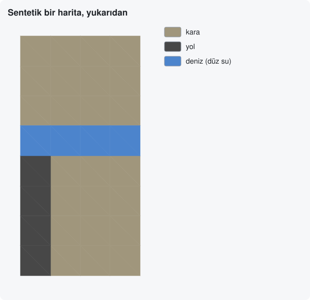
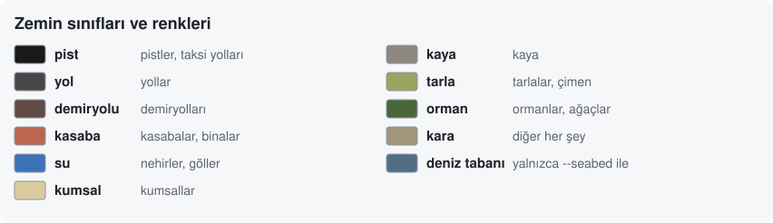

# Seviye dosyaları {#the-level-files}

Seviye, zeminin 3B bir modelidir; tiyatro ise DCS World'ün bir harita için kullandığı sözcüktür.

`<out>/<name>.glb` ve yanındaki `<name>.json`.

| Parça | Nedir |
|---|---|
| `ground:<Level>` | arazinin kendi üçgenleri, oyunun her birinin üstüne çizdiğine göre renklendirilmiş |
| `water:<Level>` | oyunun deniz altında işaretlediği her üçgen, deniz seviyesinde düz olarak serilmiş |
| `structure:<Level>` | tiyatronun binaları, oyunun yerleştirdiği yerde kutular olarak (aşağıda) |

Renkler aşağıdaki sınıflardır:

Renkler, görüntüleyicinin Arka plan / bölüm panelinde **Yakalanan renk** ile görünür. Her zemin üçgeni, oyunun onu çizdiği katmanın sınıfını alır:

| Sınıf | Renk | Oyunun katmanından |
|---|---|---|
| runway | neredeyse siyah | `Runway` - pistler, taksi yolları ve apronlar |
| road | koyu gri | `Road` |
| rail | kahverengi | `Rail` |
| town | tuğla kırmızısı | `Town`, `Building` |
| water | mavi | `River`, `Lake` (iç sular, zemin olarak çizilir) |
| beach | kum | `Beach` |
| rock | gri | `Rock` |
| field | açık yeşil | `Field`, `Grass` |
| forest | koyu yeşil | `Forest`, `Trees` |
| land | haki | bunların hiçbiri |
| seabed | arduvaz mavisi | yalnızca `--seabed` ile |

Birden çok katman aynı üçgeni çizdiğinde, tablonun sırası karar verir (ormanın içinden geçen bir yol, yoldur). Her katman üçgeni, zeminin kendi üçgenlerinden biridir: denenen tiyatroların her sınıfında kontrol edildi, her biri eşleşti. Bu yüzden sınıflar tam, yakındaki noktalardan tahmin edilmiş değil.

**Koordinatlar** DCS'nin kendi dünya metreleridir: x kuzey, y yukarı, z doğu; glTF eksenleri aynıdır (X = x, Y = y, Z = z). DCS metrelerindeki telemetri (3DHeat Watcher'ın DCS kancası tam olarak bunu yazar) görüntüleyicinin varsayılanlarıyla (Y yukarı, ölçek 1) ve yerleştirme adımı olmadan seviyeye düşer.

**Enlem ve boylam:** her tiyatro, kendi sabitleriyle bir Transverse Mercator izdüşümüdür. `<name>.json` bu sabitleri, seviyenin köşelerini enlem ve boylamla, her kasabayı da hem enlem/boylamıyla hem DCS x/z değerleriyle taşır. Bir tiyatronun sabitleri yayımlanmamışsa, tiyatronun kendi `beacons.lua` dosyasının iki çerçevede verdiği işaretlere uydurulurlar (birkaç cm kök ortalama kare; aynı uydurma, diğer tiyatroların yayımlanmış sabitlerini milimetreye kadar geri verir).
Sabitleri olmayan bir tiyatro için [`fit`](fit.md), ikisini de içeren herhangi bir kayıttan (örneğin tek bir uçuşun Watcher oturumu) sabitleri bulur.

**Deniz tabanı** dışarıda bırakılır (bir uçuş simülatörü ısı haritası deniz tabanına ihtiyaç duymaz); `--seabed` onu zemin olarak tutar. `--no-water` düz denizi dışarıda bırakır.

**Boyut.** Bkz. [Seviye oluşturma: Boyut](level.md#size).

**Hava alanları.** Her `AirfieldsTaxiways/<name>.rn4` dosyası, bir hava alanının taksi ağını tutar ve adıyla anılır; noktaları DCS metrelerinde (x, y, z) çift duyarlıklı sayılardır. Seviyenin `.json` dosyası, bölge içindeki her hava alanını adıyla (dosyanın adı), noktalarının kutusunun ortasıyla, kutuyla ve oradaki zeminle listeler. Denenen tiyatroda her hava alanı dosyası okundu ve her biri kendi sahasına yerleşti (ölçülmüş hava limanı referans noktasından birkaç yüz metre içinde: pistin değil, taksi yollarının ortası).

**Binalar.** `Scenes/<theatre>.scn5` tiyatronun her nesnesini yerleştirir (milyonlarcası: ağaçlar, lambalar, çitler, teller, evler). Adı ve boyutu nedeniyle bina olanlar (evler, daireler, kulübeler, hangarlar, fabrikalar, kuleler, terminaller: modellerin küçük bir kısmı, yüz binlerce yerleştirme) kutu olarak çizilir. Her modelin, dosyadaki kendi sınırlayıcı kutusu yönüne döndürülür ve oyunun koyduğu yere, orijininin en fazla 3 m altından (eğimde temeli) en üstüne kadar oturtulur. Ağaçlar, çalılar, ışıklar, direkler, teller, çitler, duvarlar, tabelalar, araçlar, vagonlar, tekneler, vinçler, direkler, elektrik direkleri ve köprüler dışarıda bırakılır. Oyunun model şekli ya da dokusu kopyalanmaz: her bina bir kutudur, türüne göre renklendirilir (ev, blok, endüstriyel, hava alanı, kule, diğer). `<name>.json` onları da listeler (`buildings.rows`: x, z, taban, yükseklik, yarı uzunluklar, yön, tür); görüntüleyicinin hibrit arka planı için. Bu arka plan onları, eşlenmiş binalar yerine oyunun kasabalarında çizer. `--no-buildings` onları dışarıda bırakır.

`<name>.json` ayrıca kaynak dosyayı, boyutunu ve tarihini, okunan karoları, sınıf başına üçgen sayısını ve tiyatronun kaç kasabasının zemine düştüğünü kaydeder; izdüşümün bir denetimi olarak "N of N" okunmalıdır.

Seviye, her 3DHeat seviyesi gibi adlandırılmış parçaları olan bir glTF ikilisidir; görüntüleyicinin [Seviyeler](https://holdi601.github.io/3DHeat/levels.html) sayfası onları nasıl yüklediğini anlatır.
