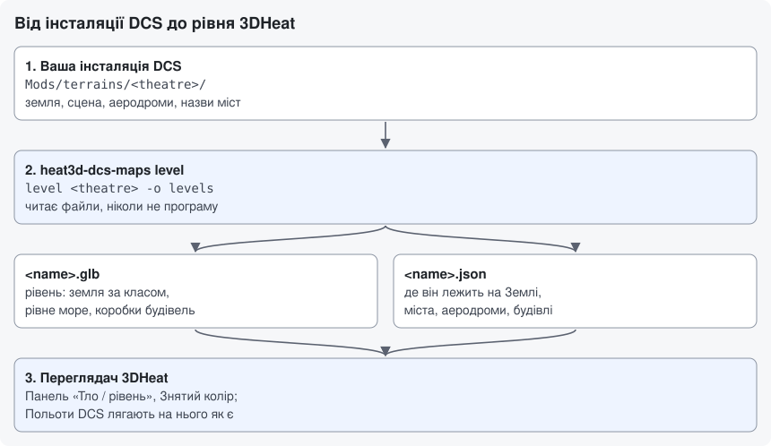

# 3DHeat DCS {#dheat-dcs}

**Що це?** Театр — це назва карти в DCS World: ділянка світу, над якою ви летите.
Цей інструмент перетворює землю одного театру, прочитану з **вашої власної
інсталяції**, на 3D-рівень — модель, над якою можна летіти, — для переглядача
[3DHeat](https://github.com/Holdi601/3DHeat)
([документація](https://holdi601.github.io/3DHeat/)).

**Навіщо це потрібно?** Щоб побачити свої польоти в DCS на самій карті гри: її
пагорби, узбережжя, аеродроми, дороги, залізниці, міста і будівлі.

**Приклад:** `heat3d-dcs-maps level <theatre> -o levels` ->
`levels/<theatre>.glb` (рівень) + `levels/<theatre>.json` (де він лежить на
Землі, його міста і аеродроми).

Для чого це корисно:

- **Польоти на власній карті гри.** Фон світу в 3DHeat сьогодні малює сучасну
  Землю з відкритих даних; це малює театр так, як його малює DCS.
- **Без кроку розміщення.** Рівень існує у світових метрах DCS, тож телеметрія в
  метрах DCS (гачок DCS у 3DHeat Watcher записує саме так) потрапляє на нього з
  типовими налаштуваннями переглядача.
- **Широта і довгота.** Кожен рівень містить свою проєкцію, свої кути і свої
  міста в обох системах координат.



## Швидкий старт {#quick-start}

Ви лише починаєте працювати з командним рядком? Спершу прочитайте
[Перш ніж почати](before-you-start.md). Виконуйте ці команди в папці, куди ви
клонували або розпакували інструмент:

```bash
python -m pip install -e .                         # встановлює команду heat3d-dcs-maps
heat3d-dcs-maps list                               # встановлені театри і те, чи можна кожен прочитати
heat3d-dcs-maps level <theatre> -o levels          # увесь (невеликий) театр
heat3d-dcs-maps level <theatre> --around <lat> <lon> 12 -o levels --name <name>   # 12 км в обидва боки від точки
```

Після `list` ви маєте побачити по одному рядку на театр, який закінчується словом
`readable`. Потім завантажте `levels/<name>.glb` у панелі «Тло / рівень» переглядача
([Рівні](https://holdi601.github.io/3DHeat/levels.html)).

Рівні, які він записує, побудовано з даних гри, тож вони лишаються **на вашому
комп'ютері**, для перегляду, а не для передачі чи публікації ([Умови](terms.md)).

## Сторінки {#pages}

| Сторінка | Що в ній |
|---|---|
| [Перш ніж почати](before-you-start.md) | Python, термінал, перший запуск |
| [Пошук театрів: list](list.md) | де шукається інсталяція, що виводить `list` |
| [Побудова рівня: level](level.md) | кожен параметр, регіони, розмір, крок за кроком |
| [Файли рівня](output.md) | частини `.glb`, класи землі та їхні кольори, `.json`, координати |
| [Назви місць: towns](towns.md) | міста театру з координатами DCS |
| [Проєкції: fit](fit.md) | знаходження проєкції театру із запису |
| [Як читаються файли](reading.md) | формати, що було перевірено, що не читається |
| [Умови і ліцензія](terms.md) | ліцензія Eagle Dynamics і чому це окремий пакет |
| [Довідка з команд](../cli-reference.md) | кожен параметр, створений з коду |
| [Підтримка цих документів](maintaining.md) | контрольний список для випуску |

## Пов'язане {#related}

- Переглядач 3DHeat: [github.com/Holdi601/3DHeat](https://github.com/Holdi601/3DHeat),
  документація на [holdi601.github.io/3DHeat](https://holdi601.github.io/3DHeat/).
- Телеметрія для цих рівнів: [3DHeat Watcher](https://holdi601.github.io/3DHeat-Watcher/)
  записує польоти DCS; формати файлів переглядача, зокрема його контейнер один
  файл на матч, описано в [Один файл на матч (.3dheat)](https://holdi601.github.io/3DHeat/container.html).

## Інструменти 3DHeat {#the-3dheat-tools}

| Інструмент | Що робить | Код | Документація |
|---|---|---|---|
| Переглядач 3DHeat | показує дані: теплові карти, аналіз заїздів, огляд матчів | [3DHeat](https://github.com/Holdi601/3DHeat) | [документація](https://holdi601.github.io/3DHeat/) |
| GameFiles | рівні й траси з власних файлів гри | [3DHeat-GameFiles](https://github.com/Holdi601/3DHeat-GameFiles) | [документація](https://holdi601.github.io/3DHeat-GameFiles/) |
| GameCapture | телеметрія кіл, а також рівні, відтворені з відео ігрового процесу | [3DHeat-GameCapture](https://github.com/Holdi601/3DHeat-GameCapture) | [документація](https://holdi601.github.io/3DHeat-GameCapture/) |
| Unreal Exporter | плагін для Unreal Editor: рівень як один `.glb` | [3DHeat-UnrealExporter](https://github.com/Holdi601/3DHeat-UnrealExporter) | [документація](https://holdi601.github.io/3DHeat-UnrealExporter/) |
| CS2 | демо та карти Counter-Strike 2 | [3DHeat-CS2](https://github.com/Holdi601/3DHeat-CS2) | [документація](https://holdi601.github.io/3DHeat-CS2/) |
| Watcher | записує те, що ігри публікують під час вашої гри | [3DHeat-Watcher](https://github.com/Holdi601/3DHeat-Watcher) | [документація](https://holdi601.github.io/3DHeat-Watcher/) |
| Ext-WarThunder | повтори War Thunder | [3DHeat-Ext-WarThunder](https://github.com/Holdi601/3DHeat-Ext-WarThunder) | [документація](https://holdi601.github.io/3DHeat-Ext-WarThunder/) |
| Ext-WoT | повтори World of Tanks | [3DHeat-Ext-WoT](https://github.com/Holdi601/3DHeat-Ext-WoT) | [документація](https://holdi601.github.io/3DHeat-Ext-WoT/) |
| Ext-WoWs | повтори World of Warships | [3DHeat-Ext-WoWs](https://github.com/Holdi601/3DHeat-Ext-WoWs) | [документація](https://holdi601.github.io/3DHeat-Ext-WoWs/) |
| Ext-Squad | демо серверів Squad | [3DHeat-Ext-Squad](https://github.com/Holdi601/3DHeat-Ext-Squad) | [документація](https://holdi601.github.io/3DHeat-Ext-Squad/) |
| Ext-DCS | карти DCS World як 3D-рівні | [3DHeat-Ext-DCS](https://github.com/Holdi601/3DHeat-Ext-DCS) | [документація](https://holdi601.github.io/3DHeat-Ext-DCS/) |
| Ext-IL2 | карти IL-2 Sturmovik як 3D-рівні | [3DHeat-Ext-IL2](https://github.com/Holdi601/3DHeat-Ext-IL2) | [документація](https://holdi601.github.io/3DHeat-Ext-IL2/) |
