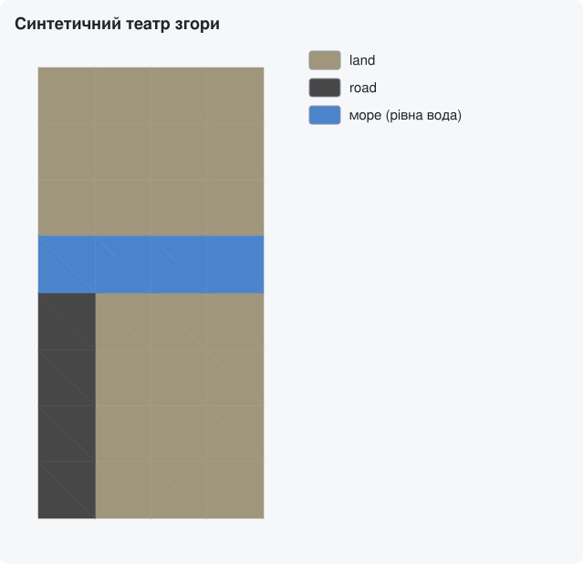
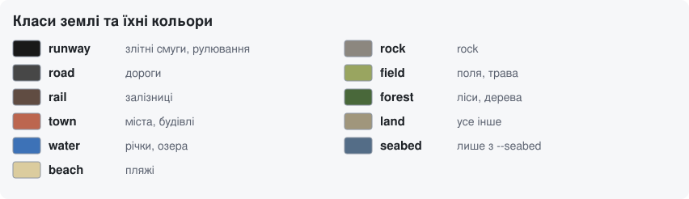

# Файли рівня {#the-level-files}

Рівень — це 3D-модель землі; театр — це назва карти в DCS World.

`<out>/<name>.glb` і поруч `<name>.json`.

| Частина | Що це |
|---|---|
| `ground:<Level>` | власні трикутники ландшафту, пофарбовані за тим, що гра малює поверх кожного |
| `water:<Level>` | кожен трикутник, який гра позначає як під водою, покладений пласко на рівні моря |
| `structure:<Level>` | будівлі театру як коробки там, де їх розмістила гра (нижче) |

Кольори відповідають класам нижче:

Кольори видно, якщо в панелі «Тло / рівень» переглядача увімкнено **Знятий колір**. Кожен
трикутник землі отримує клас того накладання, яким гра його малює:

| Клас | Колір | З накладання гри |
|---|---|---|
| runway | майже чорний | `Runway` — злітні смуги, рулювальні доріжки і стоянки |
| road | темно-сірий | `Road` |
| rail | коричневий | `Rail` |
| town | цегляно-червоний | `Town`, `Building` |
| water | синій | `River`, `Lake` (внутрішні води, намальовані як земля) |
| beach | піщаний | `Beach` |
| rock | сірий | `Rock` |
| field | світло-зелений | `Field`, `Grass` |
| forest | темно-зелений | `Forest`, `Trees` |
| land | хакі | жодне з цього |
| seabed | сланцево-синій | лише з `--seabed` |

Коли кілька накладань малюють той самий трикутник, вирішує порядок у таблиці
(дорога крізь ліс — це дорога). Кожен трикутник накладання є одним з трикутників
самої землі — перевірено на кожному класі в спробованих театрах, кожен збігся — тож
класи точні, а не вгадані за сусідніми точками.

**Координати** — це світові метри самої DCS: x — північ, y — вгору, z — схід, і осі glTF
такі самі (X = x, Y = y, Z = z). Телеметрія в метрах DCS — гачок DCS у 3DHeat Watcher
записує саме так — потрапляє на рівень із типовими налаштуваннями переглядача (Y
вгору, масштаб 1) без кроку розміщення.

**Широта і довгота:** кожен театр — це проєкція Transverse Mercator зі своїми
константами; `<name>.json` містить їх, кути рівня в широті та довготі і кожне місто з
його широтою/довготою та координатами DCS x/z. Якщо константи театру не опубліковано,
їх підбирають за маяками з його власного `beacons.lua` в обох системах координат
(середньоквадратична похибка кілька см; той самий підбір дає опубліковані константи
інших театрів з точністю до міліметра). Для театру без констант [`fit`](fit.md) знаходить
їх із будь-якого запису, який містить обидва, наприклад сесії Watcher одного польоту.

**Дно моря** пропускається (теплова карта польотного симулятора не потребує морського
дна); `--seabed` залишає його як землю. `--no-water` не включає рівну поверхню моря.

**Розмір.** Див. [Побудова рівня: Розмір](level.md#size).

**Аеродроми.** Кожен `AirfieldsTaxiways/<name>.rn4` містить мережу рулювання одного
аеродрому, названу його ім'ям; його точки — це (x, y, z) у форматі double у метрах DCS.
`.json` рівня перелічує кожен аеродром усередині регіону з його назвою (з файлу),
серединою коробки його точок, самою коробкою і землею там. На спробованому театрі
кожен файл аеродрому було прочитано, і кожен розміщено на його полі (в межах кількох
сотень метрів від опорної точки аеропорту за геодезичними даними: середини рулювальних
доріжок, а не злітної смуги).

**Будівлі.** `Scenes/<theatre>.scn5` розміщує кожен об'єкт театру (мільйони — дерева,
ліхтарі, огорожі, дроти, будинки). Ті, що є будівлями за назвою і розміром (будинки,
квартири, сараї, ангари, фабрики, вежі, термінали: частка моделей, сотні тисяч
розміщень), малюються коробками: власна обмежувальна коробка кожної моделі з файлу,
повернута за її курсом і поставлена там, де її розмістила гра, від не більш ніж 3 м
нижче її початку (її основа на схилі) до верху. Дерева, кущі, ліхтарі, стовпи, дроти,
огорожі, стіни, знаки, техніка, вагони, човни, крани, щогли, опори і мости не
включаються. Форми моделей і текстури гри не копіюються: одна коробка на будівлю,
пофарбована за типом (будинок, блок, промислова, аеродромна, вежа, інша). `<name>.json`
також їх перелічує (`buildings.rows`: x, z, base, height, half lengths, heading, kind)
для гібридного фону переглядача, який малює їх у містах гри замість картографованих
будівель. `--no-buildings` їх не включає.

`<name>.json` також фіксує вихідний файл, його розмір і дату, прочитані тайли,
кількість трикутників на клас і скільки міст театру лежить на землі — перевірка
проєкції, яка має показати «N з N».

Рівень — це двійковий glTF з іменованими частинами, як і кожен рівень 3DHeat; сторінка
[Рівні](https://holdi601.github.io/3DHeat/levels.html) переглядача пояснює, як він
завантажується.
