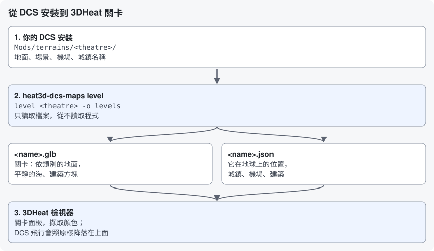

# 3DHeat DCS {#dheat-dcs}

**這是什麼？** 「戰區」是 DCS World 對地圖的稱呼：你飛越的一片世界區域。本工具會把一個戰區的地面，從**你自己的安裝**中讀取出來，轉換成 3D 關卡（一個你可以飛越的模型），供 [3DHeat](https://github.com/Holdi601/3DHeat) 檢視器使用（[說明文件](https://holdi601.github.io/3DHeat/)）。

**為什麼要用它？** 在遊戲自己的地圖上檢視你的 DCS 飛行：它的山丘、海岸、機場、道路、鐵路、城鎮與建築。

**範例：** `heat3d-dcs-maps level <theatre> -o levels` ->
`levels/<theatre>.glb`（關卡）+ `levels/<theatre>.json`（它在地球上的位置，以及它的城鎮與機場）。

它的用途包括：

- **在遊戲自己的地圖上飛行。** 3DHeat 的世界背景目前以開放資料繪製地球；本工具則依 DCS 的繪製方式呈現戰區。
- **不需要擺放步驟。** 關卡使用 DCS 自己的世界公尺，因此以 DCS 公尺記錄的遙測（3DHeat Watcher 的 DCS 掛鉤正是寫出這種格式）會直接以檢視器的預設值落在關卡上。
- **經緯度。** 每個關卡都帶有其投影、四個角落與城鎮，並同時提供兩種座標系。



## 快速開始 {#quick-start}

第一次使用命令列？請先閱讀[開始之前](before-you-start.md)。
在你複製或解壓縮的資料夾中執行以下命令：

```bash
python -m pip install -e .                         # installs the heat3d-dcs-maps command
heat3d-dcs-maps list                               # the theatres installed, and whether each can be read
heat3d-dcs-maps level <theatre> -o levels          # a whole (small) theatre
heat3d-dcs-maps level <theatre> --around <lat> <lon> 12 -o levels --name <name>   # 12 km either side of a point
```

`list` 會為每個戰區印出一行，結尾為 `readable`。
接著在檢視器的關卡面板中載入 `levels/<name>.glb`（[關卡](https://holdi601.github.io/3DHeat/levels.html)）。

它所寫出的關卡是由遊戲的資料建成的，只能**留在你的電腦上**供檢視，不可分享或發布（[條款](terms.md)）。

## 頁面 {#pages}

| 頁面 | 內容 |
|---|---|
| [開始之前](before-you-start.md) | Python、終端機、第一次執行 |
| [尋找戰區：list](list.md) | 安裝位置的尋找方式，`list` 會印出什麼 |
| [建立關卡：level](level.md) | 每個選項、區域、大小、逐步說明 |
| [關卡檔案](output.md) | `.glb` 的各部分、地面類別與其顏色、`.json`、座標 |
| [地名：towns](towns.md) | 戰區的城鎮與其 DCS 座標 |
| [投影：fit](fit.md) | 從錄製中找出戰區的投影 |
| [檔案如何被讀取](reading.md) | 格式、已驗證的內容、未被讀取的內容 |
| [條款與授權](terms.md) | Eagle Dynamics 的授權，以及為何這是獨立的套件 |
| [命令參考](../cli-reference.md) | 每個選項，由程式碼產生 |
| [維護這些文件](maintaining.md) | 發行檢查清單 |

## 相關連結 {#related}

- 3DHeat 檢視器：[github.com/Holdi601/3DHeat](https://github.com/Holdi601/3DHeat)，
  說明文件位於 [holdi601.github.io/3DHeat](https://holdi601.github.io/3DHeat/)。
- 這些關卡的遙測：[3DHeat Watcher](https://holdi601.github.io/3DHeat-Watcher/)
  會記錄 DCS 飛行；檢視器的檔案格式（包括每場比賽一個檔案的容器）記載於
  [每場比賽一個檔案（.3dheat）](https://holdi601.github.io/3DHeat/container.html)。

## 3DHeat 工具 {#the-3dheat-tools}

| 工具 | 功能 | 程式碼 | 文件 |
|---|---|---|---|
| 3DHeat 檢視器 | 顯示資料：熱圖、賽車分析、對戰回顧 | [3DHeat](https://github.com/Holdi601/3DHeat) | [文件](https://holdi601.github.io/3DHeat/) |
| GameFiles | 遊戲自身檔案中的關卡與賽道 | [3DHeat-GameFiles](https://github.com/Holdi601/3DHeat-GameFiles) | [文件](https://holdi601.github.io/3DHeat-GameFiles/) |
| GameCapture | 圈速遙測，以及從遊戲影片重建的關卡 | [3DHeat-GameCapture](https://github.com/Holdi601/3DHeat-GameCapture) | [文件](https://holdi601.github.io/3DHeat-GameCapture/) |
| Unreal Exporter | Unreal Editor 外掛：將關卡匯出為一個 `.glb` | [3DHeat-UnrealExporter](https://github.com/Holdi601/3DHeat-UnrealExporter) | [文件](https://holdi601.github.io/3DHeat-UnrealExporter/) |
| CS2 | Counter-Strike 2 的對戰與地圖 | [3DHeat-CS2](https://github.com/Holdi601/3DHeat-CS2) | [文件](https://holdi601.github.io/3DHeat-CS2/) |
| Watcher | 在你遊玩時，記錄遊戲所發布的內容 | [3DHeat-Watcher](https://github.com/Holdi601/3DHeat-Watcher) | [文件](https://holdi601.github.io/3DHeat-Watcher/) |
| Ext-WarThunder | War Thunder 錄影 | [3DHeat-Ext-WarThunder](https://github.com/Holdi601/3DHeat-Ext-WarThunder) | [文件](https://holdi601.github.io/3DHeat-Ext-WarThunder/) |
| Ext-WoT | World of Tanks 錄影 | [3DHeat-Ext-WoT](https://github.com/Holdi601/3DHeat-Ext-WoT) | [文件](https://holdi601.github.io/3DHeat-Ext-WoT/) |
| Ext-WoWs | World of Warships 錄影 | [3DHeat-Ext-WoWs](https://github.com/Holdi601/3DHeat-Ext-WoWs) | [文件](https://holdi601.github.io/3DHeat-Ext-WoWs/) |
| Ext-Squad | Squad 伺服器對戰 | [3DHeat-Ext-Squad](https://github.com/Holdi601/3DHeat-Ext-Squad) | [文件](https://holdi601.github.io/3DHeat-Ext-Squad/) |
| Ext-DCS | 以 3D 關卡呈現的 DCS World 地圖 | [3DHeat-Ext-DCS](https://github.com/Holdi601/3DHeat-Ext-DCS) | [文件](https://holdi601.github.io/3DHeat-Ext-DCS/) |
| Ext-IL2 | 以 3D 關卡呈現的 IL-2 Sturmovik 地圖 | [3DHeat-Ext-IL2](https://github.com/Holdi601/3DHeat-Ext-IL2) | [文件](https://holdi601.github.io/3DHeat-Ext-IL2/) |
