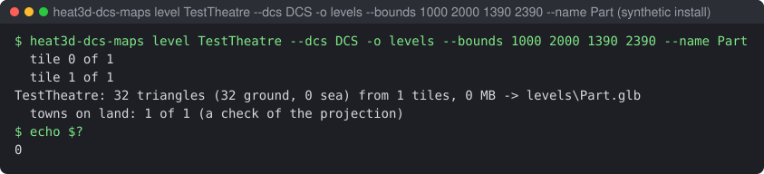

# 建立關卡：`level` {#building-a-level-level}

```text
heat3d-dcs-maps level <theatre> -o <folder> [--dcs FOLDER] [--name NAME]
                      [--around LAT LON KM | --bounds X0 Z0 X1 Z1] [--cell M]
                      [--seabed] [--no-water] [--no-buildings] [--force]
                      [--projection LON0 FE FN]
```

## 逐步說明 {#step-by-step}

第一次使用命令列？請先閱讀[開始之前](before-you-start.md)。

1. 用 [`list`](list.md) 找出戰區的資料夾名稱。
2. 對於小型戰區，整個建立：`heat3d-dcs-maps level <theatre> -o levels`。
3. 對於大型戰區，選一個區域：`--around <lat> <lon> <km>`（以某點為中心、每邊各 km 的正方形），或以 DCS 公尺表示的 `--bounds X0 Z0 X1 Z1`。
   用 `--name` 為它命名。
4. 此命令會在讀取時印出網格、三角形數量、寫入的檔案，以及有多少個戰區城鎮落在地面上——這是投影的檢查，應顯示「N of N」。
5. 在檢視器的關卡面板中載入 `<folder>/<name>.glb`，並開啟 **Captured colour** 以查看地面類別。


同一個合成戰區的一塊區域，以 DCS 公尺表示：



## 選項 {#options}

| 選項 | 預設 | 作用 |
|---|---|---|
| `theatre` | - | `Mods\terrains` 下的資料夾名稱，即 `list` 所印出的（大小寫皆可） |
| `-o`、`--out` | 必填 | 寫入 `<name>.glb` 與 `<name>.json` 的資料夾 |
| `--dcs FOLDER` | 自動尋找 | DCS World 資料夾（[尋找位置](list.md#where-the-install-is-found)） |
| `--name NAME` | 戰區的名稱 | 關卡及其檔案的名稱 |
| `--around LAT LON KM` | - | 僅限以某點為中心、每邊此 km 的正方形 |
| `--bounds X0 Z0 X1 Z1` | - | 僅限此方框，以 DCS 公尺表示（x 朝北，z 朝東） |
| `--cell M` | `0` | 稀疏化網格：每個距離 *M* 公尺以內的頂點會合併為一個（0：使用遊戲自己的三角形） |
| `--seabed` | 關閉 | 將海底保留為地面（預設會省略） |
| `--no-water` | 關閉 | 省略平坦的海面 |
| `--no-buildings` | 關閉 | 省略戰區場景中的建築 |
| `--force` | 關閉 | 以完整細節整個匯出非常大的地圖 |
| `--projection LON0 FE FN` | 戰區自身的 | 本工具不認識的戰區所使用的橫向麥卡托常數（[fit](fit.md)） |

程式列出的每個選項：[命令參考](../cli-reference.md)。

## 大小 {#size}

遊戲的網格是自適應的——開闊海面以相距數公里的三角形表示，海岸與道路則以數公尺為單位。小型戰區約有數百萬個三角形；大型戰區則有數千萬個頂點。當要讀取的頂點超過 3000 萬個時，`level` 會停止（結束狀態 1），並要求你選擇一個區域、較稀疏的網格（`--cell 50`）或 `--force`。

結束狀態：0 完成；1 失敗或太大；2 找不到安裝或戰區（會列出找到的戰區）。

## 範例 {#examples}

```bash
heat3d-dcs-maps level <theatre> -o levels                                       # whole, full detail
heat3d-dcs-maps level <theatre> --around <lat> <lon> 12 -o levels --name Part   # a 24 km square
heat3d-dcs-maps level <theatre> --bounds 1000 2000 1390 2390 -o levels          # a box in DCS metres
heat3d-dcs-maps level <theatre> --cell 50 -o levels                             # whole, thinned to 50 m
heat3d-dcs-maps level <theatre> --no-buildings --no-water -o levels             # the ground alone
```

檔案中有什麼內容：[關卡檔案](output.md)。
