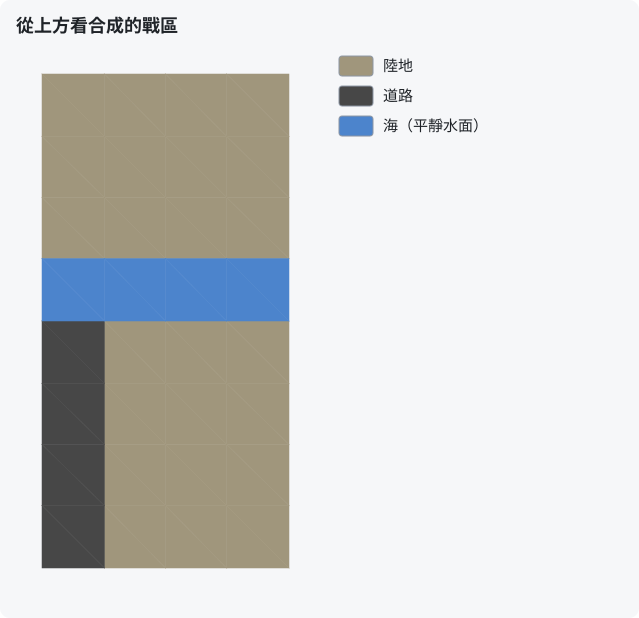
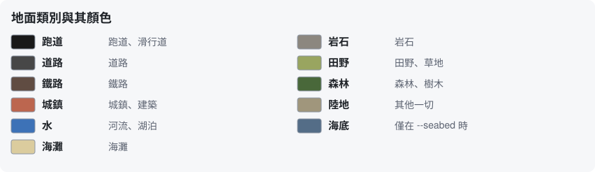

# 關卡檔案 {#the-level-files}

關卡是地面的 3D 模型；戰區是 DCS World 對地圖的稱呼。

`<out>/<name>.glb` 與其旁邊的 `<name>.json`。

| 部分 | 內容 |
|---|---|
| `ground:<Level>` | 地形自身的三角形，依遊戲在其上繪製的內容上色 |
| `water:<Level>` | 遊戲標記為位於海面之下的每一個三角形，平放在海平面上 |
| `structure:<Level>` | 戰區的建築，以方塊表示，位置依遊戲的放置方式（見下文） |

顏色對應如下的類別：

在檢視器的背景／關卡面板中開啟 **Captured colour** 即可看到這些顏色。每個地面三角形會採用遊戲繪製它時所用的覆蓋層類別：

| 類別 | 顏色 | 來自遊戲的覆蓋層 |
|---|---|---|
| runway | 接近黑色 | `Runway`：跑道、滑行道與停機坪 |
| road | 深灰色 | `Road` |
| rail | 棕色 | `Rail` |
| town | 磚紅色 | `Town`、`Building` |
| water | 藍色 | `River`、`Lake`（內陸水域，以地面繪製） |
| beach | 沙色 | `Beach` |
| rock | 灰色 | `Rock` |
| field | 淺綠色 | `Field`、`Grass` |
| forest | 深綠色 | `Forest`、`Trees` |
| land | 卡其色 | 以上皆非 |
| seabed | 石板藍 | 僅在使用 `--seabed` 時 |

若多個覆蓋層繪製同一個三角形，則以表格的順序決定（穿過森林的道路為道路）。每一個覆蓋層三角形都屬於地面本身的三角形——在所試過的戰區的每個類別上都已檢查，且全部吻合——因此類別是精確的，而不是從附近的點推測出來的。

**座標** 是 DCS 自己的世界公尺：x 朝北、y 朝上、z 朝東，glTF 的軸也相同（X = x、Y = y、Z = z）。以 DCS 公尺表示的遙測（3DHeat Watcher 的 DCS 掛鉤正是寫出這種格式）會以檢視器的預設值（Y 朝上、比例 1）落在關卡上，不需要擺放步驟。

**經緯度：** 每個戰區都是一個橫向麥卡托投影，並有其自己的常數；`<name>.json` 會記錄這些常數、關卡四個角落的經緯度，以及每個城鎮的經緯度與其 DCS 的 x/z。若某戰區的常數未公開，則會依其自身 `beacons.lua` 在兩種座標系中給出的信標進行擬合（均方根誤差約為數公分；同樣的擬合也能精確到毫米地還原其他戰區已公開的常數）。
對於沒有常數的戰區，[`fit`](fit.md) 會從任何同時包含兩者的錄製（例如一次飛行的 Watcher 工作階段）中找出它們。

**海底** 會被省略（飛行模擬的熱圖不需要海底）；`--seabed` 會將其保留為地面。`--no-water` 則會省略平坦的海面。

**大小。** 請見[建立關卡：大小](level.md#size)。

**機場。** 每個 `AirfieldsTaxiways/<name>.rn4` 都保存一座機場的滑行道網路，以該機場命名；其點為 DCS 公尺的 (x, y, z) 雙精度浮點數。關卡的 `.json` 會列出區域內的每一座機場，包括其名稱（取自檔案）、其點所構成方框的中心、方框本身，以及該處的地面。在所試過的戰區上，每個機場檔案都已讀取，且每一個都落在其所在的場地上（距離測量得到的機場參考點在數百公尺之內：是滑行道的中心，而非跑道的中心）。

**建築。** `Scenes/<theatre>.scn5` 放置了戰區的每一個物件（數以百萬計——樹木、路燈、圍欄、電線、房屋）。其中依名稱與大小屬於建築的（房屋、公寓、棚屋、機庫、工廠、塔樓、航站樓：佔模型的一小部分，約數十萬個放置）會以方塊表示：每個模型自身在檔案中的邊界方框，依其朝向旋轉，並站在遊戲放置它的位置上，從其原點以下最多 3 公尺（斜坡上的地基）延伸到其頂部。樹木、灌木、燈具、電線桿、電線、圍欄、牆、標誌、車輛、貨車、船隻、起重機、桅杆、電塔與橋樑都會被省略。遊戲的任何模型形狀或材質都不會被複製：每座建築一個方塊，依種類上色（房屋、街區、工業、機場、塔樓、其他）。`<name>.json` 也會列出它們（`buildings.rows`：x、z、底面、高度、半長、朝向、種類），供檢視器的混合背景使用，檢視器會在遊戲的城鎮中以它們取代映射的建築來繪製。`--no-buildings` 會將它們省略。

`<name>.json` 還會記錄來源檔案、其大小與日期、讀取的網格區塊、每個類別的三角形數量，以及有多少戰區城鎮落在地面上——這是投影的檢查，應顯示「N of N」。

關卡是具有具名部分的 glTF 二進位檔，與每個 3DHeat 關卡相同；檢視器的[關卡](https://holdi601.github.io/3DHeat/levels.html)頁面說明了如何載入它們。
