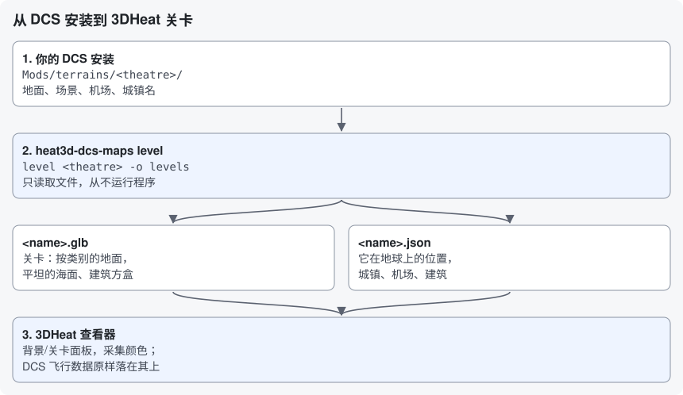

# 3DHeat DCS {#dheat-dcs}

**这是什么？** Theatre（战区）是 DCS World 对地图的称呼：你飞行经过的一片世界区域。本工具读取**你自己安装的** DCS 中某个战区的地面，并把它转换成一个 3D 关卡（一个你可以在上面飞行的模型），供 [3DHeat](https://github.com/Holdi601/3DHeat) 查看器使用（[文档](https://holdi601.github.io/3DHeat/)）。

**我为什么要用它？** 在游戏自己的地图上查看你的 DCS 飞行：它的山丘、海岸、机场、道路、铁路、城镇和建筑。

**示例：** `heat3d-dcs-maps level <theatre> -o levels` ->
`levels/<theatre>.glb`（关卡）+ `levels/<theatre>.json`（它在地球上的位置、城镇和机场）。

它的用途包括：

- **在游戏自己的地图上飞行。** 3DHeat 的世界背景目前使用开放数据绘制现实中的地球；本工具则按 DCS 绘制的方式绘制战区。
- **无需摆放步骤。** 关卡使用 DCS 自己的世界米制坐标，因此以 DCS 米为单位的遥测数据（3DHeat Watcher 的 DCS 接口正是写出这种数据）会以查看器的默认设置直接落在关卡上。
- **纬度和经度。** 每个关卡都同时以两种坐标系记录其投影、角点和城镇。



## 快速开始 {#quick-start}

第一次使用命令行？请先阅读 [开始之前](before-you-start.md)。
在你克隆或解压的文件夹中运行以下命令：

```bash
python -m pip install -e .                         # 安装 heat3d-dcs-maps 命令
heat3d-dcs-maps list                               # 已安装的战区，以及每个战区能否被读取
heat3d-dcs-maps level <theatre> -o levels          # 一个完整的（较小的）战区
heat3d-dcs-maps level <theatre> --around <lat> <lon> 12 -o levels --name <name>   # 某点两侧各 12 公里
```

`list` 会为每个战区输出一行，行尾显示 `readable`。
然后在查看器的 [背景/关卡面板](https://holdi601.github.io/3DHeat/levels.html) 中加载 `levels/<name>.glb`。

它生成的关卡由游戏数据构建，因此它们**只保存在你的电脑上**，供你自己查看，不得分享或发布（[条款](terms.md)）。

每个游戏读取器都是一个独立的小项目，有自己的许可证文件、发布版本和问题跟踪，因此可以单独安装、更新、维护——或应权利人的要求撤下——而不影响查看器或其他工具。

## 页面 {#pages}

| 页面 | 内容 |
|---|---|
| [开始之前](before-you-start.md) | Python、终端和第一次运行 |
| [查找战区：list](list.md) | 安装位置如何被找到，`list` 打印什么 |
| [构建关卡：level](level.md) | 每个选项、区域、大小，逐步说明 |
| [关卡文件](output.md) | `.glb` 的各个部分、地面类别及其颜色、`.json`、坐标 |
| [地名：towns](towns.md) | 战区的城镇及其 DCS 坐标 |
| [投影：fit](fit.md) | 从一段录制中找出战区的投影 |
| [如何读取文件](reading.md) | 文件格式、已验证的内容、未读取的内容 |
| [条款与许可证](terms.md) | 读取什么、不随附什么、许可证 |
| [命令参考](../cli-reference.md) | 每个选项，由代码生成 |
| [维护这些文档](maintaining.md) | 发布检查清单 |

## 相关内容 {#related}

- 3DHeat 查看器：[github.com/Holdi601/3DHeat](https://github.com/Holdi601/3DHeat)，
  文档位于 [holdi601.github.io/3DHeat](https://holdi601.github.io/3DHeat/)。
- 这些关卡的遥测数据：[3DHeat Watcher](https://holdi601.github.io/3DHeat-Watcher/)
  记录 DCS 飞行；查看器的文件格式，包括一场对局一个文件的容器，见
  [一场对局一个文件（.3dheat）](https://holdi601.github.io/3DHeat/container.html)。

## 3DHeat 工具 {#the-3dheat-tools}

| 工具 | 作用 | 代码 | 文档 |
|---|---|---|---|
| 3DHeat 查看器 | 显示数据：热力图、赛车分析、对局回顾 | [3DHeat](https://github.com/Holdi601/3DHeat) | [文档](https://holdi601.github.io/3DHeat/) |
| GameFiles | 从游戏自身文件中提取关卡和赛道 | [3DHeat-GameFiles](https://github.com/Holdi601/3DHeat-GameFiles) | [文档](https://holdi601.github.io/3DHeat-GameFiles/) |
| GameCapture | 圈速遥测，以及从游戏录像重建的关卡 | [3DHeat-GameCapture](https://github.com/Holdi601/3DHeat-GameCapture) | [文档](https://holdi601.github.io/3DHeat-GameCapture/) |
| Unreal Exporter | 虚幻编辑器插件：把一个关卡导出为一个 `.glb` | [3DHeat-UnrealExporter](https://github.com/Holdi601/3DHeat-UnrealExporter) | [文档](https://holdi601.github.io/3DHeat-UnrealExporter/) |
| CS2 | 反恐精英 2 的录像和地图 | [3DHeat-CS2](https://github.com/Holdi601/3DHeat-CS2) | [文档](https://holdi601.github.io/3DHeat-CS2/) |
| Watcher | 在你游玩时记录游戏公开的数据 | [3DHeat-Watcher](https://github.com/Holdi601/3DHeat-Watcher) | [文档](https://holdi601.github.io/3DHeat-Watcher/) |
| Ext-WarThunder | 战争雷霆的录像 | [3DHeat-Ext-WarThunder](https://github.com/Holdi601/3DHeat-Ext-WarThunder) | [文档](https://holdi601.github.io/3DHeat-Ext-WarThunder/) |
| Ext-WoT | 坦克世界的录像 | [3DHeat-Ext-WoT](https://github.com/Holdi601/3DHeat-Ext-WoT) | [文档](https://holdi601.github.io/3DHeat-Ext-WoT/) |
| Ext-WoWs | 战舰世界的录像 | [3DHeat-Ext-WoWs](https://github.com/Holdi601/3DHeat-Ext-WoWs) | [文档](https://holdi601.github.io/3DHeat-Ext-WoWs/) |
| Ext-Squad | Squad 服务器录像 | [3DHeat-Ext-Squad](https://github.com/Holdi601/3DHeat-Ext-Squad) | [文档](https://holdi601.github.io/3DHeat-Ext-Squad/) |
| Ext-DCS | DCS World 地图，作为 3D 关卡 | [3DHeat-Ext-DCS](https://github.com/Holdi601/3DHeat-Ext-DCS) | [文档](https://holdi601.github.io/3DHeat-Ext-DCS/) |
| Ext-IL2 | IL-2 Sturmovik 地图，作为 3D 关卡 | [3DHeat-Ext-IL2](https://github.com/Holdi601/3DHeat-Ext-IL2) | [文档](https://holdi601.github.io/3DHeat-Ext-IL2/) |
