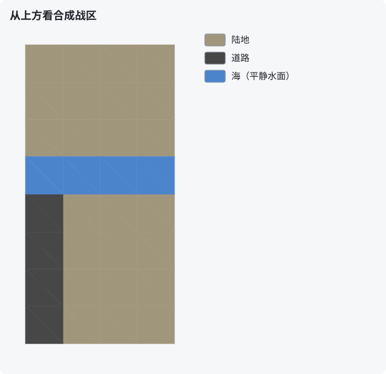
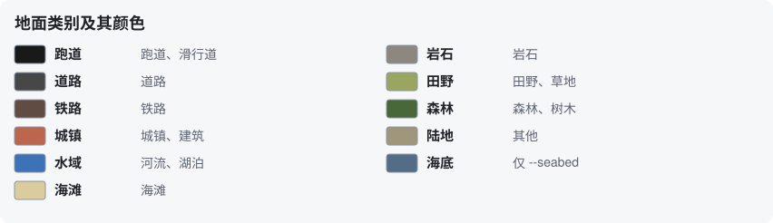

# 关卡文件 {#the-level-files}

关卡是地面的 3D 模型；战区（theatre）是 DCS World 对地图的称呼。

`<out>/<name>.glb` 以及它旁边的 `<name>.json`。

| 部分 | 内容 |
|---|---|
| `ground:<Level>` | 地形自身的三角形，按游戏在其上绘制的覆盖层着色 |
| `water:<Level>` | 游戏标记为位于海面以下的每个三角形，平铺在海平面上 |
| `structure:<Level>` | 战区的建筑，以方盒形式呈现，位置与游戏中一致（见下文） |

颜色对应以下类别：

在查看器的背景/关卡面板中打开 **采集颜色**，即可显示这些颜色。每个地面三角形都采用游戏绘制它时所用覆盖层的类别：

| 类别 | 颜色 | 来自游戏的覆盖层 |
|---|---|---|
| runway（跑道） | 近黑色 | `Runway`：跑道、滑行道和停机坪 |
| road（道路） | 深灰色 | `Road` |
| rail（铁路） | 棕色 | `Rail` |
| town（城镇） | 砖红色 | `Town`、`Building` |
| water（水域） | 蓝色 | `River`、`Lake`（内陆水域，按地面绘制） |
| beach（海滩） | 沙色 | `Beach` |
| rock（岩石） | 灰色 | `Rock` |
| field（田野） | 浅绿色 | `Field`、`Grass` |
| forest（森林） | 深绿色 | `Forest`、`Trees` |
| land（陆地） | 卡其色 | 以上都不是 |
| seabed（海底） | 石板蓝 | 仅在使用 `--seabed` 时 |

当多个覆盖层绘制同一个三角形时，以表格中的顺序为准（穿过森林的道路算作道路）。每个覆盖层三角形都属于地面本身——已在所尝试的每个战区的每个类别上检查过，全部匹配——因此这些类别是精确的，而不是根据附近的点猜测的。

**坐标**使用 DCS 自身的世界米制：x 为北，y 为上，z 为东，glTF 的轴与之相同（X = x，Y = y，Z = z）。以 DCS 米为单位的遥测数据（3DHeat Watcher 的 DCS 接口正是写出这种数据）会以查看器的默认设置（Y 轴朝上，比例为 1）直接落在关卡上，无需摆放步骤。

**纬度和经度：**每个战区都是一种横轴墨卡托投影，带有其自己的常数；`<name>.json` 中记录了这些常数、关卡角点的纬度和经度，以及每个城镇的纬度/经度及其 DCS 的 x/z 坐标。如果某个战区的常数未公开，则会根据其自身 `beacons.lua` 提供的、以两种坐标系表示的信标进行拟合（均方根误差约为几厘米；同样的拟合方法还能将其他战区已公开的常数精确还原到毫米）。对于没有常数的战区，可以用 [`fit`](fit.md) 从任何同时包含两种坐标的录制（例如一次飞行的 Watcher 记录）中求出它们。

**海底**会被去除（飞行模拟的热力图不需要海底）；`--seabed` 会将其保留为地面。`--no-water` 会去除平坦的海面。

**大小。**参见 [构建关卡：大小](level.md#size)。

**机场。**每个 `AirfieldsTaxiways/<name>.rn4` 保存一个机场的滑行道网络，以机场命名；其点为以 DCS 米为单位的 (x, y, z) 双精度数。关卡的 `.json` 列出该区域内的每个机场，包括其名称（取自文件）、其各点所构成方框的中心、该方框，以及该处的地面。在所测试的战区上，每个机场文件都被成功读取，并且每个机场都被放置在其所在的场地上（与公布的机场基准点相距几百米以内：即滑行道的中心，而不是跑道的中心）。

**建筑。**`Scenes/<theatre>.scn5` 记录战区的每个对象（数以百万计——树木、灯具、栅栏、电线、房屋）。其中按名称和大小被判定为建筑的对象（房屋、公寓、棚屋、机库、工厂、塔楼、航站楼：占模型的一小部分，但有数十万个摆放实例）会被绘制为方盒：每个模型自身的包围盒（取自文件），按其朝向旋转，并立于游戏放置它的位置，从其原点下方最多 3 米（即它在斜坡上的基础）直到其顶部。树木、灌木、灯具、电线杆、电线、栅栏、墙壁、标志、车辆、车厢、船只、起重机、桅杆、电线塔和桥梁都被去除。游戏中的模型形状和贴图都没有被复制：每个建筑是一个方盒，按类型着色（住宅、街区、工业、机场、塔楼、其他）。`<name>.json` 也会列出它们（`buildings.rows`：x、z、底部、高度、半长、朝向、类型），供查看器的混合背景使用，查看器会用游戏中的城镇来绘制它们，而不是使用映射的建筑。`--no-buildings` 会去除它们。

`<name>.json` 还记录了源文件、其大小和日期、所读取的瓦片、每个类别的三角形数量，以及战区中有多少城镇落在地面上——对投影的检查，正常应显示 “N of N”。

与每个 3DHeat 关卡一样，该关卡是带有命名部分的 glTF 二进制文件；查看器的 [关卡](https://holdi601.github.io/3DHeat/levels.html) 页面说明了如何加载它们。
